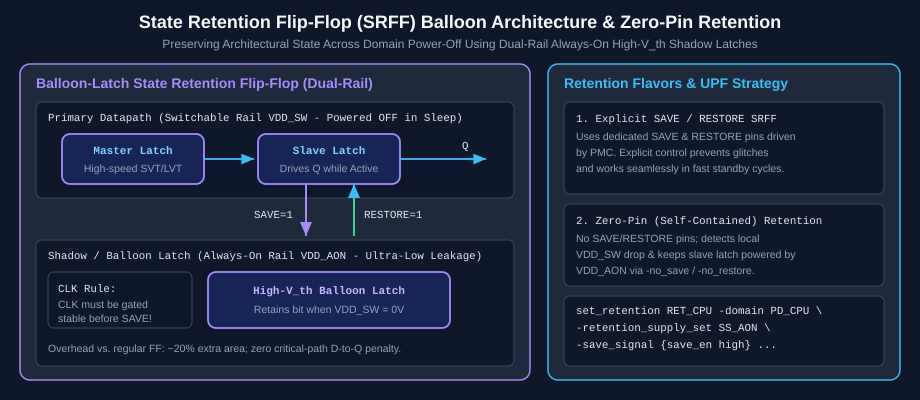
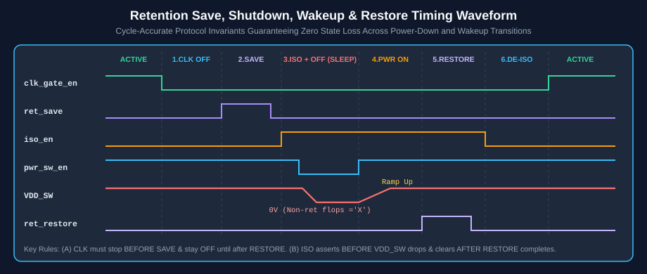

# State Retention Flip-Flops (SRFF) and Zero-Pin Retention

When a power-gated domain shuts off ($V_{DD\_SW} \to 0\text{V}$), every standard flip-flop inside that domain immediately loses its stored logic state and powers back up with random `'X'` values. Re-initializing gigabytes of configuration CSRs, TLBs, branch predictors, and pipeline state from cold reset takes milliseconds and burns significant wake-up energy. **State Retention Flip-Flops (SRFFs)** solve this problem by saving essential architectural state in ultra-low-leakage Always-On shadow latches during sleep, enabling **microsecond instant-on wakeups**.

---

## Learning Goals

After completing this chapter, you should be able to:

- Draw and explain the internal dual-rail architecture of a **Balloon-Latch SRFF** versus **Master/Slave Always-On (Zero-Pin)** retention cells.
- Write IEEE 1801 UPF retention strategies (`set_retention`, `set_retention_elements`, `map_retention_cell`) and Si2 CPF rules (`create_state_retention_rule`).
- Compare explicit `SAVE` / `RESTORE` dual-pin control against single-pin `RET` and Zero-Pin (`-no_save` / `-no_restore`) retention flavors.
- Analyze critical clocking, asynchronous reset conflict, and retention-to-total-flop ratio constraints in production SoCs.

---

## Retention Cell Microarchitecture

A standard flip-flop must switch quickly during active clock cycles, requiring fast low/standard-$V_{th}$ (LVT/SVT) transistors—which leak heavily if kept powered in sleep. Conversely, a retention latch only needs to hold static charge quietly in sleep, allowing thick/high-$V_{th}$ (HVT) devices whose leakage is $20\times$–$100\times$ lower!



### 1. Balloon-Latch SRFF (Explicit `SAVE` / `RESTORE`)

- **Primary Datapath (Master + Slave):** Built with fast LVT/SVT transistors powered by the switchable rail **`VDD_SW`**. During normal active operation, it clocks at GHz speeds with zero balloon timing overhead on the D-to-Q path.
- **Shadow Balloon Latch:** A small, high-$V_{th}$ static storage latch permanently powered by **`VDD_AON`** (`retention_supply_set`).
- **Save Action (`SAVE=1`):** Copies the Slave latch bit into the Always-On Balloon latch right before `VDD_SW` collapses.
- **Restore Action (`RESTORE=1`):** Writes the preserved Balloon latch bit back into the Master/Slave datapath after `VDD_SW` stabilizes, right before clocks resume.

### 2. Master-Slave Retention / Zero-Pin Retention (`-no_save` / `-no_restore`)

Instead of an extra balloon latch plus two dedicated `SAVE`/`RESTORE` routing trees across the entire die:
- **Zero-Pin (Self-Contained) Retention:** Keeps the Slave latch (or internal keeper) wired directly to `VDD_AON` with an internal level/switch sensing circuit, eliminating all global `SAVE`/`RESTORE` control wires.
- **Trade-Off:** Zero-Pin saves routing congestion and PMC pins, **but** leaks slightly more per flop (because the slave latch sits directly in the active datapath and cannot use ultra-slow HVT devices without degrading setup/clk-to-Q speed), and leaves less fine-grained debug visibility if a domain resets partway through wake.

| Retention Style | Control Signals | Leakage in Sleep | Timing / Area Overhead | Typical Use Case |
| :--- | :--- | :---: | :--- | :--- |
| **Balloon SRFF (2-Pin)** | Explicit `SAVE` & `RESTORE` | **Lowest (HVT balloon)** | Zero D-to-Q penalty; +20% cell area; 2 global nets | Deep-sleep mobile APs, CPU/DSP config & architectural regs |
| **Single-Pin SRFF (`RETAIN`)** | Single `RET` (`1` = save/hold, `0` = normal) | Low | Edge-triggered save on rising edge, restore on falling edge | Balanced mid-complexity ASICs reducing PMC pin routing |
| **Zero-Pin (`-no_save`)** | None (`VDD_AON` secondary rail only) | Moderate | Faster wake time; higher sleep leakage | Simple always-retained CSR islands |
| **Selective Partial Retention** | Subset via `set_retention_elements` | Minimal total sleep power | **Best PPA:** Retains only ~10%–20% critical FFs | **Industry norm:** Retain CSRs/PC, reset datapath pipeline regs! |

---

## Specifying Retention Strategies in UPF and CPF

### IEEE 1801 UPF (`set_retention` + `set_retention_elements`)

Never blindly replace 100% of flip-flops in a domain with SRFFs! Pipeline stage registers, ALU accumulators, and instruction decode latches become obsolete at a context-switch sleep boundary—only control/status registers (CSRs), FSM state vectors, and wakeup pointers need retention.

```tcl
# Step 1 (Recommended): Define an explicit list of registers/modules to retain
set_retention_elements RET_LIST_CPU \
    -elements {u_cpu/u_csr_regs u_cpu/u_pc_reg u_cpu/u_fsm_state} \
    -retention_purpose required

# Step 2: Declare retention strategy referencing the retention supply & signals
set_retention RET_CPU \
    -domain PD_CPU \
    -retention_supply_set SS_AON \
    -elements {RET_LIST_CPU} \
    -save_signal    {u_pmc/cpu_ret_save    high} \
    -restore_signal {u_pmc/cpu_ret_restore high} \
    -save_condition    {!u_cpu/gated_clk} \
    -restore_condition {!u_cpu/gated_clk}

# Step 3: Map to foundry retention cell in implementation UPF
map_retention_cell RET_CPU \
    -domain PD_CPU \
    -lib_cells {RSDFFRQX1BWP}
```

#### Selecting `all` Minus Exclusions vs. Explicit Inclusion

- **Selective Retention (`-elements {RET_LIST_CPU}`):** Only targeted registers become SRFFs; all others lose state (`'X'` on wakeup) and must be cleared cleanly by reset before clocks resume.
- **Default All-Except (`-exclude_elements {u_cpu/u_alu_pipe}`):** Retains every FF in `PD_CPU` *except* listed datapath modules. Safer against accidental unretained registers, but carries higher area/leakage if new pipeline stages are added without updating the exclude list.

### Zero-Pin Syntax in UPF 2.1+

```tcl
set_retention RET_ZERO_PIN \
    -domain PD_TIMER \
    -retention_supply_set SS_AON \
    -no_save \
    -no_restore
```

### Si2 CPF (`create_state_retention_rule` + `update_state_retention_rules`)

```tcl
create_state_retention_rule -name SR_CPU \
    -domain PD_CPU \
    -instances {u_cpu/u_csr_regs/*} \
    -save_edge    {u_pmc/cpu_ret_save} \
    -restore_edge {u_pmc/cpu_ret_restore} \
    -secondary_domain PD_TOP

update_state_retention_rules -names SR_CPU \
    -cells {RSDFFRQX1BWP} \
    -cell_type balloon
```

---

## Retention Timing and Protocol Invariants

Even a tiny glitch or ordering mistake on `SAVE`, `RESTORE`, `CLK`, or `RST_N` silently corrupts retained bits into `'X'`!



### Five Mandatory Hardware Rules for SRFFs

1. **Clock Stability Rule (`-save_condition` / `-restore_condition`):**
   `dom_clk` **must** already be gated cleanly to a known static level (`0` or `1` per the library's `.lib` `clock_pin` constraint) *before* `SAVE` rises, and remain completely quiet until *after* `RESTORE` falls back low. If `dom_clk` toggles during `SAVE` or `RESTORE`, metastability corrupts the retained bit to `'X'`.
2. **Power Valid Before `SAVE` and `RESTORE`:**
   - During power-down: Complete the full `SAVE` pulse **while `VDD_SW` is still at full voltage** (before `pwr_sw_en` turns off).
   - During power-up: Wait for `pwr_ack == 1` (confirming `VDD_SW` has stabilized) **before** pulsing `RESTORE`.
3. **Isolation Encloses the Power-Off Window:**
   Assert `ISO_EN` before power drops, and **do not release `ISO_EN`** until after `RESTORE` finishes transferring shadow bits back to primary `Q` outputs! Otherwise, un-isolated outputs broadcast transient wakeup `'X'` values during power ramp!
4. **Reset Precedence Conflict (Fatal Bug Vector!):**
   Standard SRFF cells often connect asynchronous `RST_N` directly to the primary Slave latch—meaning if the PMC holds `rst_n == 0` **while** pulsing `RESTORE = 1`, the async reset immediately overwrites and destroys the freshly restored state! Two standard solutions exist:
   - **Sequence A (Non-Retained FFs need Reset):** Assert `rst_n = 0` to clear non-retained FFs *first* while `VDD_SW` is ON (masking `rst_n` on retained flops or checking SRFF reset behavior), release `rst_n = 1`, and *then* pulse `RESTORE = 1`.
   - **Sequence B (Dedicated Retention-Aware Reset):** Deassert `rst_n = 1` on SRFF cells during `RESTORE`, or use UPF `-exclude_elements` on async resets per library requirements.
5. **`VDD_AON` Must Never Droop Below Retention Minimum:**
   All retention cells require their `retention_supply_set` (`VDD_AON`) to remain `FULL_ON` continuously across the entire sleep window.

---

## Best Practices and Common Pitfalls

- **Use `set_retention_elements` Explicitly for Partial Retention:** Retain only $10\%$–$20\%$ of total FFs (configuration CSRs, architectural program state) to maximize area and sleep leakage savings, and pair non-retained FFs with a clean wakeup reset.
- **Check Edge vs. Level Sensitivity of Library Cells:** Check whether your foundry SRFF triggers `SAVE`/`RESTORE` on **active level** (`high` / `low`) or **edge** (`posedge` / `negedge`)! UPF's `{sig high}` vs `{sig posedge}` mismatch causes silent PA-Sim vs. Gate-Level divergence.
- **Beware Scan-Shift Collision with Retention Pins:** Verify with DFT engineers (Chapter 8 of *DFT*) that ATPG scan chains constrain `SAVE`/`RESTORE` inactive during scan capture and retain clock-gating safety during low-power ATPG.
- **Never Forget Level-Shifting Retention Control Signals:** If `u_pmc` runs at $0.80\text{V}$ AON and drives `SAVE`/`RESTORE` into a DVFS core running at $1.00\text{V}$ when awake, `SAVE`/`RESTORE` pins also cross voltage domains and must be level-shifted or library-characterized as AON-compatible pins!

---

## Practical Exercises with Solutions

### Exercise 1 Diagnosing a Post-Restore `'X'` Corruption Bug

**Problem:**
During power-aware simulation of `PD_CPU`, all retained CSRs in `u_cpu/u_csr_regs` save cleanly at shutdown, `VDD_CPU_SW` powers down and back up cleanly (`pwr_ack == 1`), and `RESTORE` pulses for 4 cycles—yet immediately after wakeup, every CSR reads **`32'h0000_0000` (all zeros)** instead of its pre-sleep value! Reviewing the PMC waveform shows `cpu_rst_n == 0` throughout the entire wakeup ramp until 2 cycles *after* `RESTORE` deasserts. What happened?

**Solution:**
Because the PMC kept `cpu_rst_n == 0` active **during** the `RESTORE` pulse, the SRFF's asynchronous reset pin dominated the `RESTORE` input inside the Slave latch (clearing every retained register back to its `0` reset state!).
**Fix:** Either:
1. Release `cpu_rst_n = 1` right *before* pulsing `RESTORE = 1` (if non-retained flops already cleared while reset was low after `pwr_ack == 1` and clocks remained gated), **or**
2. Separate the reset nets (`core_nonret_rst_n` vs. `core_ret_por_rst_n`) so `RESTORE` writes retained CSRs undisturbed while non-retained datapath FFs reset cleanly.

### Exercise 2 Writing Selective Retention UPF

**Problem:**
In `u_isp` (`PD_ISP`, total 4,000 FFs), only the 128 FFs inside `u_isp/u_cfg_regs` must survive power shutdown; the remaining 3,872 pixel-pipeline FFs can reset on wake. Write the UPF 2.1 commands using `set_retention_elements`, `set_retention`, and `map_retention_cell` (cell `RSDF_LVT_X1`), given active-low `u_pmc/isp_save_n` and `u_pmc/isp_restore_n` and gated clock `u_isp/clk_gated`.

**Solution:**

```tcl
set_retention_elements ISP_CFG_ONLY \
    -elements {u_isp/u_cfg_regs} \
    -retention_purpose required

set_retention RET_ISP_CFG \
    -domain PD_ISP \
    -retention_supply_set SS_AON \
    -elements {ISP_CFG_ONLY} \
    -save_signal    {u_pmc/isp_save_n    low} \
    -restore_signal {u_pmc/isp_restore_n low} \
    -save_condition    {!u_isp/clk_gated} \
    -restore_condition {!u_isp/clk_gated}

map_retention_cell RET_ISP_CFG \
    -domain PD_ISP \
    -lib_cells {RSDF_LVT_X1}
```

### Exercise 3 Comparing Balloon SRFF vs Zero-Pin Area and Leakage

**Problem:**
Why do smartphone application processors overwhelmingly choose 2-pin Balloon SRFFs over Zero-Pin retention for 32-bit CPU/GPU configuration banks that spend 90% of the day in Deep Sleep?

**Solution:**
Zero-Pin retention leaves the primary Slave latch on `VDD_AON`, forcing its active datapath transistors to strike a compromise that leaks significantly more static current over 90% Deep Sleep duty cycle. Balloon SRFFs isolate retention into a tiny ultra-high-$V_{th}$ shadow latch while disconnecting the entire fast active Master/Slave path (`VDD_SW = 0V`), saving substantial battery life during long sleep durations.

##### Copyright (c) 2026 squared-studio
