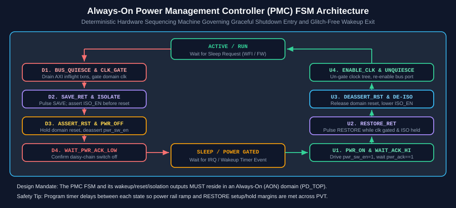
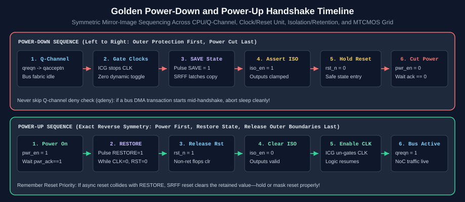

# Power Management Controller (PMC) Design and Sequencing

UPF and CPF files declare **structural power intent** (which cells clamp, shift, retain, or switch), but UPF alone cannot flip power switches at runtime. An actual synthesizable hardware finite state machine—the **Power Management Controller (PMC)** (also called PCU or P-Channel/Q-Channel Power Controller)—must reside in an **Always-On (AON)** RTL module to orchestrate quiescent bus drainage, clock gating, retention save/restore, isolation clamping, resets, and power switches in strict temporal order.

---

## Learning Goals

After completing this chapter, you should be able to:

- Partition an Always-On PMC cleanly in SystemVerilog RTL so none of its state or control outputs sit inside a switchable island.
- Trace and implement the canonical **mirror-image power-down and power-up FSM sequence**.
- Integrate low-power system-bus quiescence handshakes (ARM **Q-Channel** `QREQn` / `QACCEPTn` / `QDENY` and **P-Channel**).
- Guard against the top three PMC hardware bugs: bus lockups, premature de-isolation, and retention-reset races.
- Connect PMC RTL pins cleanly to `create_power_switch`, `set_isolation`, and `set_retention` in UPF/CPF.

---

## Always-On PMC Architecture and FSM Design

To safely manage switchable domains (`PD_CPU`, `PD_GPU`, `PD_DMA`), the PMC module itself (`u_pmc`) **must live unconditionally inside `PD_TOP` (Always-On)** and run from an Always-On clock (`aon_clk`, typically an always-running low-frequency $32\text{kHz}$–$50\text{MHz}$ oscillator or divided AON clock) and Power-On Reset (`por_rst_n`).



### Why Every Transition Follows Strict Mirror Symmetry

Think of low-power domain protection like winterizing a house before turning off the furnace:
- **Shutdown Order (Outside $\to$ Inside):** First stop traffic entering the domain (`bus quiesce`), freeze the internal clocks (`clk gate`), snapshot critical memory (`SAVE`), lock down all exterior doors (`ISO_EN = 1`), hold non-retained internal state (`RST_N = 0`), and *lastly* cut the main breaker (`pwr_sw_en = 0`).
- **Wakeup Order (Inside $\to$ Outside, Exact Reverse):** Restore the main breaker and wait for rails to stabilize (`pwr_sw_en = 1` $\to$ `pwr_ack == 1`), recover preserved memory (`RESTORE`), release reset safely, unlock exterior doors (`ISO_EN = 0`), restart internal clocks (`clk_en = 1`), and announce readiness to the system interconnect (`bus active`).

---

## Golden Power-Down and Power-Up Handshake Timeline

Every step between software intent (such as a CPU executing `WFI` or firmware writing a PMC register) and physical MTCMOS switch actuation relies on closed-loop hardware handshakes rather than blind single-cycle guesses.



### ARM Q-Channel Quiescence Handshake

Before gating clocks on an AXI/AHB bus block, cutting its clock mid-flight would drop active `AWVALID`/`WLAST`/`RVALID` beats and deadlock the system NoC! Production SoCs deploy a **Q-Channel** (or custom idle-handshake) port on every switchable peripheral:

1. **Request Sleep (`QREQn = 0`):** PMC lowers `QREQn` asking the block to enter quiescence.
2. **Accept (`QACCEPTn = 0`) OR Deny (`QDENY = 1`):**
   - If idle (no in-flight AXI bursts, FIFOs drained), the block blocks new inbound work and lowers `QACCEPTn = 0`. PMC may now safely gate clocks!
   - If a sudden wakeup interrupt or high-priority DMA burst arrives, the block drives **`QDENY = 1`**, causing the PMC to **abort sleep**, raise `QREQn = 1`, and return smoothly to `ACTIVE` without hanging the bus!

---

## Synthesizable SystemVerilog PMC Implementation

Below is a clean, synthesizable Always-On PMC controller driving Q-channel quiescence, ICG clock gating, SRFF save/restore, isolation, reset, and daisy-chained switch enables with programmable settling delays:

```systemverilog
module pmc_ctrl #(
    parameter int unsigned SAVE_CYCLES    = 4,
    parameter int unsigned RESTORE_CYCLES = 4,
    parameter int unsigned SETTLE_CYCLES  = 8
) (
    input  logic aon_clk,
    input  logic por_rst_n,

    // Software / Wakeup Triggers (Always-On)
    input  logic sleep_req,
    input  logic wake_event,

    // Q-Channel Bus Quiescence Handshake
    output logic qreq_n,
    input  logic qaccept_n,
    input  logic qdeny,

    // Domain Clocks, Reset & UPF-Controlled Pins
    output logic dom_clk_en,
    output logic dom_rst_n,
    output logic dom_iso_en,
    output logic dom_save,
    output logic dom_restore,
    output logic pwr_sw_en,
    input  logic pwr_sw_ack
);

    typedef enum logic [3:0] {
        ST_ACTIVE       = 4'd0,
        ST_Q_REQ        = 4'd1,
        ST_Q_ABORT      = 4'd2,
        ST_CLK_GATE     = 4'd3,
        ST_RET_SAVE     = 4'd4,
        ST_ISOLATE      = 4'd5,
        ST_ASSERT_RST   = 4'd6,
        ST_PWR_OFF      = 4'd7,
        ST_SLEEP        = 4'd8,
        ST_PWR_ON       = 4'd9,
        ST_CLR_RST_PRE  = 4'd10,
        ST_RET_RESTORE  = 4'd11,
        ST_DEISOLATE    = 4'd12,
        ST_CLK_ENABLE   = 4'd13
    } pmc_state_e;

    pmc_state_e state, next_state;
    logic [7:0] timer_cnt;

    always_ff @(posedge aon_clk or negedge por_rst_n) begin
        if (!por_rst_n) begin
            state     <= ST_ACTIVE;
            timer_cnt <= '0;
        end else begin
            state <= next_state;
            if (state != next_state)
                timer_cnt <= '0;
            else
                timer_cnt <= timer_cnt + 8'd1;
        end
    end

    always_comb begin
        next_state = state;
        case (state)
            ST_ACTIVE:      if (sleep_req && !wake_event) next_state = ST_Q_REQ;
            ST_Q_REQ: begin
                if (!qaccept_n)                           next_state = ST_CLK_GATE;
                else if (qdeny || wake_event)             next_state = ST_Q_ABORT;
            end
            ST_Q_ABORT:     if (qaccept_n && !qdeny)      next_state = ST_ACTIVE;
            ST_CLK_GATE:    if (timer_cnt >= 8'd2)        next_state = ST_RET_SAVE;
            ST_RET_SAVE:    if (timer_cnt >= SAVE_CYCLES) next_state = ST_ISOLATE;
            ST_ISOLATE:     if (timer_cnt >= 8'd2)        next_state = ST_ASSERT_RST;
            ST_ASSERT_RST:  if (timer_cnt >= 8'd2)        next_state = ST_PWR_OFF;
            ST_PWR_OFF:     if (!pwr_sw_ack)              next_state = ST_SLEEP;
            ST_SLEEP:       if (wake_event)               next_state = ST_PWR_ON;
            ST_PWR_ON:      if (pwr_sw_ack && timer_cnt >= SETTLE_CYCLES)
                                                          next_state = ST_CLR_RST_PRE;
            // Release reset BEFORE RESTORE (assumes non-ret FFs cleared during ST_PWR_ON while clk gated)
            ST_CLR_RST_PRE: if (timer_cnt >= 8'd2)        next_state = ST_RET_RESTORE;
            ST_RET_RESTORE: if (timer_cnt >= RESTORE_CYCLES)
                                                          next_state = ST_DEISOLATE;
            ST_DEISOLATE:   if (timer_cnt >= 8'd2)        next_state = ST_CLK_ENABLE;
            ST_CLK_ENABLE:  if (timer_cnt >= 8'd2)        next_state = ST_ACTIVE;
            default:                                      next_state = ST_ACTIVE;
        endcase
    end

    // Glitch-Free Registered Outputs (critical for ISO, SAVE, RESTORE, and PWR_EN!)
    always_ff @(posedge aon_clk or negedge por_rst_n) begin
        if (!por_rst_n) begin
            qreq_n      <= 1'b1;
            dom_clk_en  <= 1'b1;
            dom_rst_n   <= 1'b1;
            dom_iso_en  <= 1'b0;
            dom_save    <= 1'b0;
            dom_restore <= 1'b0;
            pwr_sw_en   <= 1'b1;
        end else begin
            qreq_n      <= (next_state inside {ST_ACTIVE, ST_Q_ABORT, ST_CLK_ENABLE});
            dom_clk_en  <= (next_state inside {ST_ACTIVE, ST_Q_REQ, ST_Q_ABORT, ST_CLK_ENABLE});
            dom_rst_n   <= !(next_state inside {ST_ASSERT_RST, ST_PWR_OFF, ST_SLEEP, ST_PWR_ON});
            dom_iso_en  <= (next_state inside {ST_ISOLATE, ST_ASSERT_RST, ST_PWR_OFF, ST_SLEEP,
                                               ST_PWR_ON, ST_CLR_RST_PRE, ST_RET_RESTORE});
            dom_save    <= (next_state == ST_RET_SAVE);
            dom_restore <= (next_state == ST_RET_RESTORE);
            pwr_sw_en   <= !(next_state inside {ST_PWR_OFF, ST_SLEEP});
        end
    end
endmodule
```

> [!IMPORTANT]
> **Always Register PMC Control Outputs!** Never drive `dom_iso_en`, `dom_save`, `dom_restore`, or `pwr_sw_en` directly from combinational `always_comb` state decodes. Combinational comparator glitches across multi-bit FSM transitions can fire false nano-second pulses onto balloon retention latches or power switch chains!

---

## Binding the PMC to UPF Strategies

Once `u_pmc` exists in the Always-On domain `PD_TOP`, link its registered outputs cleanly in UPF:

```tcl
# All control ports reside in PD_TOP (SS_AON)
create_power_switch SW_DOM -domain PD_DOM \
    -input_supply_port  {in  VDD_AON} \
    -output_supply_port {out VDD_DOM_SW} \
    -control_port       {ctrl u_pmc/pwr_sw_en} \
    -ack_port           {ack  u_pmc/pwr_sw_ack {ctrl}} \
    -on_state           {ON   in {ctrl}} \
    -off_state          {OFF  {!ctrl}}

set_isolation ISO_DOM -domain PD_DOM \
    -isolation_supply_set SS_AON \
    -clamp_value 0 \
    -isolation_signal u_pmc/dom_iso_en \
    -isolation_sense high \
    -location parent

set_retention RET_DOM -domain PD_DOM \
    -retention_supply_set SS_AON \
    -save_signal    {u_pmc/dom_save    high} \
    -restore_signal {u_pmc/dom_restore high} \
    -save_condition    {!u_dom/gated_clk} \
    -restore_condition {!u_dom/gated_clk}
```

---

## Best Practices and Common Pitfalls

- **Guard Against Wake Events Arriving Mid-Shutdown:** Notice how `ST_Q_REQ` handles `wake_event` by aborting cleanly via `ST_Q_ABORT`—never ignore `wake_event` once committed to sleep, or latch pending wake interrupts inside `u_pmc` so the domain immediately wakes right after entering `ST_SLEEP` (`ST_SLEEP -> ST_PWR_ON`) without ever dropping a wake IRQ!
- **Synchronize Cross-Clock Signals (`aon_clk` vs `dom_clk`):** Because `u_pmc` normally runs on a slower `aon_clk` ($32\text{kHz}$–$25\text{MHz}$) while `qaccept_n`/`qdeny` originate in `dom_clk` ($1\text{GHz}$), insert standard 2-FF CDC synchronizers in the AON PMC domain!
- **Wait for Switch Acknowledgment Before Advancing:** Never use fixed cycle counts *alone* to guess when a large CPU power grid finishes waking up. Always gate `ST_PWR_ON -> next` on the physical daisy-chain tail signal `pwr_sw_ack == 1` **plus** a settling guard margin (`SETTLE_CYCLES`).
- **Keep Reset Held During `ST_PWR_ON` Ramp:** Holding `dom_rst_n = 0` while `VDD_SW` ramps up prevents non-retained flip-flops from waking up in random unknown states and propagating internal contention before reset clears them (then release `dom_rst_n = 1` cleanly before `ST_RET_RESTORE` unless your SRFF library ignores reset during restore).

---

## Practical Exercises with Solutions

### Exercise 1 Fixing a Premature De-Isolation Bug

**Problem:**
In a modified version of `pmc_ctrl`, an engineer accidentally moved `ST_DEISOLATE` **before** `ST_RET_RESTORE` to save 2 cycles of wakeup latency. What fails in both Power-Aware Simulation and real silicon?

**Solution:**
Before `ST_RET_RESTORE` executes, all retained SRFF slave latches still hold corrupt `'X'` post-power-up values (while non-retained logic is stabilizing). Clearing `dom_iso_en = 0` prior to `RESTORE` leaks `'X'` values straight out across the domain boundary into active Always-On receivers, corrupting downstream arbiters and violating `p_no_early_deisolate`! `dom_iso_en` must remain `1` until **after** `ST_RET_RESTORE` completes.

### Exercise 2 Adding Wake-Abort Protection Mid-Shutdown

**Problem:**
What happens in `pmc_ctrl` if `wake_event` pulses briefly during `ST_ISOLATE` or `ST_PWR_OFF` and then clears before `ST_SLEEP`? How do you make sure the wakeup is never lost?

**Solution:**
In the basic transition above, if `wake_event` is a 1-cycle edge pulse that returns to `0` before `state` reaches `ST_SLEEP`, the PMC finishes shutting down and gets stuck asleep permanently!
**Fix:** Add a sticky **pending wake register** (`wake_pending_q`) inside `u_pmc` that latches `1` whenever `wake_event` asserts while `state != ST_ACTIVE`, clears only upon entering `ST_ACTIVE`, and drives `ST_SLEEP -> ST_PWR_ON` unconditionally whenever `wake_pending_q == 1`.

### Exercise 3 Checking Control Signal Isolation Self-Trap

**Problem:**
Should the output nets `u_pmc/dom_iso_en` and `u_pmc/pwr_sw_en` themselves be isolated when `PD_DOM` turns off? Why or why not?

**Solution:**
**No!** `u_pmc` resides in Always-On `PD_TOP`. Those signals go **from ON (`PD_TOP`) into switchable `PD_DOM`** (or into Always-On switches/parent ISO cells). Putting an isolation gate driven by `dom_iso_en` *on* `dom_iso_en` itself would create a self-defeating circular loop!

##### Copyright (c) 2026 squared-studio
