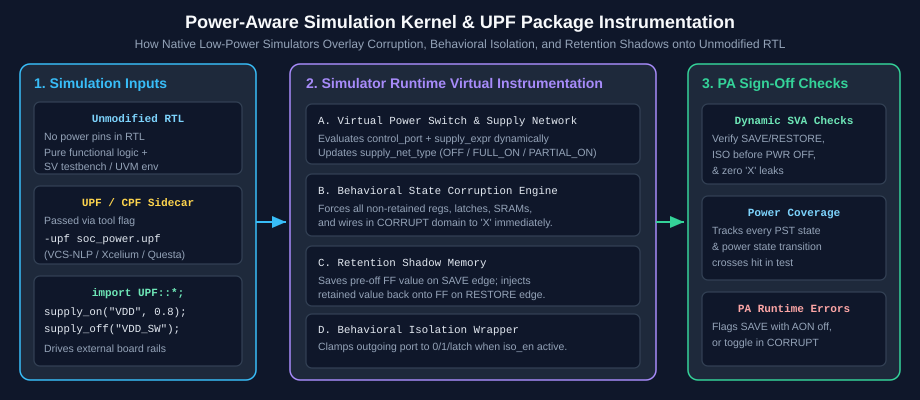
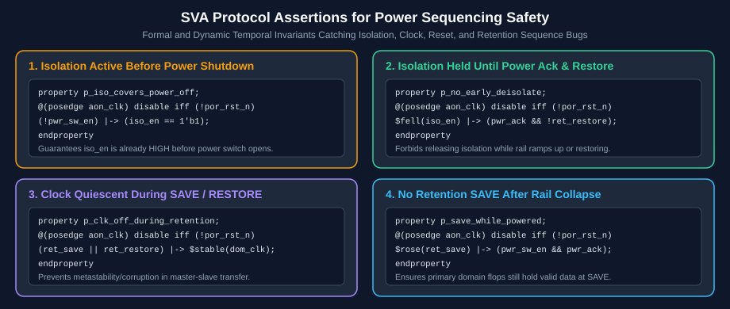

# Power-Aware Simulation and Low-Power Verification

A traditional RTL simulation runs in an idealized world where power rails never turn off, every module remains energized continuously, and flip-flops never lose state. Consequently, functional verification alone cannot detect missing isolation clamps, inverted save polarities, or premature de-isolation. **Power-Aware (PA) Simulation** instruments the unmodified RTL at elaboration time using your UPF/CPF file, dynamically injecting realistic `'X'` corruption and modeling virtual power switches, isolation clamps, and retention latches directly at the RTL level.

---

## Learning Goals

After completing this chapter, you should be able to:

- Explain how a native Power-Aware simulator (VCS-NLP, Xcelium PA, Questa PA) instruments pure SystemVerilog RTL from UPF/CPF metadata.
- Control external chip power rails in a SystemVerilog testbench using the IEEE 1801 **`UPF`** SystemVerilog package (`supply_on`, `supply_off`, `supply_partial_on`, `get_supply_value`).
- Debug `'X'` propagation failures caused by missing isolation, corrupted retention shadow copies, or improper random re-initialization on wakeup.
- Write SystemVerilog Assertions (SVA) and functional coverage `covergroup` models to verify power sequencing protocols and cross-domain PST transitions.

---

## How Power-Aware RTL Simulation Works

When invoking a Power-Aware simulator (such as `vcs -upf soc.upf`, `xrun -lps_upf soc.upf`, or `vsim -pa -upf soc.upf`), the compiler elaborates RTL and UPF side-by-side without requiring modifications to the synthesizable RTL modules:



### Four Runtime Instrumentation Engines

1. **Supply Network Evaluator:** Builds an internal event graph tracking every `supply_port`, `supply_net`, `supply_set`, and `create_power_switch`. Whenever `u_pmc/pwr_sw_en` toggles in RTL, the virtual switch drives `VDD_SW` from `FULL_ON` $\to$ `OFF` (or vice versa).
2. **State Corruption Engine:** When a domain's `simstate` transitions to `CORRUPT`, the simulator immediately overrides every non-retained `reg`/`logic` FF, latch, continuous driver, and SRAM array inside that domain with `'X'` (`1'bx`).
3. **Behavioral Retention Engine:** Monitors `-save_signal` and `-restore_signal` edges alongside `-save_condition` clocks. On a legal `SAVE` event, it copies register values into a simulator-managed shadow array; on `RESTORE`, it pushes those preserved values back into the RTL variables after power returns.
4. **Behavioral Isolation Engine:** Wraps cross-boundary nets with behavioral clamp muxes driven by `-isolation_signal`, substituting `0`, `1`, or `latch` cleanly whenever isolation activates.

> [!IMPORTANT]
> **Always Test Random Corruption on Wakeup (`0` / `1` vs `'X'`):** In real silicon, un-retained registers wake up in unpredictable `0` or `1` physical states—not clean Verilog `'0'`! Enable simulator options that randomize or preserve `'X'` until explicit reset clears them so hidden missing-reset bugs cannot hide behind accidental `0` initialization.

---

## Driving Supply Rails via the SystemVerilog UPF Package

Top-level testbenches act as the board-level PMIC (Power Management IC) supplying external voltages (`VDD_AON`, `VSS`, `VDD_GPU`) and verifying domain voltage transitions via the standardized IEEE 1801 `UPF` package:

```systemverilog
module tb_soc_power_aware;
    import UPF::*; // Standard IEEE 1801 Simulation Package

    logic aon_clk = 1'b0;
    logic por_rst_n = 1'b0;
    logic wake_irq  = 1'b0;

    always #10 aon_clk = ~aon_clk;

    soc_top dut (
        .aon_clk   (aon_clk),
        .por_rst_n (por_rst_n),
        .wake_irq  (wake_irq)
    );

    initial begin
        bit status;

        // 1. Power up external board supplies at time 0 (MUST match PST voltages!)
        status = supply_on("tb_soc_power_aware/dut/VDD_AON", 0.80);
        status = supply_on("tb_soc_power_aware/dut/VSS",     0.00);
        status = supply_on("tb_soc_power_aware/dut/VDD_GPU", 0.95);

        if (!status) $fatal(1, "UPF supply_on failed for board supplies!");

        // 2. Release POR after supplies settle
        #100 por_rst_n = 1'b1;

        // ... Run active CPU/GPU transactions ...

        // 3. Test DVFS Voltage Scaling on GPU PMIC rail dynamically
        #500;
        $display("[%0t] Scaling VDD_GPU -> 0.70V Eco Mode", $time);
        status = supply_on("tb_soc_power_aware/dut/VDD_GPU", 0.70);

        // 4. Test External PMIC Off (if GPU also uses external regulator shutdown)
        #1000;
        $display("[%0t] Current CPU switch supply = %0f V",
                 $time, get_supply_value("tb_soc_power_aware/dut/VDD_CPU_SW"));

        // Shut down external rail cleanly after handshake
        // supply_off("tb_soc_power_aware/dut/VDD_GPU");
        $finish;
    end
endmodule
```

### Common `UPF::*` Simulation Functions

| SystemVerilog Function (`import UPF::*;`) | Purpose |
| :--- | :--- |
| `supply_on("path/net", real_volts)` | Sets a supply net or supply port to `FULL_ON` at the given voltage |
| `supply_off("path/net")` | Powers off the specified supply net (`OFF` state $\to$ `CORRUPT` domain) |
| `supply_partial_on("path/net", real_volts)` | Sets a retention/standby rail to `PARTIAL_ON` (`CORRUPT_ON_ACTIVITY`) |
| `get_supply_value("path/net")` | Returns current `real` voltage (`0.0` when `OFF`) for monitors & scoreboards |
| `get_supply_on_state("path/net")` | Returns `1` if `FULL_ON` (or `PARTIAL_ON` per variant), `0` if `OFF` |

---

## SVA Assertions for Power Protocol Verification

While UPF specifies structural intent and `-illegal_state` catches static mismatches, **SystemVerilog Assertions (SVA)** bound into the Always-On PMC (`bind pmc_ctrl pmc_lp_sva u_sva (.*);`) mathematically verify every cycle-by-cycle ordering requirement during both dynamic simulation and formal verification!



```systemverilog
module pmc_lp_sva (
    input logic aon_clk,
    input logic por_rst_n,
    input logic dom_clk,
    input logic dom_rst_n,
    input logic dom_iso_en,
    input logic dom_save,
    input logic dom_restore,
    input logic pwr_sw_en,
    input logic pwr_sw_ack
);
    default clocking cb @(posedge aon_clk); endclocking
    default disable iff (!por_rst_n);

    // Rule 1: Never switch off domain power without isolation already asserted
    a_iso_before_pwroff: assert property (
        !pwr_sw_en |-> dom_iso_en
    ) else $error("LP_SEQ_ERR: Power switched OFF while dom_iso_en == 0!");

    // Rule 2: Never release isolation before power switch ack confirms rail up AND restore finishes
    a_no_early_deiso: assert property (
        $fell(dom_iso_en) |-> (pwr_sw_ack && !dom_restore)
    ) else $error("LP_SEQ_ERR: Isolation cleared prematurely!");

    // Rule 3: Clocks must stay completely quiet throughout SAVE and RESTORE
    a_clk_quiet_on_ret: assert property (
        (dom_save || dom_restore) |-> $stable(dom_clk)
    ) else $error("LP_SEQ_ERR: Domain clock toggled during SAVE/RESTORE!");

    // Rule 4: Reset must not collide actively with SRFF RESTORE pulse
    a_no_rst_on_restore: assert property (
        dom_restore |-> (dom_rst_n == 1'b1)
    ) else $error("LP_SEQ_ERR: Active reset during RESTORE overwrites retained flops!");

    // Coverage: Prove at least one full power-down -> sleep -> wakeup cycle completed
    c_full_pwr_cycle: cover property (
        (!pwr_sw_ack) ##[1:$] ($rose(pwr_sw_ack) ##[1:20] $fell(dom_iso_en))
    );
endmodule
```

---

## Functional Coverage for Low-Power Closure

Tape-out sign-off requires proving not just that tests ran, but that **every legal PST state and power transition** was exercised alongside concurrent traffic (interrupts arriving mid-shutdown, back-to-back sleep/wake cycles, and simultaneous multi-domain power gating):

```systemverilog
covergroup cg_soc_power_modes @(posedge tb.aon_clk);
    cp_cpu_pwr: coverpoint tb.dut.u_pmc.cpu_pwr_sw_ack {
        bins off = {0};
        bins on  = {1};
        bins sleep_to_wake = (1 => 0 => 1);
    }
    cp_gpu_pwr: coverpoint tb.dut.u_pmc.gpu_pwr_sw_ack {
        bins off = {0};
        bins on  = {1};
    }
    // Cross all simultaneous CPU x GPU active/sleep states!
    cx_cpu_x_gpu: cross cp_cpu_pwr, cp_gpu_pwr;

    cp_wake_abort: coverpoint (tb.dut.u_pmc.state == tb.dut.u_pmc.ST_Q_ABORT) {
        bins hit_abort = {1};
    }
endgroup
```

---

## Best Practices and Common Pitfalls

- **Check Boundary Signal `'X'` Monitors on Every Domain Exit:** Bind an SVA `$isunknown(out_bus)` assertion strictly at the receiving input of Always-On blocks (`PD_TOP`) so any fleeting 1-cycle un-isolated `'X'` glitch fails immediately rather than silently clearing on reset.
- **Verify UVM Register Mirror vs. Physical State After Wakeup:** Non-retained CSRs lose state across power gating while UVM RAL mirrors keep their pre-sleep predicted values unless your scoreboard/RAL calls `reg_block.reset()` on `CORRUPT` events for non-retained blocks and verifies **retained** CSRs read back unchanged via frontdoor reads after wake!
- **Watch Simulator Compilation Performance Flags:** Only enable full behavioral power-aware elaboration on regressions targeting LP verification, and verify both zero-delay RTL PA-Sim and back-annotated Gate-Level PG netlist PA-Sim (`+neg_tchk`) on critical wakeup tests.
- **Test Simultaneous Wake Interrupts & Abort Corners:** Most real silicon power bugs do *not* occur during clean idle sleep; they occur when a DMA interrupt or debug request arrives one cycle *after* `QREQn` drops or during `ST_ISOLATE`.

---

## Practical Exercises with Solutions

### Exercise 1 Debugging a Missing `supply_on` in Testbench

**Problem:**
You launch Power-Aware simulation with `soc.upf` on an unmodified functional testbench that previously passed 100% in standard simulation. Immediately at time `t = 0`, every flip-flop in Always-On `PD_TOP` turns to `'X'`, even though `u_pmc/pwr_sw_en` isn't gating `PD_TOP`. Why?

**Solution:**
In Power-Aware simulation, every top-level `supply_port` / root `supply_net` defaults to **`UNDETERMINED`** (`simstate = CORRUPT`) until driven `ON` by the testbench! Because the legacy testbench didn't call `UPF::supply_on(".../VDD_AON", 0.80)` and `supply_on(".../VSS", 0.00)` at time `0`, `PD_TOP` started completely unpowered!

### Exercise 2 Writing an SVA Boundary Integrity Check

**Problem:**
Write an immediate or concurrent SVA property checking that whenever Always-On bus module `u_noc` samples `cpu_axi_arvalid` from switchable `PD_CPU`, `cpu_axi_arvalid` is never `'X'` or `'Z'` (even during `PD_CPU` power-off and wakeup ramps).

**Solution:**

```systemverilog
a_no_x_on_cpu_arvalid: assert property (
    @(posedge noc_clk) disable iff (!por_rst_n)
    !$isunknown(cpu_axi_arvalid)
) else $error("Unisolated X/Z detected on PD_CPU -> u_noc interface!");
```

### Exercise 3 Auditing UVM RAL Synchronization Across Sleep

**Problem:**
Switchable IP `u_crypto` contains 10 registers: registers 0–3 are retained via `set_retention_elements`, while registers 4–9 are non-retained. After running a power-down + power-up sequence, a UVM RAL bit-bash read check passes on registers 0–3 and fails on 4–9 comparing expected `0xA5A5_5A5A` vs actual `0x0000_0000`. Why did the UVM testbench complain?

**Solution:**
The RTL/UPF behaved **correctly**: registers 0–3 retained `0xA5A5_5A5A`, and non-retained registers 4–9 cleanly reset to `0x0000_0000` on wakeup. However, the UVM RAL model wasn't notified of the partial power-down event! A power-aware RAL testbench must mirror hardware selectivity—invoking `.reset()` *only* on the non-retained register objects (4–9) upon `PD_CRYPTO` shutdown while leaving retained RAL mirrors (0–3) intact.

##### Copyright (c) 2026 squared-studio
