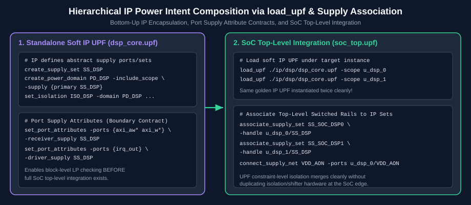
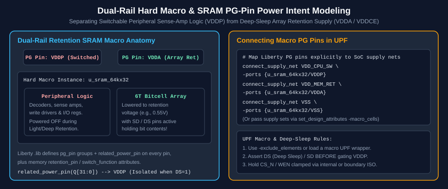

# Hierarchical SoC Power Intent, IP Reuse, and Macro Modeling

Modern SoCs assemble dozens of third-party soft IPs (CPUs, PCIe controllers, USB PHYs) alongside hundreds of foundry-compiled hard SRAM macros and analog PLLs. Writing a single monolithic 10,000-line UPF script referencing every leaf instance across the chip breaks encapsulation and prevents IP vendors from certifying their own blocks. IEEE 1801 solves scalability through **bottom-up hierarchical UPF composition (`load_upf`)**, boundary **port supply attributes**, and **macro `.lib` PG-pin modeling**.

---

## Learning Goals

After completing this chapter, you should be able to:

- Write a standalone, portable soft-IP UPF block using abstract Supply Sets and `set_port_attributes` (`-driver_supply`, `-receiver_supply`).
- Compose multi-instance IP UPFs cleanly into an SoC top-level UPF via `load_upf -scope` and `associate_supply_set`.
- Override or refine IP-level default strategies (`-update`) at the SoC top level without duplicating isolation cells.
- Model multi-rail hard macros (dual-rail SRAMs, analog PLLs, I/O pads) by mapping Liberty `.lib` `pg_pin` groups to SoC supply nets.
- Write equivalent hierarchical `set_macro_model` and `set_instance` constructs in Si2 CPF.

---

## Bottom-Up IP Encapsulation and load_upf Composition

A reusable soft IP (e.g., `dsp_core`) must verify cleanly *standalone* before the top-level SoC even exists, while seamlessly integrating into any parent SoC topology later—even when instantiated multiple times (`u_dsp_0`, `u_dsp_1`) on separate switches!



### Step 1 Portable Block-Level IP UPF (`dsp_core.upf`)

Notice how `dsp_core.upf` avoids hardcoding SoC net names (`VDD_SOC_CPU`) or top-level paths (`/soc_top/u_pmc`):

```tcl
# dsp_core.upf -- Validated standalone inside IP verification!
upf_version 2.1

# 1. Abstract Supply Sets (no hardwired physical VDD names yet)
create_supply_set SS_DSP_MAIN
create_supply_set SS_DSP_AON

# 2. Create Top Domain of this IP (covers all sub-instances cleanly)
create_power_domain PD_DSP -include_scope \
    -supply {primary           SS_DSP_MAIN} \
    -supply {default_isolation SS_DSP_AON} \
    -supply {default_retention SS_DSP_AON}

# 3. Declare IP Boundary Supply Attributes (Vital for Standalone LP Checks!)
set_port_attributes -ports {axi_* irq_out} \
    -driver_supply   SS_DSP_MAIN

set_port_attributes -ports {clk rst_n iso_en save_en restore_en} \
    -receiver_supply SS_DSP_AON

# 4. Define Constraint-Level Isolation & Retention using IP local control ports!
set_isolation ISO_DSP_OUT \
    -domain PD_DSP \
    -isolation_supply_set SS_DSP_AON \
    -applies_to outputs \
    -clamp_value 0 \
    -isolation_signal iso_en \
    -isolation_sense high \
    -location self  ;# Or parent if SoC handles placement

set_retention RET_DSP_CFG \
    -domain PD_DSP \
    -retention_supply_set SS_DSP_AON \
    -elements {u_cfg_bank} \
    -save_signal    {save_en    high} \
    -restore_signal {restore_en high}
```

### Why `set_port_attributes` Is Critical for Soft IP Sign-Off

When verifying `dsp_core` standalone, the IP has no parent `PD_TOP` outside its module ports. Without `set_port_attributes`, static checkers cannot know what supply voltage powers the external driver feeding an input or the external sink receiving `irq_out`. Declaring `-driver_supply` and `-receiver_supply` gives VC LP / Conformal LP complete boundary context at the block level!

### Step 2 Top-Level SoC Integration (`soc_top.upf`)

At the SoC level, `soc_top.upf` instantiates physical supplies, builds top-level domains, loads `dsp_core.upf` cleanly into each DSP instance, and stitches Supply Sets via `associate_supply_set`:

```tcl
# soc_top.upf
upf_version 2.1
set_scope /

# Physical SoC Rails & Supply Sets
create_supply_port VDD_AON -direction in
create_supply_port VSS     -direction in
create_supply_net  VDD_AON
create_supply_net  VSS
connect_supply_net VDD_AON -ports {VDD_AON}
connect_supply_net VSS     -ports {VSS}

create_supply_net  VDD_DSP0_SW
create_supply_net  VDD_DSP1_SW

create_supply_set SS_SOC_AON  -function {power VDD_AON}     -function {ground VSS}
create_supply_set SS_SOC_DSP0 -function {power VDD_DSP0_SW} -function {ground VSS}
create_supply_set SS_SOC_DSP1 -function {power VDD_DSP1_SW} -function {ground VSS}

create_power_domain PD_TOP -include_scope -supply {primary SS_SOC_AON}

# Load Reusable IP UPF Under Target Sub-Instances
load_upf ./ip/dsp/dsp_core.upf -scope u_dsp_0
load_upf ./ip/dsp/dsp_core.upf -scope u_dsp_1

# Associate SoC Rails Onto Each IP's Abstract Supply Sets!
associate_supply_set SS_SOC_AON  -handle u_dsp_0/SS_DSP_AON
associate_supply_set SS_SOC_DSP0 -handle u_dsp_0/SS_DSP_MAIN

associate_supply_set SS_SOC_AON  -handle u_dsp_1/SS_DSP_AON
associate_supply_set SS_SOC_DSP1 -handle u_dsp_1/SS_DSP_MAIN

# Power Switches reside at SoC Top Level connecting VDD_AON -> VDD_DSP0_SW / VDD_DSP1_SW
create_power_switch SW_DSP0 -domain PD_TOP \
    -input_supply_port  {in  VDD_AON} \
    -output_supply_port {out VDD_DSP0_SW} \
    -control_port       {ctrl u_pmc/dsp0_pwr_en} \
    -on_state           {ON in {ctrl}} -off_state {OFF {!ctrl}}
```

> [!TIP]
> **Notice Switch Domain Location:** Putting `SW_DSP0` inside `PD_TOP` (or in `u_dsp_0/PD_DSP` via `set_scope u_dsp_0`) cleanly supplies `VDD_DSP0_SW` without touching a single line inside `dsp_core.upf`! And if `dsp_core.upf` already declared `ISO_DSP_OUT -location self` while `soc_top` prefers `-location parent`, `soc_top` can refine it via `set_isolation ISO_DSP_OUT -domain u_dsp_0/PD_DSP -update -location parent`.

---

## Hard Macro and Dual-Rail SRAM Modeling

Unlike soft RTL blocks where tools synthesize standard gates and infer boundary wrappers, **hard IP macros** (compiled SRAMs, ROMs, high-speed SerDes PHYs, PLLs) arrive as fixed physical GDS/LEF blocks whose power/ground pins are already baked inside their **Liberty `.lib` timing model**.



### Dual-Rail SRAM Power Modes

Modern compiled SRAMs separate their power grid into two rails:
1. **`VDDP` (Periphery / Sense-Amp Rail):** Powers high-leakage address decoders, bitline precharge drivers, and output sense amplifiers. Shut down (`0V`) during standby/retention.
2. **`VDDA` / `VDDCE` (Core Bitcell Array Rail):** Powers the 6T SRAM storage cells. Can drop to a lower minimum retention voltage (e.g., $0.55\text{V}$ when `DS` = Deep Sleep pin is asserted) while still holding 100% of stored bits!

Inside the macro's Liberty `.lib`, every data/address pin declares its `related_power_pin` (`VDDP` vs `VDDA`), plus retention/isolation cells already integrated inside the macro (`is_isolated` / `retention_pin`) so tools know whether `Q[31:0]` is internally clamped when `DS == 1`!

### Wiring Macro PG Pins in UPF

Because RTL instantiations of SRAMs generally hide physical `VDDP`/`VDDA` pins (`// PG pins omitted in pure RTL`), UPF connects macro PG pins directly via `connect_supply_net`:

```tcl
# Map PG pins defined in SRAM Liberty .lib to physical UPF supply nets
connect_supply_net VDD_CPU_SW  -ports {u_cpu/u_l2_sram/VDDP}
connect_supply_net VDD_MEM_RET -ports {u_cpu/u_l2_sram/VDDA}
connect_supply_net VSS         -ports {u_cpu/u_l2_sram/VSS}

# Optional: Mark macro pins already internally isolated in .lib to avoid double clamps
set_port_attributes -elements {u_cpu/u_l2_sram} -ports {Q} \
    -clamp_value 0 -sink_off_clamp 0
```

> [!WARNING]
> **Hard Macro `exclude_elements` Trap:** If an SRAM resides inside `PD_CPU` (`VDD_CPU_SW`) yet keeps its `VDDA` pin tied to `VDD_MEM_RET`, explicitly connecting both `VDDP` and `VDDA` (or excluding/creating a dedicated macro domain / `-reuse` supply connection) prevents synthesis from tying `VDDA` mistakenly to `PD_CPU`'s primary switched net!

---

## Hierarchical Macro Reuse in Si2 CPF

In Si2 CPF, reusable soft IPs and hard macros use **`define_power_domain`** / **`create_power_domain`** inside a named **`set_macro_model`**, instantiated at the SoC top via **`set_instance -model`**:

```tcl
# Inside macro CPF file (sram_macro.cpf)
set_macro_model SRAM_64KX32
    create_power_domain -name PD_PERIPH -boundary_ports {A* D* Q* CS_N WE_N} -default
    create_power_domain -name PD_ARRAY  -boundary_ports {VDDA}
    create_state_retention_rule -name SRAM_RET -domain PD_ARRAY -instances {*} ...
end_macro_model

# Inside SoC Top CPF
set_instance u_cpu/u_l2_sram -model SRAM_64KX32 -domain_mapping {PD_PERIPH PD_CPU  PD_ARRAY PD_L2_RET}
```

---

## Best Practices and Common Pitfalls

- **Never Modify Third-Party IP UPF Files In-Place:** Use `load_upf` plus top-level `associate_supply_set`, `add_power_state -update`, and `set_isolation -update` so IP vendor updates drop in cleanly without merging diffs.
- **Avoid Cross-Hierarchy `set_scope` Leakage:** When using `load_upf ./ip/block.upf -scope u_blk`, UPF automatically restores the caller's previous `set_scope` when the sub-file finishes—still verify explicitly with `[set_scope]` logging in complex multi-vendor chips.
- **Inspect `.lib` `pg_pin` and `related_power_pin` Attributes:** Nearly 40% of hard-macro P&R failures come from typoed PG pin names (`VDDCE` vs `VDDA` vs `VDD_ARRAY`) or missing `related_bias_pin` declarations between UPF and foundry SRAM compilers!
- **Validate IP Both Standalone and In-Context:** Require IP teams to deliver a zero-error VC LP / Conformal LP report alongside their `ip.upf` before SoC integration begins.

---

## Practical Exercises with Solutions

### Exercise 1 Detecting Double Isolation on Hierarchical IP Boundaries

**Problem:**
Vendor IP `u_pcie` ships with `pcie.upf` setting `set_isolation ISO_PCIE -domain PD_PCIE -applies_to outputs -location self ...`. At the SoC top level, the SoC team also runs a blanket top-level isolation rule on `PD_TOP` catching signals from `u_pcie`. What hardware defect results if both rules fire on the same output wire?

**Solution:**
Two cascaded isolation cells get inserted back-to-back on every PCIe output path (`ISO_PCIE` `-location self` inside `u_pcie` followed by top-level `ISO` in `PD_TOP`), wasting area and adding unnecessary setup timing delay!
**Fix:** Use a **consistent boundary responsibility contract**: let the IP own its output isolation cleanly (and do *not* match `u_pcie` outputs in the SoC parent domain rule), **or** override the IP's rule at the SoC top using `-update` / `-no_isolation` on the redundant layer.

### Exercise 2 Fixing a Multi-Instance UPF Load Bug

**Problem:**
An SoC has two Ethernet MACs (`u_mac0`, `u_mac1`) that must sit in **independent** switchable domains (`PD_MAC0`, `PD_MAC1`). An engineer writes `load_upf eth.upf` once without `-scope` and tries to reference absolute names inside `eth.upf`. Why does this fail, and how should it be structured?

**Solution:**
Without `-scope`, `eth.upf` attaches only to the root scope and cannot instantiate independent domain/supply-set hierarchies per MAC instance!
**Fix:** Write `eth.upf` using relative paths and abstract Supply Sets (`SS_ETH_MAIN`, `SS_ETH_AON`), then load it twice with explicit scopes:

```tcl
load_upf eth.upf -scope u_mac0
load_upf eth.upf -scope u_mac1
associate_supply_set SS_SOC_MAC0 -handle u_mac0/SS_ETH_MAIN
associate_supply_set SS_SOC_MAC1 -handle u_mac1/SS_ETH_MAIN
```

### Exercise 3 Connecting a Dual-Rail Retention SRAM

**Problem:**
A compiled ROM/SRAM macro `u_boot_sram` inside switchable `PD_CPU` has three PG pins in its `.lib`: `VDD_PERIPH` (must power down with CPU), `VDD_CELL` (stays Always-On at $0.80\text{V}$), and `VSS`. Write the UPF commands to wire its PG pins correctly.

**Solution:**

```tcl
connect_supply_net VDD_CPU_SW -ports {u_boot_sram/VDD_PERIPH}
connect_supply_net VDD_AON    -ports {u_boot_sram/VDD_CELL}
connect_supply_net VSS        -ports {u_boot_sram/VSS}
```

##### Copyright (c) 2026 squared-studio
