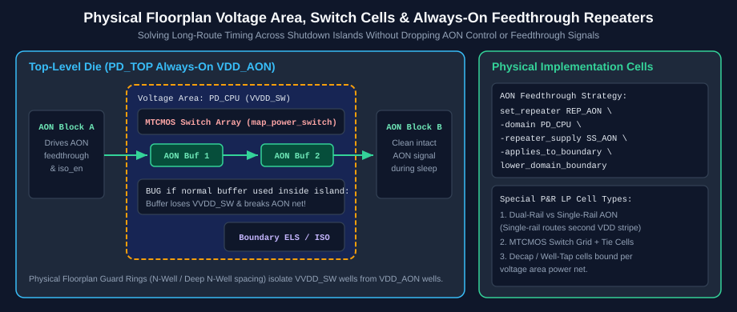
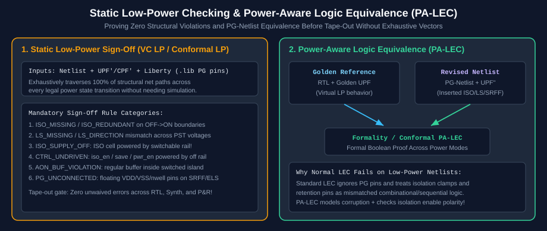

# Low-Power Synthesis, Physical Implementation, and Sign-Off

Writing a clean `golden.upf` and passing RTL Power-Aware simulation marks only the halfway point toward silicon tape-out. Synthesis and Place-and-Route (P&R) must translate abstract UPF intent into millions of physical standard cells, voltage areas, power switch grids, and always-on repeater buffers—and then **sign-off verification** must mathematically prove that not a single gate, power pin, or logic cone broke during optimization!

---

## Learning Goals

After completing this chapter, you should be able to:

- Differentiate **Golden UPF (`UPF`)**, **Synthesis Output (`UPF'`)**, and **Physical P&R Output (`UPF''`)** across the ASIC flow.
- Prevent **Always-On (AON) feedthrough corruption** inside switchable islands using `set_repeater` and physical dual-rail/single-rail AON buffers.
- Understand physical voltage-area floorplanning, MTCMOS switch rings, N-well isolation, and PG pin tying during Place-and-Route.
- Execute **Static Low-Power Structural Checks** (VC LP / Conformal LP) to eliminate `ISO_MISSING`, `LS_MISSING`, `CTRL_UNDRIVEN`, and `PG_UNCONNECTED` bugs.
- Run **Power-Aware Logic Equivalence Checking (PA-LEC)** (Formality / Conformal) comparing Golden RTL+UPF against the final PG netlist.

---

## Evolution of UPF Across Synthesis and Physical Design

A common point of confusion for engineers is why multiple UPF files exist across an ASIC tape-out directory (`golden.upf`, `synth.upf`, `pnr_pg.upf`). Every EDA stage refines the power intent while preserving functional equivalence:

1. **Golden UPF (`golden.upf`):** Hand-authored intent covering RTL hierarchy, Supply Sets, PST/power states, and abstract strategies (`set_isolation`, `set_level_shifter`, `set_retention`, `create_power_switch`). Stored under version control.
2. **Synthesis Implementation Overlay + `UPF'` (`synth.upf'`):** Combines `golden.upf` with cell-mapping commands (`map_isolation_cell`, `map_level_shifter_cell`, `map_retention_cell`). Synthesis (Design Compiler / Genus) physically inserts isolation gates, level shifters, and SRFFs, rewires ports, and emits **`UPF'`** (`save_upf`) containing the newly inserted boundary cell `connect_supply_net` connections.
3. **Physical P&R `UPF''` (`pnr.upf''`):** Place-and-Route (ICC2 / Innovus) creates physical voltage islands (`create_voltage_area`), places MTCMOS switch meshes (`map_power_switch`), inserts Always-On clock/feedthrough buffers, resolves scan-chain crossings across domains, connects every standard-cell `VDD`/`VSS` Power-Ground (PG) pin explicitly in a **PG Verilog Netlist**, and writes out the final supplemental **`UPF''`**.

---

## Always-On Feedthrough Nets and Physical Repeaters

Consider an Always-On interrupt wire `irq_aon` generated in `AON Block A` (left edge of die) traveling across the silicon floorplan to `AON Block B` (right edge of die), passing directly *over* the physical bounding box of switchable voltage island `PD_CPU`!



### The Silent Physical P&R Trap

Because wires longer than a few hundred micrometers suffer severe RC delay degradation and slew violations, the P&R router automatically inserts repeater buffers along `irq_aon`.
- **Catastrophic Bug:** If the P&R router inserts a normal standard-cell buffer sitting inside the `PD_CPU` voltage island, that buffer taps **`VDD_CPU_SW`**! The instant `PD_CPU` sleeps, the repeater loses power and cuts `irq_aon` into `'X'`—even though neither Block A nor Block B ever powered down!
- **Hardware Solution:** Insert qualified **Always-On (AON) Buffers (`AONBUF`)** inside the switchable island, or constrain the router with `set_repeater`:

```tcl
# Instruct P&R to buffer Always-On feedthroughs inside PD_CPU using SS_AON
set_repeater REP_CPU_FEEDTHROUGH \
    -domain PD_CPU \
    -repeater_supply SS_AON \
    -applies_to_boundary lower_domain_boundary
```

### Dual-Rail vs. Single-Rail AON Repeaters

| Style | Power Grid Requirement | Trade-Offs |
| :--- | :--- | :--- |
| **Dual-Rail AON Buffer** | Takes both `VDD_SW` (well/primary frame) + dedicated secondary pin `VDD_AON` (internal gate) | Compatible with island well-tap rules; requires routing secondary `VDD_AON` trunk over switchable area |
| **Single-Rail AON Buffer** | Takes only `VDD_AON` (`nwell` + source) in an isolated well strip | Smaller cell footprint; requires Deep N-Well or careful DRC spacing inside switched island |

> [!CAUTION]
> **Always-On Clock Tree Synthesis (AON-CTS):** Any Always-On clock or wakeup signal routed through a switchable domain (including `save`, `restore`, `iso_en`, and `aon_clk` reaching AON retention blocks) **must** exclusively use Always-On buffers/inverters during CTS—otherwise a single normal clock buffer destroys wakeup!

---

## Static Low-Power Structural Verification

Even with extensive dynamic PA simulation, a corner-case wire (such as an un-exercised DFT testmux path or debug scan output) might never toggle in test vectors yet still trigger silicon failure if left un-isolated. **Static Low-Power Checking** (Synopsys **VC LP**, Cadence **Conformal LP**) exhaustively analyzes 100% of structural net connectivity across RTL, Synthesis, and Post-P&R PG Netlists without needing a single simulation vector!



### Top Static LP Sign-Off Violation Categories

| Rule Code Pattern | Root Cause | Physical / Logical Risk |
| :--- | :--- | :--- |
| **`ISO_MISSING`** | Signal crosses from potentially `OFF` source into `ON` sink with no isolation cell | Static DC crowbar current + `'X'` avalanche in active logic |
| **`ISO_REDUNDANT`** | Isolation exists between domains that can never be `OFF`/`ON` simultaneously, or stacked double ISO | Wasted die area, dynamic power, and setup timing penalty |
| **`ISO_SUPPLY_OFF`** | Isolation cell's primary/backup supply shuts off while clamping is needed (`-location self` mistake) | Clamp output floats to `'X'` during shutdown |
| **`CTRL_UNDRIVEN` / `ISO_CTRL_OFF`** | `iso_en`, `save`, `restore`, or `pwr_sw_en` originates in or passes through a switchable domain | Domain loses ability to stay clamped or wake up cleanly! |
| **`LS_MISSING` / `LS_WRONG_DIR`** | Voltage delta in PST exceeds `-threshold` without matching L2H/H2L/BOTH cell | Severe timing distortion, PMOS static leakage, or oxide overstress |
| **`AON_BUF_MISSING`** | An Always-On net passes through a switched region buffered by non-AON gates | AON control/feedthrough net collapses during island sleep |
| **`PG_UNCONNECTED`** | Missing or wrong-net tie on `VDD`, `VSS`, `VDD_BAK`, or `VNW` pin in post-P&R PG netlist | Hardware LVS/ERC fatal failure or floating well latch-up |

---

## Power-Aware Logic Equivalence Checking (PA-LEC)

Why does **traditional Logic Equivalence Checking (LEC)** fail immediately on low-power netlists?
Standard LEC treats synthesis as a purely Boolean RTL-to-Gate comparison (`if RTL == Netlist`). Because `golden.sv` contains **zero** isolation gates, level shifters, or retention balloon pins, standard LEC sees extra `AND`/`OR`/`ELS` gates and extra `SAVE`/`RESTORE` pins on flip-flops in the synthesized netlist and aborts with thousands of "Non-Equivalent" failures!

**Power-Aware LEC** (Synopsys **Formality Low-Power**, Cadence **Conformal LP Equivalence**) solves this cleanly:
1. Reads **Golden**: `RTL` + `golden.upf`.
2. Reads **Revised**: `Synthesized / P&R PG-Netlist` + `UPF'` / `UPF''`.
3. Builds internal low-power functional models for isolation clamps, retention state saves/restores, and power switches on *both* sides.
4. Mathematically proves across every legal PST state that:
   - Functional logic matches identically during `NORMAL` states,
   - Clamped isolation values match identically during `OFF` states,
   - Isolation/retention control polarities (`high` vs `low`) were not accidentally inverted by synthesis optimization!

---

## Multi-Corner Multi-Mode STA and IR Drop Sign-Off

1. **Multi-Voltage STA (PrimeTime / Tempus):** Timing corners must cover every legal PST row (e.g., `TURBO`: CPU $1.00\text{V}$ / GPU $0.95\text{V}$, `NOMINAL`: CPU $0.80\text{V}$ / GPU $0.70\text{V}$) plus cross-voltage paths through ELS/LS cells (`L2H` worst slow-input-to-fast-output setup and hold checks!).
2. **Dynamic Inrush IR-Drop Sign-Off (RedHawk / Voltus):** Models transient current spikes when MTCMOS daisy chains switch a powered-off island ON, verifying peak voltage droop on shared Always-On `VDD_AON` stays within $\le 5\%$–$10\%$ tolerance so active neighbor CPUs never suffer timing failures.

---

## Best Practices and Common Pitfalls

- **Run VC LP / Conformal LP at Three Mandatory Gates:** Check (1) RTL + Golden UPF, (2) Post-Synthesis Netlist + `UPF'`, and (3) Post-P&R PG-Netlist + `UPF''` before tape-out. Never waive an `ISO_SUPPLY_OFF` or `CTRL_UNDRIVEN` error without physical sign-off approval.
- **Check DFT Scan Chains Crossing Power Domains:** Synthesis and DFT must place **lockup latches** and ensure scan-enable / scan-shift buffers along paths entering/exiting switchable domains do not bypass isolation or cause `ISO_MISSING` violations during functional mode!
- **Watch P&R Cloning / Gate Optimization:** Aggressive synthesis/P&R timing optimization can clone an Always-On control buffer (`iso_en`) or pull logic across a hierarchical boundary; mark critical isolation/LS strategies `-dont_touch` or use UPF preservation attributes (`set_design_attributes -preservation`).
- **Verify Physical Well Taps & Guard Rings in DRC/LVS:** When adjacent voltage areas carry different supplies (`0.70V` vs `1.00V` or switched vs Always-On), Deep N-Well isolation or foundry well-spacing guard rings are mandatory to prevent substrate latch-up.

---

## Practical Exercises with Solutions

### Exercise 1 Interpreting a Post-P&R VC LP Violation

**Problem:**
Post-P&R static verification on a PG-netlist reports:
`ERROR [AON_BUF_VIOLATION]: Normal buffer instance u_cpu/u_cts_buf_42 (powered by VDD_CPU_SW) drives net u_cpu/ret_save_en (related AON retention control signal).`
Why did this pass RTL VC LP earlier and suddenly fail after P&R?

**Solution:**
In RTL, `ret_save_en` was an ideal zero-delay wire with no physical buffers inside `u_cpu`. During P&R Clock/High-Fanout Net Synthesis (HFNS), the router inserted `u_cts_buf_42` physically inside `u_cpu`'s voltage area (`VDD_CPU_SW`) to fix fanout/slew on `ret_save_en`. Because `u_cts_buf_42` is a regular buffer rather than an **Always-On (`AONBUF`)** cell, shutting off `VDD_CPU_SW` kills `ret_save_en`!
**Fix:** Configure `set_repeater` / HFNS cell constraints so buffers on `ret_save_en` inside `PD_CPU` strictly instantiate qualified Always-On buffers tied to `VDD_AON`.

### Exercise 2 Why Standard LEC Fails Without Power-Aware Mode

**Problem:**
A junior backend engineer loads `golden.sv` and `pnr_pg_netlist.v` into standard Formality *without* loading `golden.upf` and `pnr.upf''`, getting 12,450 failing compare points. Explain two exact structural reasons for those failures.

**Solution:**
1. **Retention Flop Pins & Polarity:** Every SRFF in `pnr_pg_netlist.v` has extra `SAVE`, `RESTORE`, and secondary `VDD_AON` PG pins that do not exist in `golden.sv`. Standard LEC flags missing/unconstrained sequential control cones.
2. **Inserted Isolation Gates & Level Shifters:** Boundary wires now contain physical `ISOLO` / `ISOHI` / `ELS` gates gated by `iso_en`, which alter the Boolean logic function relative to direct wires in `golden.sv`. Only Power-Aware LEC understands that `golden.upf` implies equivalent clamping/retention behavior!

### Exercise 3 Fixing Multi-Voltage Hold Violations Across LS/ELS

**Problem:**
Between `PD_LOW` ($0.70\text{V}$) and `PD_HIGH` ($1.00\text{V}$), a signal crosses through an L2H level shifter `U_LS` launching from fast corner $1.00\text{V}$ capture vs slow/fast timing skew. Why do Multi-Vdd boundaries exhibit severe **hold-time** violations across PST modes?

**Solution:**
In Multi-Vdd STA, setup checks pair worst-case slow launch ($0.70\text{V}$ slow-corner) with fast capture ($1.00\text{V}$), while **hold checks** must analyze fast launch against slow/lagging clock-tree capture across differing voltage supply corners! Clock-tree insertion delay shifts significantly between $0.70\text{V}$ and $1.00\text{V}$ corners—requiring cross-voltage clock-tree balancing and extra hold buffers inside the receiving domain.

##### Copyright (c) 2026 squared-studio
