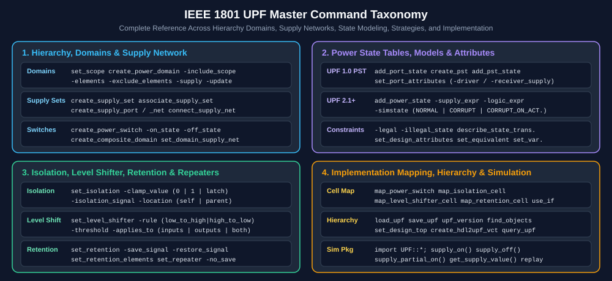
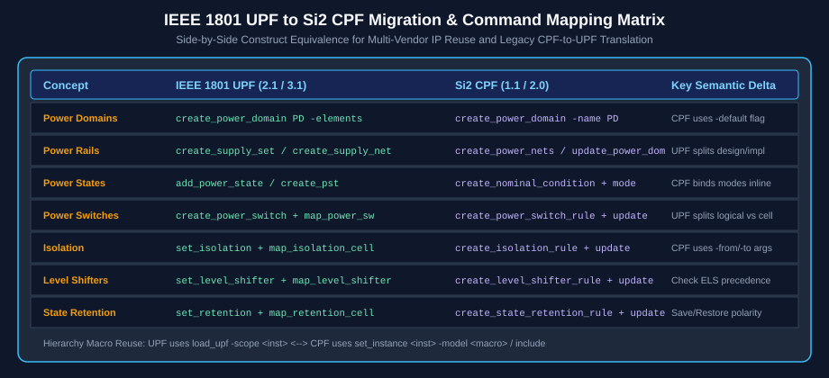

# Comprehensive UPF and CPF Command Reference and Migration Guide

Whether authoring greenfield IEEE 1801 UPF 2.1/3.1 power intent, maintaining legacy UPF 1.0 scripts, or migrating third-party Si2 CPF 2.0 blocks into a unified SoC flow, hardware and verification engineers need a reliable, side-by-side reference. This final chapter consolidates the entire IEEE 1801 UPF command taxonomy, bidirectional UPF-to-CPF equivalence tables, a complete end-to-end multi-domain SoC golden UPF + CPF pair, and a pre-tape-out sign-off checklist.

---

## Learning Goals

After completing this chapter, you should be able to:

- Locate and apply any standard IEEE 1801 UPF command across hierarchy domains, supply networks, state tables, boundary strategies, cell mapping, and simulation control.
- Translate seamlessly between **IEEE 1801 UPF (2.1/3.1)** and **Si2 CPF (1.1/2.0)** constructs while catching subtle semantic traps.
- Assemble a complete, production-structured Golden UPF and Implementation UPF template for a multi-domain SoC with Always-On, Switchable + Retention, and DVFS + ELS islands.
- Execute a comprehensive Low-Power Verification and Implementation Sign-Off Checklist prior to tape-out.

---

## IEEE 1801 UPF Command Taxonomy

IEEE 1801 organizes its commands cleanly into four architectural layers separating logical hierarchy and power intent from foundry-specific standard-cell mappings and simulation instrumentation.



### Layer 1 Power Domains and Hierarchy Scope

| UPF Command | Key Flags &amp; Semantics | Typical Usage |
| :--- | :--- | :--- |
| `upf_version` | `2.1`, `3.1`, `4.0` | Declares IEEE 1801 parser version at top of script |
| `set_scope` | `<instance_path>` or `/` | Changes current hierarchical working directory |
| `create_power_domain` | `-include_scope`, `-elements`, `-exclude_elements`, `-supply`, `-update` | Partitions RTL module subtrees into power domains |
| `create_composite_domain` | `-subdomains`, `-supply` | Fuses child domains into one physical voltage island |
| `set_design_top` | `<top_module>` | Explicitly names top module when running standalone |
| `load_upf` | `<file.upf> -scope <inst>` | Loads reusable sub-block UPF under an instance hierarchy |
| `save_upf` | `<out_file.upf>` | Exports refined `UPF'` / `UPF''` after synthesis or P&amp;R |

### Layer 2 Supply Networks and Power Switches

| UPF Command | Key Flags &amp; Semantics | Typical Usage |
| :--- | :--- | :--- |
| `create_supply_set` | `-function {power ...} -function {ground ...} -update` | Portable UPF 2.1+ rail container |
| `associate_supply_set` | `<supply_set> -handle <domain_or_set_handle>` | Binds SoC physical rails onto IP abstract sets |
| `create_supply_port` | `<port> -direction in|out` | Declares top-level power/ground pads or ports |
| `create_supply_net` | `<net> -domain <pd> -reuse` | Declares explicit electrical supply rails (UPF 1.0/2.x) |
| `connect_supply_net` | `<net> -ports {list}` | Wires supply nets to supply ports or macro PG pins |
| `set_domain_supply_net` | `-primary_power_net -primary_ground_net` | Legacy UPF 1.0 binding of primary rails onto a domain |
| `create_power_switch` | `-input_supply_port -output_supply_port -control_port -ack_port -on_state -off_state` | Models MTCMOS header/footer virtual power switches |

### Layer 3 Power States and Boundary Strategies

| UPF Command | Key Flags &amp; Semantics | Typical Usage |
| :--- | :--- | :--- |
| `add_power_state` | `-state {... -supply_expr ... -logic_expr ... -simstate ...} -legal -illegal_state -update` | Modern composable state definition + assertions |
| `add_port_state` | `<port> -state {name voltage|off}` | Declares discrete operating voltages on a supply port |
| `create_pst` / `add_pst_state` | `-supplies {list}` / `-pst <name> -state {list}` | Legacy global PST matrix defining legal modes |
| `set_port_attributes` | `-ports -elements -driver_supply -receiver_supply` | Captures external supply contracts on block boundary ports |
| `set_isolation` | `-clamp_value (0|1|latch) -isolation_signal -isolation_sense -location` | Protects `OFF -> ON` crossings against crowbar / `'X'` |
| `set_level_shifter` | `-rule (low_to_high|high_to_low|both) -threshold -no_shift -force_shift` | Protects mismatched multi-voltage crossings |
| `set_retention` | `-retention_supply_set -save_signal -restore_signal -no_save` | Preserves FF state across domain power-down |
| `set_retention_elements` | `-elements -exclude_elements -retention_purpose` | Selects exact registers/modules for partial retention |
| `set_repeater` | `-domain -repeater_supply -applies_to_boundary` | Forces Always-On buffers on feedthrough nets |

### Layer 4 Physical Cell Mapping and Verification

| UPF Command | Key Flags &amp; Semantics | Typical Usage |
| :--- | :--- | :--- |
| `map_isolation_cell` | `<iso_name> -domain <pd> -lib_cells {list}` | Binds logical isolation rule to foundry standard cell |
| `map_level_shifter_cell` | `<ls_name> -domain <pd> -lib_cells {list}` | Binds level shifter rule to foundry standard cell |
| `map_retention_cell` | `<ret_name> -domain <pd> -lib_cells {list}` | Binds retention strategy to foundry SRFF cell |
| `map_power_switch` | `<sw_name> -domain <pd> -lib_cells {list}` | Binds logical switch to HVT header/footer switch macro |
| `use_interface_cell` | `-strategy {iso ls} -lib_cells {els_cell}` | Maps combined isolation + level shifter onto ELS cell |
| `query_upf` / `find_objects` | Tcl introspection API (UPF 3.0+) | Automated UPF auditing and custom sign-off checks |

---

## Bidirectional UPF and CPF Migration Guide

Cross-vendor SoC integrations routinely convert legacy Cadence **Si2 CPF 1.1/2.0** power specs into **IEEE 1801 UPF 2.1/3.1** (or wrap CPF macros cleanly).



### Critical Semantic Gotchas When Converting CPF to UPF

1. **Inline Shutoff Condition vs. Explicit Switch Object:**
   CPF specifies `-shutoff_condition {!pmc/pwr_en}` directly inside `create_power_domain` and separates `create_power_switch_rule`. UPF represents switching via an explicit `create_power_switch` driving a switched supply net (`VDD_SW`), whose output state then determines domain `CORRUPT` behavior.
2. **CPF `-from` / `-to` Domain Crossings vs. UPF `-domain` + `-applies_to`:**
   CPF isolation and level-shifter rules explicitly pair `-from PD_SRC -to PD_DST`. In UPF, `set_isolation` attaches to a single `-domain PD_SRC` with `-applies_to outputs` (or uses `-source` / `-sink` supply sets in UPF 2.1+)—forgetting `-source`/`-sink` filters can accidentally target extra crossings to unrelated peer domains!
3. **Polarity Differences on `SAVE` / `RESTORE` vs. CPF Edge Triggers:**
   CPF's `create_state_retention_rule` uses `-save_edge` / `-restore_edge` (implying edge triggers), whereas foundry SRFF `.lib` pins and UPF `-save_signal {sig high|low|posedge|negedge}` may specify level-sensitive behavior. Always cross-check against the Liberty `.lib` retention pin model!
4. **Top-Level Boundary Default `-default` vs. `-include_scope`:**
   Ensure CPF's single `-default` top domain maps to a top-level UPF `create_power_domain PD_TOP -include_scope` declared **first** at root scope `/`.

---

## End-to-End Production Golden UPF Reference Template

Below is a complete, industry-clean Golden UPF 2.1 template integrating all principles covered across Chapters 1–11 (Always-On `PD_TOP`, Retention-backed `PD_CPU`, and DVFS + ELS `PD_GPU`):

```tcl
# ==============================================================================
# Golden SoC Power Intent (IEEE 1801 UPF 2.1) -- Synthesizable & PA-Sim Ready
# ==============================================================================
upf_version 2.1
set_scope /

# 1. Supply Ports & Nets
create_supply_port VDD_AON -direction in
create_supply_port VDD_GPU -direction in   ;# External DVFS PMIC rail
create_supply_port VSS     -direction in

create_supply_net VDD_AON
create_supply_net VDD_CPU_SW
create_supply_net VDD_GPU
create_supply_net VDD_GPU_SW
create_supply_net VSS

connect_supply_net VDD_AON -ports {VDD_AON}
connect_supply_net VDD_GPU -ports {VDD_GPU}
connect_supply_net VSS     -ports {VSS}

# 2. Portable Supply Sets
create_supply_set SS_AON    -function {power VDD_AON}    -function {ground VSS}
create_supply_set SS_CPU_SW -function {power VDD_CPU_SW} -function {ground VSS}
create_supply_set SS_GPU_SW -function {power VDD_GPU_SW} -function {ground VSS}

# 3. Power Domains
create_power_domain PD_TOP -include_scope -supply {primary SS_AON}

create_power_domain PD_CPU -elements {u_cpu} \
    -supply {primary           SS_CPU_SW} \
    -supply {default_isolation SS_AON} \
    -supply {default_retention SS_AON}

create_power_domain PD_GPU -elements {u_gpu} \
    -supply {primary           SS_GPU_SW} \
    -supply {default_isolation SS_AON}

# 4. MTCMOS Power Switches (Control signals stay Always-On inside u_pmc)
create_power_switch SW_CPU -domain PD_CPU \
    -input_supply_port  {in   VDD_AON} \
    -output_supply_port {out  VDD_CPU_SW} \
    -control_port       {ctrl u_pmc/cpu_pwr_en} \
    -ack_port           {ack  u_pmc/cpu_pwr_ack {ctrl}} \
    -on_state           {ON   in {ctrl}} \
    -off_state          {OFF  {!ctrl}}

create_power_switch SW_GPU -domain PD_GPU \
    -input_supply_port  {in   VDD_GPU} \
    -output_supply_port {out  VDD_GPU_SW} \
    -control_port       {ctrl u_pmc/gpu_pwr_en} \
    -ack_port           {ack  u_pmc/gpu_pwr_ack {ctrl}} \
    -on_state           {ON   in {ctrl}} \
    -off_state          {OFF  {!ctrl}}

# 5. Legal & Illegal Power State Definitions
add_power_state SS_AON    -state ON_08  {-supply_expr {power == `{FULL_ON, 0.80} && ground == `{FULL_ON, 0.0}} -simstate NORMAL}
add_power_state SS_CPU_SW -state ON_08  {-supply_expr {power == `{FULL_ON, 0.80}} -simstate NORMAL} \
                          -state OFF    {-supply_expr {power == `{OFF}}           -simstate CORRUPT}
add_power_state SS_GPU_SW -state TURBO  {-supply_expr {power == `{FULL_ON, 0.95}} -simstate NORMAL} \
                          -state ECO    {-supply_expr {power == `{FULL_ON, 0.70}} -simstate NORMAL} \
                          -state OFF    {-supply_expr {power == `{OFF}}           -simstate CORRUPT}

add_power_state PD_CPU -illegal_state {BAD_ISO -supply_expr {primary == OFF} -logic_expr {!u_pmc/cpu_iso_en}}
add_power_state PD_GPU -illegal_state {BAD_ISO -supply_expr {primary == OFF} -logic_expr {!u_pmc/gpu_iso_en}}

# 6. Isolation & Level Shifting Strategies (ELS inferred cleanly on PD_GPU)
set_isolation ISO_CPU_0 -domain PD_CPU -applies_to outputs -clamp_value 0 \
    -isolation_signal u_pmc/cpu_iso_en -isolation_sense high -location parent
set_isolation ISO_CPU_1 -domain PD_CPU -elements {u_cpu/axi_cs_n u_cpu/dbg_req_n} \
    -clamp_value 1 -isolation_signal u_pmc/cpu_iso_en -isolation_sense high -location parent

set_isolation ISO_GPU_0 -domain PD_GPU -applies_to outputs -clamp_value 0 \
    -isolation_signal u_pmc/gpu_iso_en -isolation_sense high -location parent
set_level_shifter LS_GPU -domain PD_GPU -applies_to both -rule both -threshold 0.05 -location parent

# 7. Selective State Retention inside PD_CPU
set_retention_elements CPU_CSRS -elements {u_cpu/u_csr_regs u_cpu/u_pc_state} -retention_purpose required
set_retention RET_CPU -domain PD_CPU -elements {CPU_CSRS} \
    -save_signal    {u_pmc/cpu_save    high} \
    -restore_signal {u_pmc/cpu_restore high} \
    -save_condition    {!u_cpu/gated_clk} \
    -restore_condition {!u_cpu/gated_clk}
```

---

## Pre-Tape-Out Low-Power Sign-Off Checklist

- **Golden UPF Separation:** Verify all physical cell names (`map_*_cell`) live cleanly in a separate implementation mapping script, leaving `golden.upf` portable across simulation and synthesis.
- **Control & Clock Hygiene:** Confirm `u_pmc`, `iso_en`, `save`, `restore`, `pwr_sw_en`, and all Always-On clock/feedthrough buffers use Always-On rails (`SS_AON`) cleanly.
- **Active-Low Clamp Verification:** Audit every active-low interface (`rst_n`, `cs_n`, `req_n`, `ack_n`) leaving switchable domains to ensure `-clamp_value 1` overrides default `-clamp_value 0`.
- **Static LP Sign-Off Zero Errors:** Achieve zero unwaived errors in VC LP / Conformal LP across RTL, Post-Synthesis `UPF'`, and Post-P&R PG Netlist `UPF''`.
- **PA-Sim & SVA Coverage Closure:** Verify dynamic `'X'` injection tests hit 100% of PST modes, sleep/wake handshakes, abort corners, and retention bit-integrity readbacks.
- **PA-LEC & Dynamic IR Sign-Off:** Pass Formality/Conformal PA-LEC equivalence on the final PG netlist and confirm daisy-chain MTCMOS inrush IR droop remains safely within budget.

---

## Best Practices and Common Pitfalls

- **Version Control `golden.upf` Alongside RTL:** Never edit synthesized `UPF'` manually to patch bugs; trace every netlist violation back to `golden.upf` or RTL and re-synthesize so verification stays closed-loop.
- **Audit Tool-Specific Waiver Syntax Carefully:** Waiving static LP warnings during early RTL milestones is fine; before tape-out, every single remaining waiver must include a signed design rationale (e.g., co-switched sibling domains or verified internal macro clamping).
- **Standardize Naming Conventions Across Teams:** Consistent prefixes (`PD_`, `SS_`, `SW_`, `ISO_`, `LS_`, `RET_`, `pm_`) allow automated Tcl verification scripts (`query_upf`) to inspect multi-million-gate SoCs in seconds.

---

## Practical Exercises with Solutions

### Exercise 1 Translating a CPF Block to UPF 2.1

**Problem:**
Translate the following Si2 CPF snippet into equivalent IEEE 1801 UPF 2.1 commands:

```tcl
create_power_domain -name PD_DMA -instances {u_dma} -shutoff_condition {!u_pmc/dma_pwr_en}
create_isolation_rule -name IR_DMA -from PD_DMA -to PD_TOP \
    -isolation_condition {u_pmc/dma_iso_en} -isolation_output high
```

**Solution:**

```tcl
create_power_domain PD_DMA -elements {u_dma} \
    -supply {primary SS_DMA_SW} -supply {default_isolation SS_AON}

create_power_switch SW_DMA -domain PD_DMA \
    -input_supply_port {in VDD_AON} -output_supply_port {out VDD_DMA_SW} \
    -control_port {ctrl u_pmc/dma_pwr_en} \
    -on_state {ON in {ctrl}} -off_state {OFF {!ctrl}}

set_isolation ISO_DMA -domain PD_DMA \
    -isolation_supply_set SS_AON \
    -applies_to outputs \
    -clamp_value 1 \
    -isolation_signal u_pmc/dma_iso_en \
    -isolation_sense high \
    -location parent
```

### Exercise 2 Auditing the Golden SoC UPF Template

**Problem:**
Inspect the **End-to-End Production Golden UPF Reference Template** above. Suppose `u_cpu/axi_arvalid` and `u_cpu/axi_cs_n` both exit `PD_CPU` into `PD_TOP`. Which `set_isolation` rule clamps `axi_arvalid`, and which clamps `axi_cs_n`? What happens if you run `map_isolation_cell` only on `ISO_CPU_0` and forget `ISO_CPU_1`?

**Solution:**
- `u_cpu/axi_arvalid` is clamped to `0` by `ISO_CPU_0` (domain-wide `-applies_to outputs` default).
- `u_cpu/axi_cs_n` is explicitly targeted (`-elements {u_cpu/axi_cs_n u_cpu/dbg_req_n}`) and clamped to `1` by `ISO_CPU_1` (specific element rules override broader output rules).
- If you forget `map_isolation_cell` on `ISO_CPU_1`, synthesis either falls back to generic library cell selection (which can fail if multiple foundry `ISOHI` families exist or violate multi-$V_{th}$/cell-drive design rules) or aborts with an unmapped isolation strategy error.

### Exercise 3 Verifying Control Polarity Across the Full Sign-Off Chain

**Problem:**
When generating `UPF'` after synthesis and verifying it with PA-LEC against `golden.upf`, why is verifying polarity consistency across `set_isolation -isolation_sense` and the physical foundry ISO cell pin critical?

**Solution:**
Some foundry clamp cells use active-low enable pins (`ISO_N`), while `golden.upf` declared `-isolation_sense high`. During synthesis, the compiler inserts an Always-On inverter on `iso_en` so the physical gate operates equivalently. PA-LEC verifies that the combination of physical inverter + `.lib` pin sense matches the exact Boolean isolation intent defined in `golden.upf` across every state!

##### Copyright (c) 2026 squared-studio
