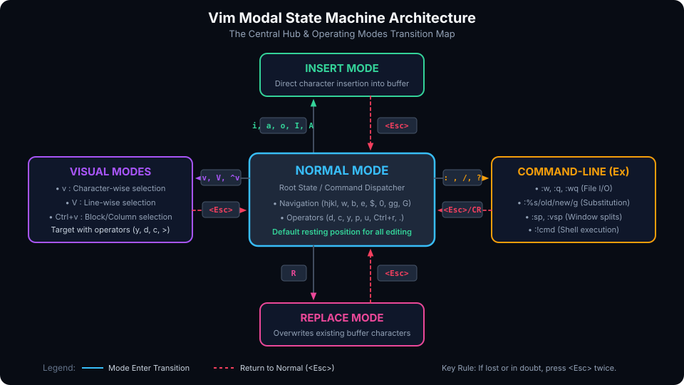
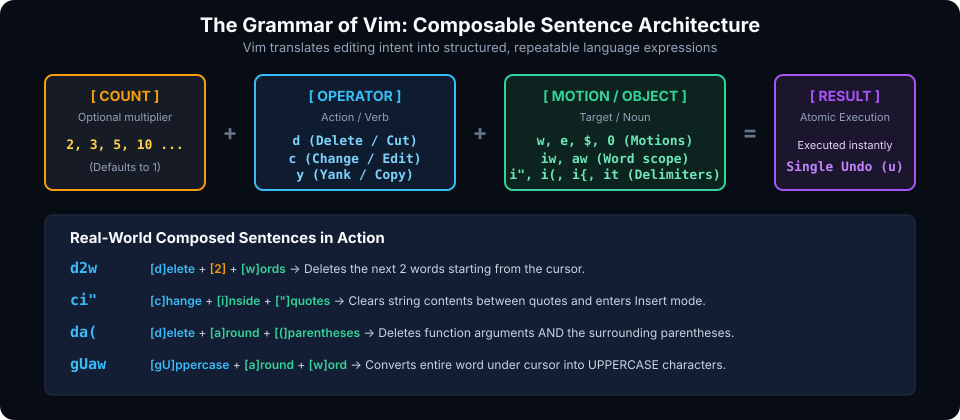

# Vi IMproved (VIM)

## Introduction

**Vim** (short for **Vi IMproved**) is a highly configurable, keyboard-driven text editor designed for speed, precision, and efficiency. Created by **Bram Moolenaar** in 1991 as an expansion of Bill Joy's 1976 Unix `vi` editor, Vim is an industry standard across systems programming, embedded firmware, DevOps, software engineering, and hardware verification.

Unlike conventional graphical editors that rely heavily on modifier combinations (`Ctrl`, `Alt`) and mouse clicks, Vim is built around **modal editing**. In Vim, your keyboard functions as a command console where standard alphanumeric keys perform navigation, manipulation, and structural edits without your hands ever leaving the home row (`ASDF` / `JKL;`).

### Core Features of Vim

1. **Modal Editing Architecture**: Separate modes for reading/navigating, typing, selecting, and issuing system commands minimize unnecessary keystrokes and prevent repetitive strain injury (RSI).
2. **Grammar-Based Editing**: Commands follow a composable sentence structure: `[Count] + [Operator] + [Motion / Text Object]`. Once you learn the verbs and nouns, you can express complex edits intuitively.
3. **Pervasive Ubiquity**: Vim comes pre-installed or readily available on virtually every Unix, Linux, BSD, and macOS system in existence, as well as cloud containers, remote virtual machines, and embedded development boards.
4. **Lightweight & High-Performance**: Vim launches instantly in your terminal, consumes minimal memory, and handles multi-megabyte log files or source trees with zero lag.
5. **Vast Extensibility**: Supports deep scripting, custom keybindings, syntax highlighting, code folding, and thousands of community plugins via modern plugin managers.

---

## The Modal Paradigm & The Grammar of Vim

### 1. Primary Operating Modes

To master Vim, you must understand its state machine. At any given moment, Vim is in one of several modes:



| Mode | Purpose | How to Enter | How to Exit |
| :--- | :--- | :--- | :--- |
| **Normal** | Navigation, deletion, copy/paste, macros (default state) | `<Esc>` or `Ctrl+[` | N/A (Root mode) |
| **Insert** | Directly entering and typing new text | `i`, `I`, `a`, `A`, `o`, `O` | `<Esc>` or `Ctrl+[` |
| **Visual** | Selecting ranges of text character-by-character | `v` | `<Esc>` |
| **Visual Line** | Selecting full lines of text | `V` (Shift+v) | `<Esc>` |
| **Visual Block**| Selecting rectangular columns of text | `Ctrl+v` | `<Esc>` |
| **Command-Line (Ex)** | Executing file I/O, search/replace, shell commands | `:` (Colon) | `<Esc>` or `<Enter>` |
| **Replace** | Overwriting existing text character-by-character | `R` (Shift+r) | `<Esc>` |

> [!TIP]
> **Modal Golden Rule:** Always return to **Normal Mode** when you finish typing. Think of Normal mode as your resting position. You should spend 80% of your time in Normal mode reading, navigating, and manipulating code.

### 2. The Language of Editing: Operators, Counts & Motions

Vim commands are not arbitrary key chords; they form an expressive grammar:



$$\text{Command} = [\text{Count}] + [\text{Operator}] + [\text{Motion / Text Object}]$$

#### Operators (Verbs)
- `d` : Delete (cut)
- `c` : Change (delete and switch directly into Insert mode)
- `y` : Yank (copy)
- `>` : Indent right
- `<` : Shift left
- `gU` : Convert to UPPERCASE
- `gu` : Convert to lowercase

#### Motions & Text Objects (Nouns / Prepositions)
- `w` : Forward to start of next word
- `b` : Backward to start of previous word
- `e` : Forward to end of word
- `$` : End of line
- `0` : Start of line
- `iw` : Inner word (excluding whitespace)
- `aw` : Around word (including surrounding whitespace)
- `i"` : Inside double quotes
- `i(` or `ib` : Inside parentheses
- `i{` or `iB` : Inside curly braces
- `it` : Inside HTML/XML tag

#### Composable Grammar Examples
- `dw` $\rightarrow$ Delete to the beginning of next word.
- `d2w` $\rightarrow$ Delete next 2 words.
- `ci"` $\rightarrow$ **C**hange **I**nside **"**quotes**"** (deletes string contents and enters Insert mode).
- `da(` $\rightarrow$ **D**elete **A**round **(**parentheses**)** (deletes parentheses and everything within them).
- `y$` $\rightarrow$ Yank from cursor to the end of the line.
- `gUaw` $\rightarrow$ Convert **A**round **W**ord to UPPERCASE.
- `3dd` $\rightarrow$ Delete 3 entire lines.

---

## Install

### For Linux Distributions

#### Debian / Ubuntu / Mint
```bash
sudo apt update
sudo apt install -y vim vim-gtk3
```
*(Installing `vim-gtk3` provides GUI clipboard support via the `+clipboard` compile flag even when running Vim strictly inside terminal sessions).*

#### Fedora / RHEL / CentOS
```bash
sudo dnf install -y vim-enhanced
```

#### Arch Linux / Manjaro
```bash
sudo pacman -S --noconfirm vim
```

### For macOS

macOS ships with a default, dated version of Vim. You can install the latest upstream release via Homebrew:

```bash
# Install CLI Vim
brew install vim

# (Optional) Install MacVim GUI
brew install --cask macvim
```

### For Windows

#### Option 1: Windows Package Manager (winget)
```powershell
winget install vim.vim
```

#### Option 2: Chocolatey
```powershell
choco install vim -y
```

#### Option 3: Git for Windows
If you install Git for Windows, Vim is automatically included inside the Git Bash terminal environment.

### Verifying Installation & Features

To verify your installation and check for features such as clipboard support and syntax highlighting:

```bash
vim --version
```

Look for `+clipboard` (or `+xterm_clipboard`) in the output. A `+` indicates the feature is compiled in; a `-` indicates it is omitted.

---

## Simple Exercise

Follow these step-by-step hands-on tutorials. Create a scratch directory and follow along inside your terminal.

```bash
mkdir -p ~/vim_practice && cd ~/vim_practice
```

### Exercise 1: The Essential Lifecycle (Opening, Writing & Exiting)

1. **Launch Vim with a new file**:
   ```bash
   vim practice.txt
   ```
2. **Inspect the initial state**: Notice that you start in **Normal Mode**. Typing regular letters will execute commands rather than insert text.
3. **Enter Insert Mode**: Press `i`. Look at the bottom left of your screen; you should see `-- INSERT --`.
4. **Type a short sentence**:
   ```text
   Vim is a powerful modal text editor built for high-efficiency programming.
   ```
5. **Return to Normal Mode**: Press `<Esc>` (or `Ctrl+[`). The `-- INSERT --` indicator disappears.
6. **Save the file without quitting**: Type `:w` and hit `<Enter>`. Vim confirms with `[New] 1L, ... written`.
7. **Save and quit**: Type `:wq` (or `:x`, or press `ZZ`) and hit `<Enter>`.
8. **Reopen the file**: Run `vim practice.txt`.
9. **Discard accidental edits**: Press `dd` to delete the line. Now quit without saving by typing `:q!` (or `ZQ`) and hit `<Enter>`. The original file remains untouched.

---

### Exercise 2: Precision Cursor Navigation

Open any multi-line file (e.g. `vim /etc/services` or your own test file) and practice moving without touching the arrow keys:

- **Home Row Fundamentals**:
  - `h` : Move cursor left one character
  - `j` : Move cursor down one line
  - `k` : Move cursor up one line
  - `l` : Move cursor right one character
- **Word Motions**:
  - Press `w` repeatedly to jump forward to the start of each word.
  - Press `e` to jump forward to the end of each word.
  - Press `b` to jump backward to the start of previous words.
  - Try capitalized variants (`W`, `E`, `B`) to treat punctuation as part of words.
- **Line Boundary Motions**:
  - Press `0` (zero) to snap to column 1 (start of line).
  - Press `^` to jump to the first non-blank character on the line.
  - Press `$` to jump to the end of the line.
- **In-Line Character Hunting**:
  - Type `fa` to jump forward directly to the next occurrence of the letter `a` on the current line.
  - Type `;` to repeat the jump forward, or `,` to repeat it backward.
  - Type `t;` to jump *until* (one character before) the next semicolon.
- **File-Wide Navigation**:
  - Press `gg` to jump to line 1 (start of file).
  - Press `G` to jump to the very last line of the file.
  - Type `42G` or `:42<Enter>` to jump directly to line 42.
  - Press `Ctrl+d` to scroll down half a screen, and `Ctrl+u` to scroll up half a screen.
  - Press `zz` to redraw the screen with the current line centered vertically.

---

### Exercise 3: Speaking the Vim Language (Operators & Text Objects)

Create a sample file `code.py` with the following content:

```python
message = "Hello, legacy World!"
total = calculate_sum(val_a, val_b)
```

1. **Delete a word**: Place the cursor anywhere on `legacy`. Press `dw`. Notice that `legacy ` is deleted cleanly.
2. **Undo the change**: Press `u`. The word `legacy` reappears.
3. **Redo the change**: Press `Ctrl+r`. The deletion is reapplied.
4. **Change inside quotes**: Move your cursor anywhere inside `"Hello, legacy World!"`. Type:
   ```text
   ci"
   ```
   Vim immediately deletes everything inside the quotes and puts you into **Insert Mode**. Type `Greetings from Vim!` and press `<Esc>`.
5. **Change inside parentheses**: Place your cursor inside `(val_a, val_b)` and type:
   ```text
   ci(
   ```
   Type `x, y, z` and hit `<Esc>`.
6. **The Magic of the Dot (`.`) Command**:
   Move down to another line, press `dd` to delete it. Move down again and press `.`. The last change is repeated instantly!

---

### Exercise 4: Visual Block Mode & Column Editing

A common real-world task is commenting or uncommenting multiple lines of code simultaneously.

Given the following lines:
```verilog
wire clk;
wire reset_n;
wire [31:0] data_bus;
wire valid;
```

To comment out all 4 lines at once:
1. Place the cursor on the letter `w` of line 1 (`wire clk;`).
2. Press `Ctrl+v` to enter **Visual Block Mode** (bottom status shows `-- VISUAL BLOCK --`).
3. Press `3j` (or press `j` three times) to highlight the first column across all 4 lines.
4. Press `Shift+i` (capital `I`) to enter Insert mode before the block.
5. Type `// ` (slash, slash, space).
6. Press `<Esc>`. Within a fraction of a second, Vim applies `// ` across all 4 lines!

To remove the comments:
1. Move to the first `/` on line 1.
2. Press `Ctrl+v`, then `3j`, then `2l` (to select the 3 characters `// ` on each line).
3. Press `d` (or `x`). All comments are removed in one stroke.

---

### Exercise 5: Global Search and Replacement

Vim features a powerful regex-capable search and replace engine using the Ex command line.

1. **Search forward**: Type `/pattern` and press `<Enter>`.
   - Press `n` to jump to the next match.
   - Press `N` to jump to the previous match.
2. **Search backward**: Type `?pattern` and press `<Enter>`.
3. **Search word under cursor**: Place cursor on any variable or word and press `*` to find the next occurrence forward, or `#` for backward.
4. **Global Replace Syntax**:
   ```vim
   :[range]s/{target}/{replacement}/{flags}
   ```
   - Replace on current line:
     ```vim
     :s/old_var/new_var/g
     ```
   - Replace throughout entire file:
     ```vim
     :%s/old_var/new_var/g
     ```
   - Replace throughout file with interactive confirmation:
     ```vim
     :%s/old_var/new_var/gc
     ```
     *(Vim will highlight each occurrence and prompt: `replace with new_var (y/n/a/q/l/^E/^Y)?`)*
   - Using alternate delimiters (ideal for file paths):
     ```vim
     :%s#/usr/bin#/usr/local/bin#g
     ```

---

### Exercise 6: Windows, Splits, Buffers & Tabs

Modern development requires working with multiple files side-by-side.

```
+---------------------+---------------------+
|                     |                     |
|      Buffer 1       |      Buffer 2       |
|    (:sp / :vsp)     |    (Ctrl+w h/l)     |
|                     |                     |
+---------------------+---------------------+
```

1. **Split window horizontally**:
   Type `:sp other_file.txt` or `:split`.
2. **Split window vertically**:
   Type `:vsp other_file.txt` or `:vsplit`.
3. **Switch between active windows**:
   - `Ctrl+w h` : Move cursor to the left split
   - `Ctrl+w l` : Move cursor to the right split
   - `Ctrl+w j` : Move cursor to the bottom split
   - `Ctrl+w k` : Move cursor to the top split
   - `Ctrl+w w` : Cycle through open windows
4. **Resize splits**:
   - `Ctrl+w =` : Make all window splits equal size
   - `Ctrl+w +` : Increase current window height
   - `Ctrl+w -` : Decrease current window height
   - `Ctrl+w >` : Increase current window width
   - `Ctrl+w <` : Decrease current window width
5. **Managing Buffers**:
   - `:e filename` : Open a file into a buffer
   - `:ls` : List all active buffers in memory
   - `:b 2` : Switch to buffer number 2
   - `:bn` / `:bp` : Switch to the next / previous buffer
   - `:bd` : Delete (close) current buffer
6. **Tabs**:
   - `:tabnew [file]` : Open a new tab page
   - `gt` : Go to the next tab
   - `gT` : Go to the previous tab
   - `:tabclose` : Close current tab

---

### Exercise 7: Macros (Automating Repetitive Workflows)

Macros record a sequence of keystrokes into a register so you can replay them arbitrarily.

Suppose you have a raw list of names:
```text
alice
bob
charlie
dave
```
And you want to convert each line to: `user_account = "alice";`

1. Place your cursor at the beginning of the first line (`alice`).
2. Press `qa` $\rightarrow$ Starts recording into register `a` (indicated by `recording @a` in status line).
3. Type: `Iuser_account = "<Esc>` (insert prefix at start of line).
4. Type: `A";<Esc>` (append suffix at end of line).
5. Type: `j0` (move down one line to column 0, positioning for next iteration).
6. Press `q` $\rightarrow$ Stops recording.
7. Replay the macro once: Type `@a`. Line 2 (`bob`) is transformed automatically!
8. Replay the last macro again: Type `@@`.
9. Replay across multiple lines: Type `10@a` to repeat the recorded macro 10 times.

---

### Exercise 8: Code Folding & Persistent Marks

1. **Folding Code**:
   - `zf10j` : Fold from cursor down 10 lines.
   - `zfa{` : Fold around the enclosing `{ ... }` block.
   - `zo` : Open fold under cursor.
   - `zc` : Close fold under cursor.
   - `za` : Toggle fold under cursor.
   - `zR` : Open all folds in the file.
   - `zM` : Close all folds in the file.
2. **Using Marks**:
   - Press `ma` to set local mark `a` at current cursor position.
   - Navigate somewhere far away in the file.
   - Press `'a` to jump to the beginning of the marked line, or \`a to jump to the exact row and column!
   - Press `''` (two single quotes) to jump back to where you were before your last jump.

---

## Study Materials & Quick Reference

### 1. Cursor Movement & Navigation

| Command | Action | Notes / Mnemonic |
| :--- | :--- | :--- |
| `h` | Move cursor left | Home row left |
| `j` | Move cursor down | Looks like a downward arrow |
| `k` | Move cursor up | Home row up |
| `l` | Move cursor right | Home row right |
| `w` | Jump forward to start of next word | Punctuation treated as word boundaries |
| `W` | Jump forward to start of next WORD | Words delimited by whitespace only |
| `e` | Jump forward to end of current word | **E**nd of word |
| `E` | Jump forward to end of current WORD | Whitespace delimited |
| `b` | Jump backward to start of previous word | **B**ackward |
| `B` | Jump backward to start of previous WORD | Whitespace delimited |
| `0` | Snap to first column of line | Zero = origin |
| `^` | Jump to first non-whitespace character | Regex start of line symbol |
| `$` | Jump to end of line | Regex end of line symbol |
| `gg` | Jump to first line of file | Top of file |
| `G` | Jump to last line of file | Bottom of file |
| `{n}G` or `:{n}` | Jump directly to line number `n` | e.g. `50G` or `:50` |
| `f{char}` | Jump forward to character `{char}` | **F**ind character |
| `F{char}` | Jump backward to character `{char}` | Backward Find |
| `t{char}` | Jump forward until one char before `{char}` | **T**o character |
| `T{char}` | Jump backward until one char after `{char}` | Backward To |
| `;` | Repeat last `f`, `F`, `t`, or `T` forward | Next match |
| `,` | Repeat last `f`, `F`, `t`, or `T` backward | Previous match |
| `Ctrl+d` | Scroll down half screen | **D**own |
| `Ctrl+u` | Scroll up half screen | **U**p |
| `Ctrl+f` | Scroll forward full screen | **F**orward page |
| `Ctrl+b` | Scroll backward full screen | **B**ackward page |
| `zz` | Center current line in window | Middle of screen |
| `zt` | Align current line at top of window | **T**op |
| `zb` | Align current line at bottom of window | **B**ottom |

---

### 2. Text Insertion & Mode Switching

All commands below start in **Normal Mode** and switch into **Insert Mode**:

| Command | Action | Mnemonic |
| :--- | :--- | :--- |
| `i` | Insert before the cursor | **I**nsert |
| `I` | Insert at the first non-blank character of line | Beginning of line |
| `a` | Append after the cursor | **A**ppend |
| `A` | Append at the end of the line | End of line Append |
| `o` | Open a new blank line below and insert | **O**pen below |
| `O` | Open a new blank line above and insert | **O**pen above |
| `ea` | Append at the end of the current word | End + Append |
| `s` | Delete character under cursor and insert | **S**ubstitute char |
| `S` | Delete entire line and insert | **S**ubstitute line (alias for `cc`) |
| `C` | Delete from cursor to end of line and insert | Change to end (alias for `c$`) |
| `R` | Enter Replace Mode (overwrites text) | **R**eplace |
| `<Esc>` | Exit back to Normal Mode | Normal State |

---

### 3. Editing, Operators & Deletion

| Command | Action | Notes |
| :--- | :--- | :--- |
| `x` | Delete character under cursor | Equivalent to `dl` |
| `X` | Delete character before cursor | Equivalent to `dh` |
| `r{char}` | Replace single character under cursor with `{char}` | Does not enter Insert mode |
| `dw` | Delete from cursor to next word | Deletes trailing space |
| `de` | Delete to end of current word | Preserves trailing space |
| `d$` or `D` | Delete from cursor to end of line | Cut to end |
| `dd` | Delete (cut) entire line | Can prefix with count: `5dd` |
| `cc` | Change (replace) entire line | Deletes line and enters Insert mode |
| `cw` | Change to end of word | Deletes word and enters Insert mode |
| `c$` | Change to end of line | Cut to end and enters Insert mode |
| `J` | Join current line with the line below | Removes line break |
| `gJ` | Join lines without inserting whitespace | Strict join |
| `xp` | Transpose two characters | Cuts char and pastes after |
| `u` | Undo last operation | Single-step undo |
| `U` | Undo all recent changes on current line | Line-level undo |
| `Ctrl+r` | Redo last undone operation | Redo |
| `.` | Repeat last editing command | Dot command |

---

### 4. Text Objects Reference

Text objects are used with operators (`d`, `c`, `y`, `v`, `gU`):

| Text Object | Scope | Includes Delimiters / Spacing? |
| :--- | :--- | :--- |
| `iw` | Inner word | No (word contents only) |
| `aw` | A word | Yes (includes surrounding space) |
| `i"` / `a"` | Inside / Around double quotes | `i"` excludes quotes; `a"` includes quotes |
| `i'` / `a'` | Inside / Around single quotes | `i'` excludes quotes; `a'` includes quotes |
| `i(` / `a(` | Inside / Around parentheses `()` | Also `ib` / `ab` |
| `i[` / `a[` | Inside / Around square brackets `[]` | Excludes / includes brackets |
| `i{` / `a{` | Inside / Around curly braces `{}` | Also `iB` / `aB` |
| `i<` / `a<` | Inside / Around angle brackets `<>` | Excludes / includes angle brackets |
| `it` / `at` | Inside / Around XML/HTML tag | `it` selects tag body; `at` selects tag + body |
| `ip` / `ap` | Inner / A paragraph | Paragraph boundary |

---

### 5. Visual Mode & Block Commands

| Command | Action |
| :--- | :--- |
| `v` | Enter Visual Mode (character-wise selection) |
| `V` | Enter Visual Line Mode (line-wise selection) |
| `Ctrl+v` | Enter Visual Block Mode (rectangular column selection) |
| `o` | Move cursor to other end of visual selection |
| `O` | Move cursor to other corner of visual block |
| `>` | Shift selected lines right (indent) |
| `<` | Shift selected lines left (unindent) |
| `y` | Yank (copy) visual selection |
| `d` or `x` | Delete (cut) visual selection |
| `c` | Change visual selection (delete and enter Insert mode) |
| `~` | Toggle case (UPPERCASE $\leftrightarrow$ lowercase) of selection |
| `u` / `U` | Make selection lowercase / UPPERCASE |

---

### 6. Cut, Copy, Paste & Registers

In Vim, all delete and change commands automatically place deleted text into a register:

| Command | Action |
| :--- | :--- |
| `yy` or `Y` | Yank (copy) current line |
| `{n}yy` | Yank `{n}` lines into register |
| `yw` | Yank word |
| `y$` | Yank to end of line |
| `p` | Put (paste) register contents *after* cursor / below line |
| `P` | Put (paste) register contents *before* cursor / above line |
| `"{reg}y` | Yank into specific named register `{reg}` (e.g. `"ayw`) |
| `"{reg}p` | Paste from specific named register `{reg}` (e.g. `"ap`) |
| `"+y` | Yank directly to **System Clipboard** (requires `+clipboard`) |
| `"+p` | Paste directly from **System Clipboard** |
| `"_d` | Delete into the **Black Hole Register** (does not overwrite clipboard) |
| `:reg` | Display the contents of all registers |

---

### 7. File, Window, Split & Buffer Management

| Command | Description |
| :--- | :--- |
| `:w` | Write (save) file to disk |
| `:w {filename}` | Write buffer to new file `{filename}` |
| `:wq` or `:x` or `ZZ` | Write and quit |
| `:q` | Quit (fails if there are unsaved changes) |
| `:q!` or `ZQ` | Quit immediately, discarding all unsaved changes |
| `:e {file}` | Open `{file}` in a new buffer |
| `:e!` | Re-read current file from disk, discarding unsaved edits |
| `:ls` or `:buffers` | Display active buffer list |
| `:b {n}` | Switch to buffer number `{n}` |
| `:bn` / `:bp` | Switch to next / previous buffer |
| `:bd` | Unload/Delete current buffer |
| `:sp [file]` | Split window horizontally |
| `:vsp [file]` | Split window vertically |
| `Ctrl+w s` | Split current window horizontally |
| `Ctrl+w v` | Split current window vertically |
| `Ctrl+w h/j/k/l` | Navigate focus to Left / Down / Up / Right window |
| `Ctrl+w w` | Cycle through open windows |
| `Ctrl+w c` | Close current window |
| `Ctrl+w o` | Close all other windows except current one (**O**nly) |
| `Ctrl+w =` | Make all split windows equal height and width |
| `:tabnew [file]` | Open a new tab page |
| `gt` / `gT` | Switch to next / previous tab |
| `:tabclose` | Close current tab |

---

### 8. Search, Pattern Matching & Shell Integration

| Command | Description |
| :--- | :--- |
| `/pattern` | Search forward for `pattern` |
| `?pattern` | Search backward for `pattern` |
| `n` | Repeat search in same direction |
| `N` | Repeat search in opposite direction |
| `*` | Search forward for the word currently under the cursor |
| `#` | Search backward for the word currently under the cursor |
| `:noh` | Clear search highlight until next search |
| `:%s/old/new/g` | Replace all occurrences of `old` with `new` across the file |
| `:%s/old/new/gc` | Interactive global replace with confirmation prompt |
| `:!{cmd}` | Execute an external shell command `{cmd}` (e.g. `:!git status`) |
| `:r !{cmd}` | Execute shell command `{cmd}` and insert its stdout into the file |

---

## Configuration & Customizing Vim (`.vimrc`)

Vim is configured through a run commands file named `.vimrc` located in your user home directory:
- **Linux / macOS**: `~/.vimrc`
- **Windows**: `~/_vimrc` or `C:\Users\<username>\_vimrc`

### Production-Ready Starter `.vimrc`

Create or edit your `~/.vimrc` to enable syntax highlighting, consistent indentation, hybrid line numbering, and system clipboard integration:

```vim
" ==============================================================================
" General Settings & UI
" ==============================================================================
set nocompatible              " Be iMproved, disable strict vi compatibility
syntax on                     " Enable syntax highlighting
set number                    " Show absolute line number on active line
set relativenumber            " Show relative line numbers for rapid jumping
set cursorline                " Highlight current screen line
set ruler                     " Show cursor position in status line
set showcmd                   " Show incomplete commands in bottom status bar
set wildmenu                  " Enhanced command-line tab completion
set scrolloff=5               " Keep 5 lines above/below cursor when scrolling

" ==============================================================================
" Indentation & Whitespace (4 Spaces Standard)
" ==============================================================================
set tabstop=4                 " Number of visual spaces per tab
set softtabstop=4             " Number of spaces in tab when editing
set shiftwidth=4              " Number of spaces for indent operations (<< and >>)
set expandtab                 " Convert tabs to spaces
set autoindent                " Copy indent from current line when starting new line
set smartindent               " Intelligent auto-indenting for C-like syntax

" ==============================================================================
" Search Ergonomics
" ==============================================================================
set hlsearch                  " Highlight search matches
set incsearch                 " Jump to matches incrementally as you type
set ignorecase                " Case-insensitive search by default
set smartcase                 " Case-sensitive search when query contains capital letters

" ==============================================================================
" System Clipboard & Backups
" ==============================================================================
" Integrate with system clipboard if supported
if has('clipboard')
    set clipboard=unnamedplus
endif

set nobackup                  " Do not create cluttering backup~ files
set noswapfile                " Disable swap files for clean git workflows

" ==============================================================================
" Custom Key Mappings
" ==============================================================================
let mapleader = " "           " Set spacebar as leader key

" Quick save and quit
nnoremap <leader>w :w<CR>
nnoremap <leader>q :q<CR>

" Clear search highlights with Leader + Enter
nnoremap <leader><CR> :noh<CR>

" Window navigation shortcuts
nnoremap <C-h> <C-w>h
nnoremap <C-j> <C-w>j
nnoremap <C-k> <C-w>k
nnoremap <C-l> <C-w>l
```

To reload configuration changes without restarting Vim:
```vim
:source ~/.vimrc
```

---

## Common Pitfalls & Troubleshooting

### 1. The Dreaded Swap File Warning (`.swp`)
When opening a file, you may encounter:
```text
E325: ATTENTION
Found a swap file by the name ".file.txt.swp"
```
**Why it happens:**
1. Another Vim process is already editing this file in another terminal.
2. Vim or your computer crashed previously before changes were flushed.

**How to resolve:**
- If another session is open, choose **`[Q]uit`** and close the other window.
- If it was a crash:
  1. Press **`[R]ecover`** to load the preserved edits.
  2. Inspect the file and save with `:w`.
  3. Exit Vim.
  4. Delete the hidden swap file: `rm .file.txt.swp`.

### 2. "Vim Froze / Stopped Responding" (`Ctrl+S`)
In Unix terminals, pressing `Ctrl+s` activates software flow control (XOFF), freezing terminal output. Many users assume Vim locked up.
- **Fix**: Press `Ctrl+q` (XON) to unfreeze the terminal instantly.

### 3. Stuck in an Unknown Mode
If keystrokes start doing strange things:
- Press `<Esc>` three times rapidly.
- If you were stuck in Command-line or Ex mode (`:` or `Q`), type `<Ctrl+c>` or `visual` and press `<Enter>`.

---

## Review Questions & Self-Assessment

1. **Why is Normal mode considered the home base of Vim rather than Insert mode?**
   *Answer:* Normal mode treats keys as editing operators, motions, and commands. Spending the majority of time in Normal mode enables rapid navigation and structural manipulation without the latency of modifier keys or mouse movements.
2. **What does the command `ci"` execute?**
   *Answer:* It triggers the **Change** operator on the **Inner Quote** text object—deleting everything between the double quotes and immediately entering Insert mode.
3. **What is the difference between `w` and `W`?**
   *Answer:* `w` treats alphanumeric characters and punctuation symbols as separate words (e.g. `foo.bar` is 3 words). `W` considers anything separated only by whitespace as a single WORD (e.g. `foo.bar` is 1 WORD).
4. **How do you comment out 10 lines of code simultaneously?**
   *Answer:* Place cursor on column 1 of line 1 $\rightarrow$ press `Ctrl+v` (Visual Block) $\rightarrow$ press `9j` $\rightarrow$ press `Shift+i` $\rightarrow$ type comment characters (`// ` or `# `) $\rightarrow$ press `<Esc>`.
5. **How do you copy text from Vim into your operating system's system clipboard?**
   *Answer:* Using the `"+` register (e.g. `"+yy` to yank a line or `"+y` on a visual selection), or setting `set clipboard=unnamedplus` in `~/.vimrc`.

---

##### Copyright (c) 2026 squared-studio
