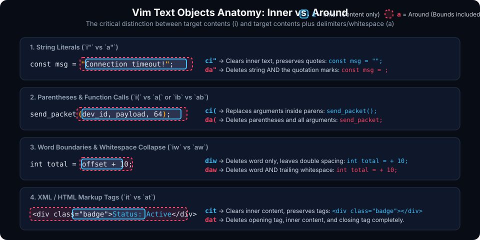
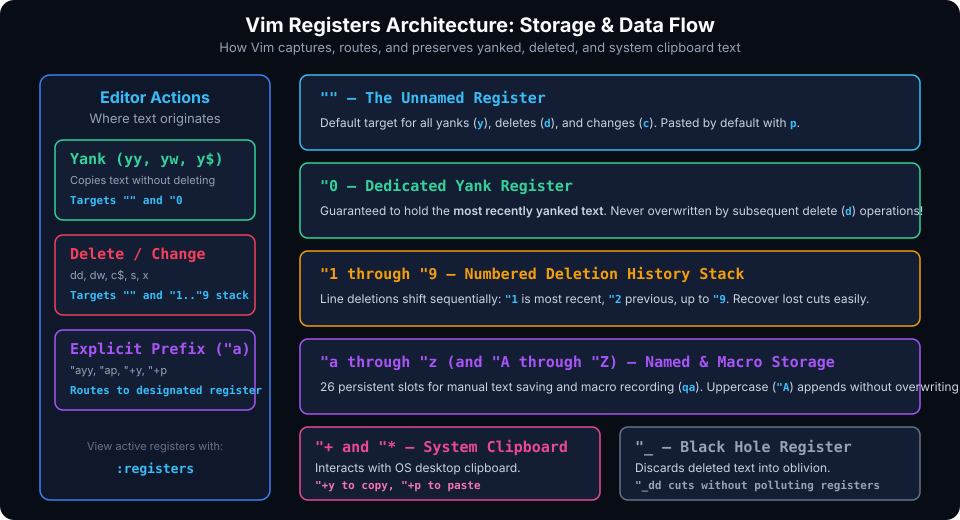

# Precision Editing, Text Objects, Registers & Repeatability

## Introduction

In modern software development, developers spend far more time reading, modifying, and refactoring existing code than typing new lines from scratch. While novice programmers edit text one character at a time using backspace and arrow keys, experienced Vim practitioners think and manipulate code at the level of syntactic constructs: **words**, **quotes**, **parenthesized arguments**, **HTML tags**, and **code blocks**.

This chapter explores Vim's most potent productivity engines:
1. **Text Objects**: Operating semantically on structured chunks of code without moving the cursor to delimiters.
2. **The Repeat Cycle (`.`)**: Executing micro-refactoring pipelines with single keystrokes.
3. **Advanced Registers**: Routing yanks, deletions, and system clipboard data across 36 distinct in-memory registers.
4. **Visual Block Column Operations**: Precision columnar editing, mass commenting, and data alignment.

---

## Mastering Vim Text Objects

Text objects allow you to target structural code elements regardless of where the cursor currently rests inside that element. Unlike basic motions (such as `w` or `$`), which simply move the cursor from point A to point B, text objects define a closed range around the current syntactic token.



### The Anatomy: Inner (`i`) vs. Around (`a`)

Every text object is invoked with a 2-character mnemonic:
- **`i` (Inner)**: Targets solely the payload/contents, strictly preserving the bounding quotation marks, brackets, braces, or whitespace.
- **`a` (Around / All)**: Targets the payload **and** its surrounding delimiters or trailing whitespace.

### Text Objects Reference Matrix

| Key | Object Type | Target Scope | Example with `ci...` or `da...` |
| :--- | :--- | :--- | :--- |
| `iw` | Inner Word | Letters/numbers of current word | `diw` deletes word without removing trailing space |
| `aw` | Around Word | Current word plus trailing whitespace | `daw` deletes word and collapses adjacent spacing |
| `iW` / `aW` | Inner/Around WORD | Non-whitespace chunk (including symbols) | Useful for paths like `/etc/nginx/nginx.conf` |
| `i"` / `a"` | Double Quotes | Content inside `"..."` / Content + `""` | `ci"` empties quote string and enters Insert mode |
| `i'` / `a'` | Single Quotes | Content inside `'...'` / Content + `''` | `ci'` clears char/string in single quotes |
| `i\`` / `a\`` | Backticks | Content inside \`...\` / Content + \`\` | Crucial for Markdown code spans & JS template strings |
| `i(` / `a(` | Parentheses | Arguments inside `(...)` / Parens + args | Also aliases `ib` and `ab` (**b**lock) |
| `i[` / `a[` | Square Brackets | Elements inside `[...]` / Brackets + elements | Array indexes and slice expressions |
| `i{` / `a{` | Curly Braces | Statements inside `{...}` / Braces + body | Also aliases `iB` and `aB` (curly **B**lock) |
| `i<` / `a<` | Angle Brackets | Elements inside `<...>` / Brackets + body | C++ templates `std::vector<int>` or generics |
| `it` / `at` | Markup Tags | Body between `<tag>...</tag>` / Entire tag pair | Indispensable for HTML, XML, JSX, TSX |
| `is` / `as` | Sentences | A grammatical sentence ending in `.`, `?`, `!` | Prose and documentation editing |
| `ip` / `ap` | Paragraphs | Blank-line-delimited block of text | Refactoring paragraph blocks or comment blocks |

### Practical Refactoring Examples with Text Objects

#### 1. Modifying Function Arguments
Given:
```c
int status = transmit_frame(device_handle, buffer_ptr, timeout_ms);
```
- Cursor on `buffer_ptr`:
  - Pressing `ci(` deletes all arguments, leaving `int status = transmit_frame();` in Insert mode.
  - Pressing `da(` deletes arguments and parens, leaving `int status = transmit_frame;`.

#### 2. Cleaning HTML / JSX Markup
Given:
```html
<button class="btn btn-primary" onclick="submit()">Confirm Order</button>
```
- Cursor on `Confirm Order`:
  - `cit` $\rightarrow$ Clears text inside tag: `<button class="btn btn-primary" onclick="submit()"></button>`.
  - `dat` $\rightarrow$ Deletes the entire `<button>...</button>` element from the document.

---

## The Repeat Cycle: The Power of the Dot Command (`.`)

In Vim, the **Dot command (`.`)** repeats the **last single change** made in the buffer. A "change" is defined as any operation from the moment you leave Normal mode or issue an operator until you return to Normal mode.

```
+-------------------------------------------------------+
|  1. Position cursor on target                         |
|  2. Execute change (e.g. `cw` or `ci"` or `x` or `dd`)|
|  3. Return to Normal mode (<Esc>)                     |
|  4. Jump to next target (e.g. `n` or `;` or `j`)      |
|  5. Press `.` to repeat change instantly!             |
+-------------------------------------------------------+
```

### The "One Keystroke per Action" Ideal
Consider replacing multiple variable names throughout a function:
1. Search for target variable: `/old_name<Enter>`.
2. Change the word: `cw` $\rightarrow$ type `new_name` $\rightarrow$ `<Esc>`.
3. Jump to next occurrence: Press `n`.
4. Replace: Press `.`.
5. Jump again: Press `n`.
6. Skip an occurrence? Just press `n` without pressing `.`.
7. Replace another? Press `.`.

This combination of **`n` (find next)** and **`.` (repeat edit)** gives you full interactive control over refactoring faster than any GUI search-and-replace dialog.

---

## Vim Registers Architecture

When you copy (`y`), delete (`d`), or change (`c`) text in Vim, that text is preserved in an internal memory bank called a **Register**. Vim maintains 36 distinct registers.



### The Register Types

#### 1. The Unnamed Register (`""`)
Whenever you issue `d`, `c`, `s`, `x`, or `y` without specifying a register, Vim stores the text in the unnamed register. When you press `p`, Vim pastes from this register by default.
> [!WARNING]
> **The Classic Clipboard Trap**: If you yank a word with `yw`, move to another line, and delete a junk word with `dw`, your yanked text is replaced in `""` with the deleted junk word! Read below for the solution.

#### 2. The Dedicated Yank Register (`"0`)
Vim automatically routes all explicit yank operations (`y`, `yy`, `yaw`, etc.) into register `"0`. Subsequent delete (`d`) commands **never** overwrite register `"0`.
- To paste your yanked text even after deleting intermediate code:
  ```vim
  "0p
  ```

#### 3. Numbered Deletion Registers (`"1` through `"9`)
Vim maintains a stack of recent large deletions (typically full lines):
- `"1`: Holds the most recent line deletion.
- `"2`: Holds the previous deletion.
- You can cycle through your deletion history by pasting `"1p`, then pressing `u` (undo) and `.` to cycle backward through `"2`, `"3`, etc.

#### 4. Named Registers (`"a` through `"z` and `"A` through `"Z`)
You have 26 named registers to store text explicitly:
- **Save text to register `a`**:
  ```vim
  "ayw    " Yank word into register a
  "add    " Cut line into register a
  ```
- **Paste from register `a`**:
  ```vim
  "ap
  ```
- **Append to register `a` using Uppercase**:
  ```vim
  "Ayw    " Appends word to register a without clearing previous contents
  ```

#### 5. The System Clipboard Registers (`"+` and `"*"`)
To interact with other applications (VS Code, Chrome, Terminal, Slack):
- **Yank to system clipboard**:
  ```vim
  "+yy    " Copy line to system clipboard
  "+y     " (in Visual mode) Copy highlighted text to system clipboard
  ```
- **Paste from system clipboard**:
  ```vim
  "+p     " Paste system clipboard text after cursor
  ```
- `"*` register accesses the primary selection buffer on Linux X11 (middle-click buffer).

#### 6. The Black Hole Register (`"_`)
When you want to delete text without overwriting any register (including `""`):
```vim
"_dd    " Deletes line straight into oblivion
"_dw    " Deletes word without polluting clipboard
```

#### 7. The Expression Register (`"=`)
Perform inline math or evaluate Vimscript expressions directly into your document:
1. In Insert mode, press `Ctrl+r` then `=`.
2. Type `1920 / 1080 * 100` and hit `<Enter>`.
3. The calculated result is typed directly into your document!

---

## Visual Block Column Operations

Vim's Visual Block mode (`Ctrl+v`) allows you to treat text as a two-dimensional grid of cells.

### 1. Appending to the End of Multiple Uneven Lines
Suppose you have a list of definitions and need to add commas at the end of every line:
```javascript
const red = 0xFF0000
const green = 0x00FF00
const blue = 0x0000FF
```

1. Place cursor on the first line.
2. Press `Ctrl+v` (Visual Block mode).
3. Press `2j` to extend the selection down across all 3 lines.
4. Press `$` (dollar sign). Vim extends the selection to the end of each line, even though they have different lengths!
5. Press `A` (capital `A` appends to block).
6. Type `,` (comma) and hit `<Esc>`.
7. Vim appends `,` to the end of every line in the block simultaneously!

### 2. Creating Column Aligned Tables
Use `Ctrl+v` to delete or insert arbitrary rectangular blocks of whitespace to align variable names, data tables, or register addresses into neat vertical columns.

---

## Hands-On Exercises

### Exercise 1: The Precision Refactor Challenge
Open a test file `test_objects.js`:
```javascript
function send_alert(alert_type, user_record, status_code) {
    const error_log = "[FATAL_ERROR]: Unable to connect to host database server";
    console.log(error_log);
}
```

1. Move your cursor to the word `alert_type`.
2. Press `ci(` and replace the arguments with `config_payload`. Press `<Esc>`.
3. Move cursor anywhere inside `"[FATAL_ERROR]: ..."`.
4. Press `ci"` and type `[WARN]: Operation timed out`. Press `<Esc>`.
5. Move cursor to `console.log(error_log);`. Press `ci{` to empty the function body.

### Exercise 2: Surviving the Clipboard Trap
1. Create two lines:
   ```text
   important_variable_name
   delete_this_junk
   ```
2. On line 1, yank the word: `yw`.
3. Move to line 2. Delete the junk word: `dw`.
4. Try pasting with `p`. Notice you pasted `delete_this_junk`!
5. Now press `"0p`. Notice that your original yank `important_variable_name` is pasted intact!

---

## Review Questions & Self-Assessment

1. **What is the practical difference between `diw` and `daw`?**
   *Answer:* `diw` deletes only the word characters, leaving surrounding spaces. `daw` deletes the word and automatically deletes trailing whitespace, preventing double-spaces in sentences.
2. **How does register `"0` differ from the default register `""`?**
   *Answer:* Register `""` is overwritten by both yanks and deletions (`d`, `c`, `x`). Register `"0` is strictly populated by yank operations (`y`), ensuring yanked text is safe from subsequent deletions.
3. **What is the fastest way to append a semicolon `;` to 20 uneven lines?**
   *Answer:* Place cursor on line 1 $\rightarrow$ `Ctrl+v` $\rightarrow$ `19j` $\rightarrow$ `$` $\rightarrow$ `A` $\rightarrow$ `;` $\rightarrow$ `<Esc>`.
4. **How do you append yanked text to an existing named register `k` instead of replacing it?**
   *Answer:* Use the capital letter version of the register: `"Ky` will append the yanked text to register `k`.

---

##### Copyright (c) 2026 squared-studio
