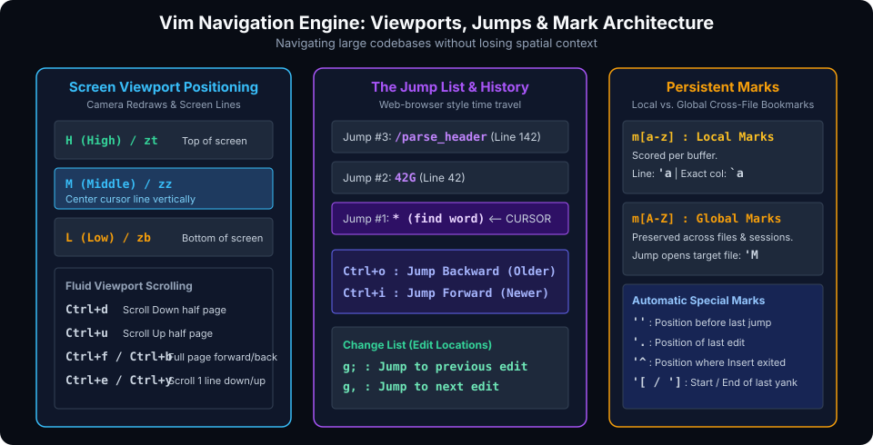

# Advanced Navigation, Search & Global Pattern Manipulation

## Introduction

As codebases scale into tens of thousands of lines across hundreds of files, basic cursor movement is wholly inadequate. High-velocity engineers do not scroll line-by-line; they navigate along semantic trajectories, project-wide search queries, jump histories, and persistent marks.

Furthermore, Vim's command-line (Ex) mode features a regular-expression search-and-replace engine combined with the legendary **Global command (`:g`)** that can transform an entire file in an instant.

This chapter covers:
1. **Screen Viewport Navigation & Fluid Scrolling**.
2. **The Jump List & Change List**: Time travel across code edits.
3. **Persistent Marks**: Local and cross-file bookmarks.
4. **Vim Regular Expressions & The Very Magic Engine (`\v`)**.
5. **The Global Command (`:g` and `:v`)**: Operating on lines matching arbitrary patterns.
6. **Project-Wide Search with `:vimgrep` and Ripgrep**.

---

## Screen Viewport Positioning & Navigation

When reading code, keeping your eyes centered on the screen avoids neck and eye strain while preserving spatial context.



### 1. Viewport Redraws (Moving the Camera)

| Command | Action | Mnemonic / Visual |
| :--- | :--- | :--- |
| `zz` | Center the screen around the cursor line | Middle of viewport |
| `zt` | Move current line to the very **T**op of viewport | **T**op line |
| `zb` | Move current line to the very **B**ottom of viewport | **B**ottom line |

### 2. Screen Boundary Motions (Moving the Cursor on Screen)

| Command | Action | Mnemonic |
| :--- | :--- | :--- |
| `H` | Jump cursor to the **H**ighest visible line on screen | **H**igh |
| `M` | Jump cursor to the **M**iddle visible line on screen | **M**iddle |
| `L` | Jump cursor to the **L**owest visible line on screen | **L**ow |

### 3. Fluid Scrolling

- `Ctrl+d` : Scroll down by half a page (**D**own).
- `Ctrl+u` : Scroll up by half a page (**U**p).
- `Ctrl+f` : Scroll forward one full page (**F**orward).
- `Ctrl+b` : Scroll backward one full page (**B**ackward).
- `Ctrl+e` : Scroll viewport down 1 line without moving cursor (**E**xtend bottom).
- `Ctrl+y` : Scroll viewport up 1 line without moving cursor.

---

## The Jump List & Change List

Vim maintains internal stacks recording where your cursor has been and where changes were applied.

### 1. The Jump List (Browser History for Code)
Whenever you make a major movement (such as `/search`, `G`, `gg`, `*`, or `42G`), Vim records the jump in the **Jump List**.

- **Jump Backward in History**: Press `Ctrl+o` (think "Old").
- **Jump Forward in History**: Press `Ctrl+i` (or `<Tab>`).
- **View Entire Jump History**: Type `:jumps`.

> [!TIP]
> **Code Exploration Pattern:** Jump into a function definition using `*` or a tag search; review the logic; then instantly press `Ctrl+o` to snap straight back to where you were originally working!

### 2. The Change List
Vim automatically records every location in the file where text was modified or inserted.

- **Jump to Previous Edit Location**: Press `g;`
- **Jump to Next Edit Location**: Press `g,`
- **View Change Locations**: Type `:changes`.

---

## The Marks System: Bookmarking Code

Marks allow you to set named anchors in your codebase and return to them with millisecond speed.

### 1. Local Buffer Marks (`m[a-z]`)
Lowercase marks are unique to the current buffer:
- `ma` : Mark current position as anchor `a`.
- `'a` : Jump to the **start of the line** of mark `a`.
- \`a : Jump to the **exact line and column** of mark `a`.

### 2. Global Cross-File Marks (`m[A-Z]`)
Uppercase marks persist across different files and even across Vim restarts!
- Open `/etc/nginx/nginx.conf` $\rightarrow$ press `mC` (mark Config).
- Open `/var/log/syslog` $\rightarrow$ press `mL` (mark Log).
- Jump instantly from any file in your project directly to `nginx.conf` at mark `C`:
  ```vim
  'C
  ```

### 3. Automatic Special Marks
| Mark | Target Location |
| :--- | :--- |
| `''` | Position before the latest jump (allows toggling back and forth) |
| `'.` | Exact location of the last change made in the buffer |
| `'^` | Exact location where Insert mode was last exited |
| `'[` and `']` | Start and end positions of the last yanked or changed text block |

---

## Pattern Matching with Vim Regular Expressions

Vim's search engine is exceptionally fast, but traditional vi regex requires heavy backslash escaping for grouping and operators (e.g. `\(\)` and `\+`). Vim provides the **Very Magic (`\v`)** flag to enable standard modern regex syntax (like Perl, Python, and PCRE).

### Comparing Normal Regex vs Very Magic (`\v`)

| Purpose | Default Vim Regex | Very Magic Mode (`\v`) |
| :--- | :--- | :--- |
| Match 1 or more digits | `\/\d\+` | `/\v\d+` |
| Capture grouping | `\/\(foo\|bar\)` | `/\v(foo|bar)` |
| Match exact word boundary | `/\<status\>` | `/\v<status>` |
| Match IP address pattern | `/\d\{1,3}\.\d\{1,3}\.\d\{1,3}\.\d\{1,3}` | `/\v\d{1,3}(\.\d{1,3}){3}` |

### Common Regex Metacharacters in Vim
- `\d` : Any digit `[0-9]` (`\D` for non-digit)
- `\s` : Whitespace character (space or tab) (`\S` for non-whitespace)
- `\w` : Word character `[a-zA-Z0-9_]` (`\W` for non-word)
- `\<` and `\>` : Start and end of word boundary
- `^` and `$` : Start and end of line
- `.` : Any single character (except newline)

---

## The Ex Substitution Command & The Global (`:g`) Command

### 1. Advanced Substitution Syntax
```vim
:[range]s/{pattern}/{replacement}/{flags}
```

#### Range Specifiers
- `%` : Entire buffer (equivalent to `1,$`).
- `.` : Current line.
- `.,+10` : Current line through next 10 lines.
- `'<,'>` : Current Visual selection (automatically inserted when pressing `:` while text is visually highlighted).

#### Flags
- `g` : Replace all occurrences on each line (not just the first).
- `c` : Prompt for confirmation before each replacement.
- `i` : Case-insensitive search.
- `I` : Strict case-sensitive search.

### 2. The Power of the Global Command (`:g` and `:v`)

The Global command (`:g`) is one of Vim's crowning superpowers: it runs an Ex command on every line that matches a regular expression.

```vim
:[range]g/{pattern}/{command}
```

#### Practical Examples of `:g`:

1. **Delete all blank lines**:
   ```vim
   :g/^\s*$/d
   ```
2. **Delete all debug lines / comments**:
   ```vim
   :g/console\.log/d
   :g/^\s*#/d
   ```
3. **Move all matching lines to the bottom of the file**:
   ```vim
   :g/ERROR/m$
   ```
4. **Copy all function signatures to another register or scratch area**:
   ```vim
   :g/^function/y A
   ```
5. **Inverse Global (`:v` or `:g!` - Non-Matching Lines)**:
   Delete all lines that do NOT contain the word `export`:
   ```vim
   :v/export/d
   ```

---

## Project-Wide Search: `:vimgrep` & Ripgrep

### 1. Built-in Search: `:vimgrep`
Search across files without leaving Vim and load all results into the **Quickfix list**:

```vim
:vimgrep /parse_packet/ src/**/*.c
:copen          " Open quickfix window to view results
:cnext          " Jump to next match
:cprev          " Jump to previous match
```

### 2. High-Speed Project Search with Ripgrep (`rg`)
Add this to your `~/.vimrc` to make Vim use Ripgrep as its backend search tool:

```vim
if executable('rg')
    set grepprg=rg\ --vimgrep\ --no-heading\ --smart-case
    set grepformat=%f:%l:%c:%m
endif
```

Now run instant searches across large codebases:
```vim
:grep "TODO:"
:copen
```

---

## Hands-On Exercises

### Exercise 1: Jump List & Mark Navigation
1. Open any source code file with 100+ lines.
2. Jump to line 10 with `10G`. Set mark `a`: `ma`.
3. Jump to the bottom of the file with `G`. Set mark `b`: `mb`.
4. Search for any word: `/return`.
5. Press `Ctrl+o` repeatedly to step backward through your jumps.
6. Press `Ctrl+i` to step forward.
7. Snap back to mark `a` instantly by typing `'a`.

### Exercise 2: The Global Command Clean-Up
Create a dirty test file `log_sample.txt`:
```text
[INFO] System initialized
// Debug comment 1
[INFO] Loading drivers
// Debug comment 2

[ERROR] Disk timeout on /dev/sda1
// Debug comment 3
[INFO] Retrying connection
```

1. Delete all empty lines:
   ```vim
   :g/^\s*$/d
   ```
2. Delete all lines beginning with `//`:
   ```vim
   :g/^\/\//d
   ```
3. Inspect your cleaned file!

---

## Review Questions & Self-Assessment

1. **How do you center the screen on the cursor after a long jump?**
   *Answer:* Press `zz`.
2. **What is the difference between mark `'a` and mark `mA`?**
   *Answer:* `'a` (lowercase) is local to the current buffer. `mA` (uppercase) is global and persists across different files and editor sessions.
3. **What is the purpose of the `\v` flag in Vim search queries?**
   *Answer:* `\v` enables "Very Magic" mode, allowing standard modern regular expression syntax without excessive backslash escaping for grouping `()` and quantifiers `+`, `?`, `{}`.
4. **What does the command `:v/pattern/d` do?**
   *Answer:* `:v` is the inverse of `:g`. It deletes all lines that do **NOT** match `pattern`.

---

##### Copyright (c) 2026 squared-studio
