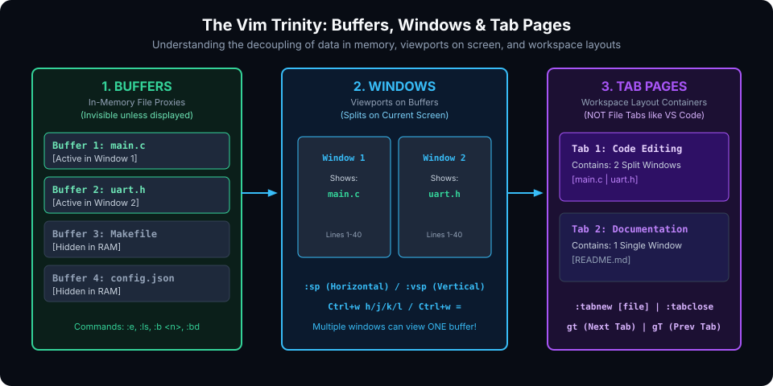

# Multi-File Architecture: Buffers, Windows, Tabs & Quickfix

## Introduction

One of the most persistent misconceptions among newcomers transitioning to Vim from modern graphical IDEs (such as VS Code or Sublime Text) is how multi-file workflows operate. In graphical editors, every opened file is represented by a GUI tab at the top of the window. When developers attempt to treat Vim tabs in the same manner, they quickly encounter friction and confusion.

Vim strictly decouples **in-memory data**, **screen viewports**, and **workspace layout containers**:
1. **Buffers**: The in-memory proxy of a file.
2. **Windows**: A viewport onto a buffer.
3. **Tab Pages**: A collection of window layouts.
4. **The Quickfix List**: A project-wide navigation queue for compiler diagnostics and search hits.



---

## Buffers: The In-Memory File Proxy

A **buffer** is a file loaded into memory for editing. When you launch `vim file1.c file2.c file3.c`, Vim loads all three files into separate buffers. If you only see one window, the other two buffers remain loaded in RAM, waiting to be summoned.

### 1. The Buffer Lifecycle

A buffer can exist in one of three primary states:
- **Active**: Displayed in at least one window on screen.
- **Hidden**: Not currently displayed in any visible window, but retains all undo/redo history and unsaved modifications in RAM.
- **Inactive / Unloaded**: Path is tracked in the buffer list, but its textual content is not loaded in RAM.

> [!IMPORTANT]
> **The `set hidden` Directive**:
> By default, legacy vi forbids switching buffers if the current buffer contains unsaved changes. To enable smooth buffer switching without being forced to write to disk every time, add this to your `~/.vimrc`:
> ```vim
> set hidden
> ```

### 2. Core Buffer Commands

| Command | Action |
| :--- | :--- |
| `:ls` or `:buffers` | List all buffers in memory with their status flags |
| `:e {filename}` | Load `{filename}` into a new or existing buffer |
| `:b {n}` | Switch directly to buffer number `{n}` (e.g. `:b 2`) |
| `:b {partial_name}` | Switch to buffer matching partial filename (e.g. `:b uart`) |
| `:bn` or `:bnext` | Cycle forward to the next buffer |
| `:bp` or `:bprev` | Cycle backward to the previous buffer |
| `:b#` or `Ctrl+6` (`Ctrl+^`) | Instant toggle between the current and previous (alternate) buffer |
| `:bd` or `:bdelete` | Unload/Delete current buffer from memory |
| `:bd!` | Force-delete buffer, discarding unsaved modifications |
| `:bufdo {cmd}` | Execute an Ex command across **all** active buffers in memory |

#### Decoding the `:ls` Buffer Flags
When you run `:ls`, Vim displays a list like:
```text
  1 #h  "main.c"       line 12
  2 %a+ "uart.c"       line 45
  3     "config.h"     line 1
```
- `%` : Buffer displayed in current active window.
- `#` : Alternate buffer (toggled with `Ctrl+^`).
- `a` : Active buffer (visible in some window).
- `h` : Hidden buffer (in memory, but not currently visible).
- `+` : Buffer contains modified, unsaved changes.
- `=` : Read-only buffer.

---

## Windows & Splits: Viewports on Buffers

A **window** is a viewport onto a buffer. You can split your screen into multiple windows horizontally, vertically, or in complex grid matrices.

A crucial design aspect of Vim is that **multiple windows can display the same underlying buffer**. For example, you can split a 3,000-line file vertically: Window 1 displays the struct definitions at line 40, while Window 2 displays the implementation at line 2,500. Editing text in one window updates the other window instantaneously in real time!

### 1. Creating Window Splits

| Command | Key Equivalent | Action |
| :--- | :--- | :--- |
| `:split [file]` or `:sp` | `Ctrl+w s` | Split window horizontally |
| `:vsplit [file]` or `:vsp`| `Ctrl+w v` | Split window vertically |
| `:new` | `Ctrl+w n` | Create horizontal split with new empty buffer |
| `:vnew` | N/A | Create vertical split with new empty buffer |

### 2. Navigating Between Splits

All window management commands begin with the **`Ctrl+w`** prefix (think "Window"):

- `Ctrl+w h` : Focus window to the **left**
- `Ctrl+w j` : Focus window **below**
- `Ctrl+w k` : Focus window **above**
- `Ctrl+w l` : Focus window to the **right**
- `Ctrl+w w` : Cycle focus to next window sequentially
- `Ctrl+w p` : Snap focus to the **previous** window

### 3. Moving and Rearranging Splits

- `Ctrl+w r` : Rotate windows clockwise.
- `Ctrl+w R` : Rotate windows counter-clockwise.
- `Ctrl+w x` : Exchange current window with adjacent sibling window.
- `Ctrl+w H` : Move current window to the **far left** (full height).
- `Ctrl+w J` : Move current window to the **very bottom** (full width).
- `Ctrl+w K` : Move current window to the **very top** (full width).
- `Ctrl+w L` : Move current window to the **far right** (full height).

### 4. Resizing Splits

- `Ctrl+w =` : Equalize heights and widths of all split windows.
- `Ctrl+w +` / `Ctrl+w -` : Increase / decrease current window height.
- `Ctrl+w >` / `Ctrl+w <` : Increase / decrease current window width.
- `:resize 25` : Set current window height to exactly 25 lines.
- `:vertical resize 80` : Set current window width to exactly 80 columns.

### 5. Closing Splits

- `Ctrl+w c` or `:close` : Close active window (buffer remains safely in memory).
- `Ctrl+w o` or `:only` : Close **all other** windows, maximizing current window.

---

## Tab Pages: Workspace Layout Containers

In Vim, a **Tab Page** is not a file; it is an isolated **workspace layout container** that holds an arbitrary arrangement of split windows.

Think of tab pages like virtual desktops:
- **Tab 1**: Split screen showing `main.c` and `uart.h` (editing logic).
- **Tab 2**: Full-screen window showing `test_runner.py` (running tests).
- **Tab 3**: Split screen showing documentation and configuration files.

### Tab Commands

| Command | Key Equivalent | Action |
| :--- | :--- | :--- |
| `:tabnew [file]` | N/A | Open a new tab page (optionally loading `{file}`) |
| `:tabclose` or `:tabc` | N/A | Close current tab page and its windows |
| `:tabonly` or `:tabo` | N/A | Close all tabs except the current active tab |
| `:tabnext` | `gt` | Switch to the next tab page |
| `:tabprev` | `gT` | Switch to the previous tab page |
| `:tabmove {n}` | N/A | Move current tab to index `{n}` |
| `:tabdo {cmd}` | N/A | Execute Ex command across all open tabs |

---

## The Quickfix & Location Lists

The **Quickfix list** is a global data structure that stores a list of file positions, typically generated by:
- Compilation errors from `:make`
- Search results from `:vimgrep` or `:grep` (Ripgrep)
- Linter output from static analysis tools

### 1. Quickfix Commands

```vim
:vimgrep /TODO/ src/**/*.c   " Populate quickfix list with matches
:copen                       " Open the quickfix navigation window
:cclose                      " Close the quickfix window
:cnext (or :cn)              " Jump to next match in quickfix
:cprev (or :cp)              " Jump to previous match in quickfix
:cfirst                      " Jump to first match
:clast                       " Jump to last match
```

### 2. Location Lists (Window-Local Quickfix)
While the Quickfix list is global to the entire Vim instance, a **Location list** is local to a specific window. Commands use the `:l` prefix instead of `:c`:
- `:lopen`, `:lclose`, `:lnext`, `:lprev`.

### 3. Project-Wide Refactoring with `:cdo` and `:cfdo`

The `:cdo` command executes an Ex command on every entry in the Quickfix list:

```vim
" 1. Search for old variable name across entire project
:grep "legacy_handler" src/

" 2. Replace with new name and save across all matching files in one shot!
:cdo s/legacy_handler/modern_handler/g | update
```
*(This single pipeline executes a multi-file refactor across hundreds of files without opening them manually!)*

---

## Hands-On Exercises

### Exercise 1: Multi-Split Window Management
1. Launch Vim with three files:
   ```bash
   vim fileA.txt fileB.txt fileC.txt
   ```
2. Split window vertically: `:vsp`.
3. In the new right window, display `fileB.txt`: `:b fileB.txt`.
4. Split the right window horizontally: `Ctrl+w s`.
5. In the bottom-right window, display `fileC.txt`: `:b fileC.txt`.
6. Equalize all split dimensions: `Ctrl+w =`.
7. Move the bottom-right window to the far left as a full-height split: `Ctrl+w H`.
8. Focus on window A and close all other windows: `Ctrl+w o`.

### Exercise 2: Quickfix Project Search Pipeline
1. In a directory with source files, run:
   ```vim
   :vimgrep /include/ *
   ```
2. Open the quickfix window: `:copen`.
3. Navigate up and down using standard `j` and `k` keys. Press `<Enter>` on any row to jump directly to that line in the corresponding file!
4. Jump between matches from Normal mode using `:cn` and `:cp`.

---

## Review Questions & Self-Assessment

1. **What is the fundamental difference between a Buffer, a Window, and a Tab in Vim?**
   *Answer:* A buffer is the in-memory representation of a file. A window is a viewport on a buffer. A tab page is a container that organizes a specific arrangement of split windows.
2. **Why should you add `set hidden` to your `.vimrc`?**
   *Answer:* `set hidden` allows you to navigate away from modified buffers without forcing you to write them to disk or discard edits first.
3. **How do you quickly toggle between your current file and the last file you edited?**
   *Answer:* Press `Ctrl+6` (or `Ctrl+^`, or type `:b#`).
4. **What does the command `:cdo s/foo/bar/g | update` accomplish?**
   *Answer:* It executes a substitution replacing `foo` with `bar` on every line matching the Quickfix list across all affected files and automatically writes the changes to disk.

---

##### Copyright (c) 2026 squared-studio
