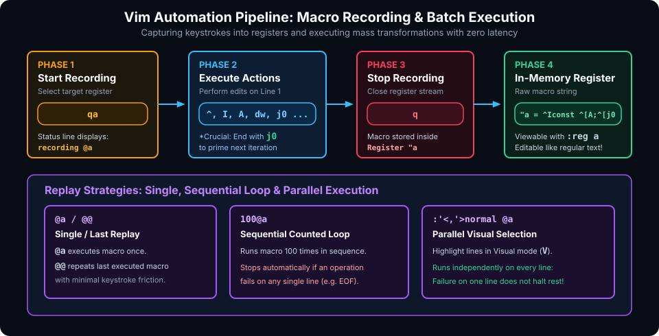

# Automation, Macros, Folding & Custom Scripting

## Introduction

Vim's true strength is not merely its keyboard ergonomics or modal speed; it is its capacity for **computational text processing**. Rather than manually performing repetitive edits across dozens of files, Vim empowers you to record, automate, filter, script, and transform data with unmatched precision.

This chapter covers:
1. **The Macro Automation Engine**: Recording, editing, and parallel execution.
2. **Code Folding**: Taming multi-thousand-line source files.
3. **External Shell Pipelines & Filters**: Transforming buffers using Unix utilities (`jq`, `sort`, `clang-format`).
4. **Vimscript Essentials**: Crafting functions, mappings, and autocommands in `.vimrc`.
5. **The Modern Ecosystem**: Plugin management, Language Server Protocol (LSP), and the Neovim revolution.

---

## The Macro Automation Engine

A macro is a recorded sequence of keystrokes stored directly inside an alphanumeric register. Because macros are stored as raw text in standard registers (`"a` to `"z`), they can be inspected, replayed, chained, and even edited like standard text!



### 1. The Anatomy of Recording a Macro

To record a robust, error-free macro, follow this sequence:

1. **Park the cursor at a predictable origin**:
   Move to the start of the target line: press `0` or `^`.
2. **Start recording into register `a`**:
   Press `qa`. The status line indicates `recording @a`.
3. **Execute the editing actions**:
   Perform your modifications.
4. **Prime the cursor for the next iteration**:
   *Golden Rule*: Always conclude your macro by moving to the start of the next line (e.g., press `j0`).
5. **Stop recording**:
   Press `q`.

### 2. Replay Strategies: Sequential vs. Parallel

#### Strategy A: Single & Sequential Counted Replay
- Replay once: `@a`
- Repeat the last executed macro: `@@`
- Run 50 times in sequence: `50@a`

> [!WARNING]
> **The Sequential Loop Limitation**: In a counted execution (such as `50@a`), if an action inside the macro fails on line 12 (for instance, an inline find `f;` fails because line 12 lacks a semicolon), the entire execution halts immediately. Lines 13 through 50 will not run!

#### Strategy B: Parallel Execution on Visual Selections (Recommended)
To run a macro reliably across multiple lines regardless of errors on individual lines:

1. Highlight all target lines in Visual Line mode: `V` followed by `G` (or `10j`).
2. Type:
   ```vim
   :normal @a
   ```
   *(Vim prompts with `:'<,'>normal @a`)*
3. Hit `<Enter>`. Vim executes the macro **independently** on every selected line. If line 12 fails, Vim logs the error for that line and proceeds to execute lines 13 through 50 without interruption!

### 3. Inspecting and Editing Recorded Macros

Because macros live in regular registers, you can paste, modify, and re-yank them:

1. Create a new line and paste the contents of register `a`:
   ```vim
   "ap
   ```
2. You will see the literal keystrokes displayed (e.g., `^Iconst ^[A;^[j0`).
3. Edit the text using standard Vim commands (for example, change `const` to `let`).
4. Yank the modified keystrokes back into register `a`:
   ```vim
   0"ay$
   ```
5. Your macro is now updated and ready to execute with `@a`!

### 4. Appending to an Existing Macro
If you forgot a step while recording macro `a`, you do not need to re-record from scratch:
- Press `qA` (capital `A`). Vim reopens register `a` in append mode. Record the missing steps and press `q`.

---

## Code Folding: Taming Large Files

Code folding hides sections of code under collapsible headers, allowing you to survey architecture and navigate functions without visual clutter.

### 1. Fold Methods (`foldmethod`)

Configure your preferred folding strategy in `~/.vimrc`:
```vim
set foldmethod=indent   " Fold lines based on indentation levels
set foldlevel=99        " Start with all folds expanded when opening a file
```

Available methods:
- `manual` : Folds created manually with `zf`.
- `indent` : Folds determined automatically by indentation depth (ideal for Python, YAML).
- `syntax` : Folds defined by syntax highlighting rules (functions, classes, structs).
- `marker` : Folds delimited by explicit markers like `{{{` and `}}}`.

### 2. Essential Fold Commands

| Command | Action | Mnemonic |
| :--- | :--- | :--- |
| `zf{motion}` | Create a manual fold over `{motion}` (e.g. `zf15j` or `zfa{`) | **F**old create |
| `zo` | **O**pen fold under cursor | **O**pen |
| `zc` | **C**lose fold under cursor | **C**lose |
| `za` | Toggle fold under cursor (Open $\leftrightarrow$ Closed) | **A**lternate |
| `zR` | Open all folds in the entire file | **R**educe folding |
| `zM` | Close all folds in the entire file | **M**ore folding |
| `zd` | Delete manual fold at cursor | **D**elete fold |

---

## External Shell Pipelines & Buffer Filtering

Vim integrates seamlessly with standard Unix command-line utilities. You can execute shell commands, read external command output directly into the buffer, or filter lines through compilers, linters, and formatters.

### 1. Running Shell Commands
- Run a command and return to Vim:
  ```vim
  :!git status
  :!make test
  ```
- Open an interactive terminal emulator inside a Vim split window:
  ```vim
  :terminal
  ```

### 2. Reading Command Output into the Buffer
Insert the output of a command directly under the current line:
```vim
:r !date
:r !git rev-parse HEAD
:r !curl -s https://api.github.com/zen
```

### 3. Filtering Buffer Text through External Binaries

The syntax `:[range]!{cmd}` sends the specified lines to the standard input (`stdin`) of `{cmd}` and replaces them with its standard output (`stdout`):

#### Format Raw JSON with `jq`:
```vim
:%!jq .
```

#### Alphabetically Sort and Deduplicate Lines:
Highlight lines in Visual mode (`V`), then run:
```vim
:'<,'>!sort -u
```

#### Automatically Format C / C++ with `clang-format`:
```vim
:%!clang-format
```

---

## Vimscript & Custom Configuration Essentials

Vim includes an embedded scripting language (**Vimscript**) that governs keymappings, options, and event hooks.

### 1. The Mapping Hierarchy: Recursive vs. Non-Recursive

When defining custom shortcuts, **always prefer non-recursive mappings (`noremap`)** to prevent infinite execution loops:

- `nnoremap` : Normal mode non-recursive mapping
- `inoremap` : Insert mode non-recursive mapping
- `vnoremap` : Visual mode non-recursive mapping

```vim
" Set spacebar as leader
let mapleader = " "

" Press <leader>w to save file
nnoremap <leader>w :w<CR>

" Toggle relative line numbers on/off
nnoremap <leader>n :set relativenumber!<CR>
```

### 2. Event Automation with Autocommands (`autocmd`)

Autocommands execute Vim commands automatically when specific editor events trigger (such as opening a file, saving, or entering a buffer):

```vim
augroup ProjectSettings
    autocmd!
    " Set tab width to 2 for JavaScript/TypeScript, but 4 for Python
    autocmd FileType javascript,typescript setlocal ts=2 sw=2 et
    autocmd FileType python setlocal ts=4 sw=4 et

    " Automatically strip trailing whitespace on file save
    autocmd BufWritePre * %s/\s\+$//e
augroup END
```

### 3. Custom Vimscript Function Example

```vim
function! ToggleLineNumbering()
    if &relativenumber
        set norelativenumber
        set number
    else
        set relativenumber
    endif
endfunction

nnoremap <F3> :call ToggleLineNumbering()<CR>
```

---

## The Modern Ecosystem: Neovim, Plugins & LSP

Over the past decade, the Vim landscape has evolved significantly with the advent of **Neovim** (`nvim`), an aggressive modern fork of Vim featuring:
1. **Lua Scripting Engine**: First-class support for fast, modern Lua scripts instead of legacy Vimscript.
2. **Built-in Language Server Protocol (LSP)**: Native auto-completion, diagnostics, and refactoring without heavy third-party IDE plugins.
3. **Treesitter Integration**: Concrete syntax tree parsing for instant, error-resilient syntax highlighting and structural code motions.

### Popular Modern Plugin Managers
- **Vim-Plug** (Vim & Neovim): Ultra-fast, minimal parallel installer.
- **Lazy.nvim** (Neovim): Modern plugin manager featuring lazy loading, lockfile generation, and high performance.

---

## Hands-On Exercises

### Exercise 1: The Macro Transformation Lab
Create a raw CSV text file:
```text
101, Alice Smith, Engineering
102, Bob Jones, Marketing
103, Charlie Brown, Operations
```
And transform every line into a JSON object:
```json
{"id": 101, "name": "Alice Smith", "dept": "Engineering"},
```

1. Move cursor to line 1, column 0: `0`.
2. Press `qa` to start recording.
3. Transform line 1 into valid JSON using `I`, `A`, and substitution.
4. Conclude with `j0`.
5. Press `q` to stop recording.
6. Replay across lines 2 and 3 using `2@a` or Visual Line `V` $\rightarrow$ `:'<,'>normal @a`.

### Exercise 2: Pipeline Filtering with Unix Tools
1. In Vim, create an unordered list of random integers:
   ```text
   42
   10
   99
   10
   3
   ```
2. Sort and deduplicate them in place:
   ```vim
   :%!sort -n | uniq
   ```
3. Inspect your sorted, deduplicated buffer!

---

## Review Questions & Self-Assessment

1. **Why should macros always conclude with a motion like `j0` or `j^`?**
   *Answer:* Concluding on the start of the subsequent line ensures the cursor is parked at a predictable, consistent state for the next replay iteration.
2. **Why is `:'<,'>normal @a` preferred over `100@a` for batch processing?**
   *Answer:* `:'<,'>normal @a` runs independently across each highlighted line. If an error occurs on one line, Vim still completes execution on all remaining lines, unlike `100@a` which halts completely upon the first failure.
3. **What is the difference between `noremap` and `map` in `.vimrc`?**
   *Answer:* `noremap` is non-recursive, preventing keymapping loops where a custom binding re-triggers other mapped keys. `map` allows recursive expansion and can cause infinite loops.
4. **How do you format an entire buffer using an external command like `prettier` or `jq`?**
   *Answer:* Run `:%!{cmd}`, for example `:%!jq .` or `:%!prettier --stdin-filepath %`.

---

##### Copyright (c) 2026 squared-studio
