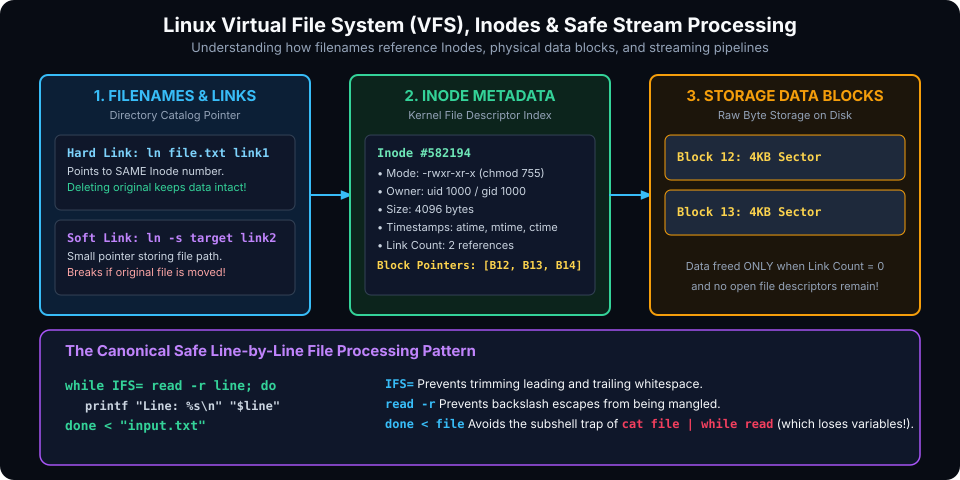

# Working with Files and Streams in Bash

## Introduction

In Linux and Unix environments, the operating system adheres to the foundational philosophy: **"Everything is a file"**. Beyond standard text files and source code, hardware devices (`/dev/sda`), system information (`/proc/cpuinfo`), inter-process communication sockets, and named pipes are all represented within the filesystem tree.

For automation engineers, systems administrators, and verification teams, manipulating files and data streams reliably is the bread and butter of Bash scripting. However, naive scripts frequently fall victim to treacherous edge cases: filenames containing whitespace or newlines, race conditions during parallel executions, subshell variable loss during stream reads, and permission vulnerabilities.

This chapter covers:
1. **The Linux Virtual File System (VFS), Inodes & Link Architecture**.
2. **Comprehensive File Test Operators & Comparisons**.
3. **High-Performance Stream Processing & The Subshell Loop Trap**.
4. **Advanced Directory Traversal with `find` and Zero-Byte Delimiters**.
5. **Permissions, Security & `umask` Discipline**.
6. **Concurrency, Safe Temporary Files & File Locking with `flock`**.

---

## The Linux Virtual File System (VFS) & Inodes Architecture

To interact with files safely, you must understand how Linux maps directory paths to physical disk sectors.



### 1. Inodes: The Identity of a File

In Unix filesystems (such as ext4, XFS, and ZFS), a file's name is merely an entry in a directory catalog that maps a string to an integer known as an **Inode number**. The Inode data structure stores all metadata about the file:
- File type and permissions (`-rwxr-xr-x`)
- Owner User ID (`UID`) and Group ID (`GID`)
- File byte size
- Timestamps: Access time (`atime`), Modification time (`mtime`), and Inode Change time (`ctime`)
- Link counter (how many filenames reference this Inode)
- Pointers to the physical data blocks on disk

> [!NOTE]
> The Inode does **not** store the file name or file contents. Filenames reside in directory data blocks.

To inspect the Inode number of any file:
```bash
ls -li example.txt
# Output: 582194 -rw-r--r-- 1 user user 4096 Nov 10 00:00 example.txt
```

### 2. Hard Links vs. Soft (Symbolic) Links

Understanding links prevents catastrophic data loss during cleanup routines:

| Feature | Hard Link (`ln target link`) | Soft / Symbolic Link (`ln -s target link`) |
| :--- | :--- | :--- |
| **Inode** | Shares the **exact same Inode** as original | Has its **own new Inode** pointing to target path |
| **Data Blocks** | Shares identical data blocks | Stores path string pointing to target file |
| **Cross-Filesystem** | Cannot span across different mount points | Can cross different drives, partitions, and networks |
| **Directories** | Cannot link directories (prevents infinite cycles)| Can link directories (`ln -s /var/log ./logs`) |
| **Target Deletion**| Data remains accessible until link count drops to 0 | Becomes a **broken symlink** (points to non-existent path) |

```bash
# Check if two paths point to the exact same physical file
if [ "file1.txt" -ef "file2.txt" ]; then
    echo "file1 and file2 share the same Inode!"
fi
```

---

## Comprehensive File Test Operators

Always prefer the extended test construct `[[ ... ]]` over legacy `[ ... ]` when evaluating file properties. It prevents syntax crashes when variable paths contain spaces.

### File Type Tests
- `[[ -e "$path" ]]` : Path exists (file, directory, socket, device, etc.).
- `[[ -f "$path" ]]` : Path exists and is a **regular file** (not a directory, socket, or device).
- `[[ -d "$path" ]]` : Path exists and is a **directory**.
- `[[ -L "$path" ]]` or `[[ -h "$path" ]]` : Path is a **symbolic link**.
- `[[ -s "$path" ]]` : File exists and has a size **greater than zero bytes** (non-empty).
- `[[ -p "$path" ]]` : Path is a named pipe (**FIFO**).
- `[[ -S "$path" ]]` : Path is a network or Unix domain **socket**.
- `[[ -b "$path" ]]` : Path is a **block device** (e.g. `/dev/sda`).
- `[[ -c "$path" ]]` : Path is a **character device** (e.g. `/dev/urandom`).

### Permission & Ownership Tests
- `[[ -r "$path" ]]` : Readable by current process user.
- `[[ -w "$path" ]]` : Writable by current process user.
- `[[ -x "$path" ]]` : Executable (or searchable, for directories) by current user.
- `[[ -O "$path" ]]` : Owned by effective UID of current user.
- `[[ -G "$path" ]]` : Owned by effective GID of current user.

### Age & Timestamp Comparisons
- `[[ "$file1" -nt "$file2" ]]` : `file1` is **newer than** `file2` (based on `mtime`).
- `[[ "$file1" -ot "$file2" ]]` : `file1` is **older than** `file2`.
- `[[ "$file1" -ef "$file2" ]]` : Both files share the same device and Inode number (**equal file**).

---

## Stream Processing & File I/O

### 1. The Canonical Line-by-Line Reading Pattern

When parsing text files, novice scripts often use `cat file | while read line`. This contains a critical architectural flaw: **the pipe creates a subshell!** Any variables computed inside the `while` loop are completely lost when the loop finishes.

#### The Anti-Pattern (Subshell Data Loss):
```bash
count=0
cat numbers.txt | while read -r line; do
    (( count++ ))
done
echo "Total lines: $count" # ALWAYS PRINTS 0! Variables inside subshell disappeared!
```

#### The Production Solution (Process in Current Shell):
Redirect the input directly into the `done` statement using standard redirection (`<`):

```bash
count=0
while IFS= read -r line || [[ -n "$line" ]]; do
    (( count++ ))
    printf "Processing line %d: %s\n" "$count" "$line"
done < "numbers.txt"

echo "Total lines: $count" # Correctly prints the updated count!
```

#### Why `IFS= read -r` and `|| [[ -n "$line" ]]` Matter:
1. **`IFS=`**: Setting the Internal Field Separator to empty prevents Bash from trimming leading and trailing whitespace/tabs from lines.
2. **`read -r`**: Disables backslash escape interpretation (prevents `\n` or `\t` from being mangled).
3. **`|| [[ -n "$line" ]]`**: Ensures that the final line of a file is processed even if it lacks a trailing newline character!

### 2. Multi-Column Delimiter Parsing (CSV / TSV)

You can assign custom field separators locally to the `read` command to unpack columnar data directly into variables:

```bash
# Parsing a CSV file (e.g., username,uid,shell)
while IFS=',' read -r username uid shell; do
    printf "User: %-15s | UID: %-6s | Shell: %s\n" "$username" "$uid" "$shell"
done < "users.csv"
```

### 3. Fast File Reading Without Subshells

To load an entire file into a Bash variable without spawning an external `cat` process:

```bash
# High-speed built-in file ingestion
config_data=$(< "settings.json")
```

### 4. Here-Documents (`<<EOF`) vs. Here-Strings (`<<<`)

Here-documents allow you to generate multi-line text blocks directly inside scripts:

#### Unquoted `EOF` (Variables and Command Substitutions are Expanded):
```bash
cat <<EOF > /etc/motd
=========================================
Welcome to $(hostname)
Current Kernel: $(uname -r)
Active User: $USER
=========================================
EOF
```

#### Quoted `'EOF'` (Literal Text - All Substitutions are Disabled):
Ideal for generating code snippets, configuration files, or nested Bash scripts:
```bash
cat <<'EOF' > deploy_remote.sh
#!/bin/bash
# $USER and $PATH will NOT be expanded here!
echo "Running on remote host: $USER"
EOF
```

#### Here-Strings (`<<<`):
Feeds the contents of a variable directly into a command's standard input:
```bash
raw_json='{"status": 200, "message": "OK"}'
jq .message <<< "$raw_json"
```

---

## Advanced Directory Traversal with `find`

When managing files programmatically, never parse the output of `ls` (e.g. `for f in $(ls *.txt)`). If any filename contains a space, newline, or glob character, the script will break.

### 1. Safe Processing with `find` and Zero-Byte Delimiters (`-print0`)

Filenames in Linux can contain any character except `/` (the path separator) and `\0` (the null byte). By terminating search results with a null byte (`-print0`), you can safely process any file regardless of strange characters:

```bash
# Safely process files with spaces, quotes, and newlines in their names
find /var/log -type f -name "*.log" -mtime +30 -print0 | while IFS= read -r -d '' file; do
    printf "Archiving stale log: %s\n" "$file"
    gzip "$file"
done
```

### 2. Batch Execution with `-exec ... {} +`

Rather than spawning a separate process for every single matching file (`-exec cmd {} \;`), using the `+` terminator aggregates matching files into a single command invocation, boosting performance by up to 100x:

```bash
# Fast: Spawns chmod only ONCE with all files passed as arguments
find /srv/www -type f -name "*.sh" -exec chmod 750 {} +
```

---

## Concurrency, Temporary Files & File Locking (`flock`)

### 1. Secure Temporary Files with `mktemp`

Never use hardcoded temporary file paths (such as `/tmp/temp.txt`). This introduces security vulnerabilities (symlink attacks) and causes collisions when multiple instances run simultaneously.

Always generate randomized temporary files or directories using `mktemp`:

```bash
#!/usr/bin/env bash
set -euo pipefail

# Create a secure temporary working directory
WORK_DIR=$(mktemp -d -t myapp_XXXXXX)

# Guarantee cleanup upon script exit or crash
trap 'rm -rf "$WORK_DIR"' EXIT INT TERM

# Safely use the directory
temp_payload="$WORK_DIR/payload.bin"
curl -s "https://api.internal/data" -o "$temp_payload"
```

### 2. Preventing Race Conditions with `flock`

If a script runs via cron or can be triggered concurrently by multiple users, you must prevent overlapping executions using kernel-level file descriptor locks (`flock`).

```bash
#!/usr/bin/env bash
set -euo pipefail

LOCK_FILE="/var/lock/backup_task.lock"
exec 200>"$LOCK_FILE"

# Try to acquire exclusive lock without waiting (-n / non-blocking)
if ! flock -n 200; then
    echo "CRITICAL: Another backup instance is already running! Aborting." >&2
    exit 1
fi

# Lock acquired! Perform critical section operations
echo "Starting database backup at $(date)..."
sleep 10
echo "Backup complete."

# Lock is automatically released when process terminates and closes FD 200
```

---

## Hands-On Exercises

### Exercise 1: Robust Line Counter and Word Frequency Inspector
Create a script `file_stat.sh` that:
1. Accepts a filename as argument `$1`.
2. Validates that `$1` exists, is a regular file, and is readable.
3. Streams through the file line-by-line using `while IFS= read -r line`.
4. Computes total line count, non-empty line count, and character count without spawning external processes.

### Exercise 2: Stale File Purge Pipeline
Write a maintenance script that:
1. Searches `/tmp/scratch` for all files ending in `.tmp` older than 7 days.
2. Uses `find ... -print0` to safely pipe into a `while` loop.
3. Prompts the administrator for confirmation or deletes them safely.

---

## Review Questions & Self-Assessment

1. **What is an Inode, and what information about a file does it NOT store?**
   *Answer:* An Inode stores file metadata (permissions, ownership, size, timestamps, block pointers, link count). It does **not** store the file name or file content data.
2. **Why does `cat file.txt | while read line; do ((count++)); done` print 0 for `$count`?**
   *Answer:* The pipe character (`|`) executes the `while` loop inside an isolated **subshell**. Any variable modifications made within the subshell do not persist in the parent shell after the pipeline terminates.
3. **What is the difference between `<<EOF` and `<<'EOF'` in Here-documents?**
   *Answer:* `<<EOF` allows parameter, variable, and command substitution (`$VAR`, `$(cmd)`). `<<'EOF'` treats the enclosed text literally, disabling all shell expansions.
4. **Why is `find . -print0` paired with `read -d ''` critical for production scripting?**
   *Answer:* Filenames can contain spaces, tabs, and newlines. The null byte (`\0`) is the only character forbidden in Unix filenames, ensuring filenames are parsed with absolute boundary safety.
5. **How does `flock` prevent simultaneous cron job executions?**
   *Answer:* `flock` acquires an exclusive kernel-level advisory lock on an open file descriptor. If a second instance attempts to acquire the lock while the first is running, it fails immediately (`-n`) and exits safely.

---

##### Copyright (c) 2026 squared-studio
