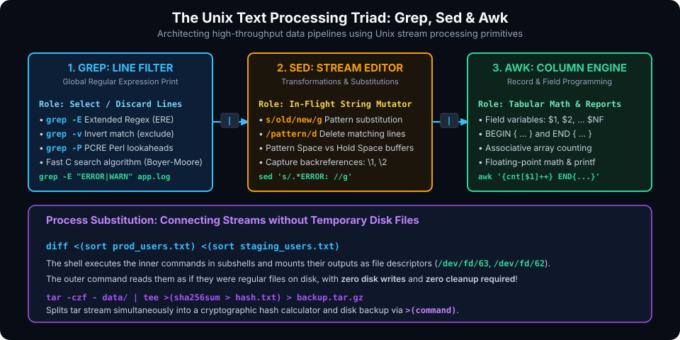

# Advanced Text Processing & Stream Transformation

## Introduction

At the core of the Unix philosophy lies the conviction that powerful programs should do one thing well and communicate with one another through clean, text-based data streams. In modern software engineering, cloud operations, and systems verification, immense volumes of data flow as plain text: server logs, network packet captures, memory dumps, CSV metrics, and configuration files.

To process these streams efficiently, expert engineers do not write ad-hoc Python or C scripts for simple transformations. Instead, they harness the legendary Unix text-processing triad: **Grep**, **Sed**, and **Awk**, orchestrated through **Process Substitution** and **Pipes**.

This chapter covers:
1. **The Unix Text Processing Triad Architecture (Grep, Sed, Awk)**.
2. **Regular Expressions: BRE, ERE & PCRE Engines**.
3. **Sed Mastery: In-Flight Stream Editing & Pattern Addressing**.
4. **Awk Mastery: Field Parsing, Associative Arrays & Statistical Reporting**.
5. **Process Substitution (`<()` and `>()`)**: Diskless Stream Interconnection.
6. **Coprocesses (`coproc`)**: Asynchronous Bidirectional Communication.

---

## The Unix Text Processing Triad Architecture

Each tool in the triad is engineered for a distinct phase of text manipulation:



| Tool | Core Specialization | Primary Question Answered | Data Model |
| :--- | :--- | :--- | :--- |
| **`grep`** | Line-level filtering and pattern detection | *"Which lines match this pattern?"* | Stream of raw lines |
| **`sed`** | Stream transformation and substitutions | *"How should matching text be altered or removed?"* | Character / line buffer (Pattern Space) |
| **`awk`** | Column-based structured computation | *"What calculations or summaries can be computed on these fields?"* | Structured table (Records & Fields) |

When combined in a pipeline, data moves from high-volume filtering (`grep`) to string mutation (`sed`) to structured reporting (`awk`) with blazing performance:

```bash
# High-speed log analysis pipeline
cat /var/log/nginx/access.log \
  | grep -E " (404|500) " \
  | sed -E 's/.*"(GET|POST) ([^" ]+).*/\2/' \
  | awk '{count[$1]++} END {for (path in count) printf "%5d %s\n", count[path], path}' \
  | sort -rn \
  | head -n 10
```

---

## Regular Expressions: BRE vs. ERE vs. PCRE

A regular expression (RegEx) is a formalized syntax for matching patterns in text. Unix tools support three distinct flavors:

1. **Basic Regular Expressions (BRE)**:
   - Used by default in `grep` and legacy `sed`.
   - Special metacharacters like `(`, `)`, `+`, `?`, `{`, `}` are treated as literal characters unless escaped with a backslash: `\+`, `\{1,3\}`.
2. **Extended Regular Expressions (ERE)**:
   - Enabled via `grep -E` (or `egrep`) and `sed -E`.
   - Metacharacters `+`, `?`, `|`, `()`, `{}` function without backslashes.
3. **Perl-Compatible Regular Expressions (PCRE)**:
   - Enabled via `grep -P`.
   - Supports advanced lookahead assertions (`(?=...)`), lookbehinds (`(?<=...)`), and non-greedy quantifiers (`.*?`).

### POSIX Character Classes
To ensure scripts work across international locales without ASCII assumptions, use POSIX character classes:

- `[[:alnum:]]` : Alphanumeric characters (`[a-zA-Z0-9]`)
- `[[:alpha:]]` : Alphabetic characters (`[a-zA-Z]`)
- `[[:digit:]]` : Numeric digits (`[0-9]`)
- `[[:blank:]]` : Space and horizontal tab characters
- `[[:space:]]` : All whitespace (spaces, tabs, newlines, carriage returns)
- `[[:upper:]]` / `[[:lower:]]` : Uppercase / Lowercase letters

---

## Sed Mastery: The Stream Editor

**Sed** (Stream Editor) parses input text line by line into an internal memory buffer called the **Pattern Space**, applies editing commands, and flushes the modified line to `stdout`.

### 1. The Universal Substitution Command: `s/pattern/replacement/flags`

```bash
# Basic replacement (first match on each line)
sed 's/localhost/127.0.0.1/' hosts.txt

# Global replacement (all matches on each line)
sed 's/false/true/g' feature_flags.json

# Case-insensitive replacement (I flag)
sed 's/error/WARNING/gI' debug.log

# Using alternate delimiters (avoids "leaning toothpick syndrome" with paths)
sed 's#/usr/local/bin#/opt/bin#g' config.sh
```

### 2. Capture Groups & Backreferences

Parenthesized expressions in ERE mode (`sed -E`) capture matched substrings, which can be re-inserted into the replacement string using `\1`, `\2`, etc.:

```bash
# Convert ISO dates (YYYY-MM-DD) to European format (DD/MM/YYYY)
echo "Released on 2026-11-08 by team" | sed -E 's/([0-9]{4})-([0-9]{2})-([0-9]{2})/\3\/\2\/\1/'
# Output: Released on 08/11/2026 by team
```

### 3. Addressing: Targeting Specific Lines or Ranges

Sed commands can be prefixed with an address selector:

- **Single Line Number**:
  ```bash
  sed '5d' data.txt              # Delete line 5
  sed '1s/draft/FINAL/' doc.txt  # Replace only on line 1
  ```
- **Line Number Range**:
  ```bash
  sed '10,25d' data.txt          # Delete lines 10 through 25
  sed -n '50,60p' data.txt       # Print ONLY lines 50 through 60 (-n suppresses default output)
  ```
- **Regex Address Range**:
  ```bash
  # Delete everything between BEGIN and END block markers
  sed '/^BEGIN/,/^END/d' config.txt
  ```

### 4. In-Place File Modification (`sed -i`)

To modify a file directly on disk without shell redirects:

> [!WARNING]
> **Cross-Platform Compatibility Trap**:
> - GNU Sed (Linux): `sed -i 's/old/new/g' file.txt`
> - BSD Sed (macOS): Requires an explicit backup extension argument: `sed -i '' 's/old/new/g' file.txt`
> - **Portable Solution**:
>   ```bash
>   sed -i.bak 's/old/new/g' file.txt && rm -f file.txt.bak
>   ```

---

## Awk Mastery: The Tabular Data Language

**Awk** is not merely a utility; it is a full, Turing-complete programming language designed for record and field manipulation. By default, Awk treats every line as a **Record** and whitespace-separated tokens as **Fields**.

### 1. Awk's Execution Lifecycle

$$\text{BEGIN Block} \longrightarrow \text{Main Loop (For Each Record)} \longrightarrow \text{END Block}$$

```awk
BEGIN {
    # Executed ONCE before any files are opened (set separators, print headers)
    FS=","          # Input Field Separator
    OFS=" | "       # Output Field Separator
}
$3 >= 1000 {
    # Executed for every line matching condition ($3 >= 1000)
    total += $3
    count++
    print $1, $2, $3
}
END {
    # Executed ONCE after EOF is reached (print summaries, averages)
    printf "Average: %.2f (Total items: %d)\n", total/count, count
}
```

### 2. Built-in Awk Variables

| Variable | Description | Example Usage |
| :--- | :--- | :--- |
| **`$0`** | The entire current record (full line) | `print $0` |
| **`$1, $2..`**| Specific field numbers | `$1` = first column, `$2` = second |
| **`$NF`** | The **very last field** on the line | `print $NF` (prints last column regardless of count) |
| **`NF`** | Total **N**umber of **F**ields on current line | `NF > 3` (filters lines with more than 3 columns) |
| **`NR`** | Current **R**ecord **N**umber (cumulative line count)| `NR > 1` (skips CSV header line!) |
| **`FNR`** | Current line number within the **current file** | Resets to 1 for each new file in multi-file jobs |
| **`FS`** | Input **F**ield **S**eparator | `BEGIN {FS=":"}` (parses `/etc/passwd`) |
| **`OFS`** | Output **F**ield **S**eparator | `BEGIN {OFS="\t"}` (emits tab-delimited columns) |

### 3. Associative Arrays: Counting & Aggregation

Awk arrays are string-keyed hash maps, making them exceptionally powerful for frequency counters:

```bash
# Count requests per HTTP status code from an Nginx log
awk '{status[$9]++} END {for (code in status) printf "%s: %d\n", code, status[code]}' access.log
```

---

## Process Substitution (`<()` and `>()`)

Process Substitution allows commands that expect file path arguments to read from or write to a subshell command directly, without creating temporary files on disk.

### 1. Reading from a Command as a File: `<(command)`

Under the hood, Bash executes `command` in a background subshell and binds its standard output to a transient FIFO file descriptor (`/dev/fd/63`).

#### Example: Diffing the Output of Two Commands Directly
```bash
# Compare package lists between production and staging servers without saving files!
diff -u <(ssh prod "rpm -qa | sort") <(ssh staging "rpm -qa | sort")
```

#### Example: Bypassing the Subshell While-Loop Trap
In Chapter 5, we observed that piping (`cmd | while read`) causes variable loss. Process substitution provides an elegant solution:

```bash
total_errors=0

while IFS= read -r line; do
    (( total_errors++ ))
    echo "Found: $line"
done < <(grep "ERROR" /var/log/syslog)

# total_errors is preserved in current shell!
echo "Total error count: $total_errors"
```

### 2. Writing to Multiple Streams: `>(command)`

Direct output into commands that process data on the fly:

```bash
# Download and split a large database dump to disk and S3 simultaneously
curl -s "https://backups.internal/db.sql.gz" \
  | tee >(sha256sum > checksum.txt) \
  | gzip -d \
  > local_db.sql
```

---

## Coprocesses: Bidirectional Asynchronous Communication

A **Coprocess** launches an asynchronous background process connected to the parent shell via two dedicated file descriptors for bidirectional communication.

```bash
#!/usr/bin/env bash

# Spawn bc (calculator) as a background coprocess
coproc CALC { bc -l; }

# Send calculation query to bc's stdin via file descriptor ${CALC[1]}
echo "scale=6; 4 * a(1)" >&"${CALC[1]}"

# Read answer from bc's stdout via file descriptor ${CALC[0]}
read -r pi <&"${CALC[0]}"

echo "Calculated Pi: $pi"

# Cleanly close coprocess file descriptor
eval "exec ${CALC[1]}>&-"
```

---

## Hands-On Exercises

### Exercise 1: Multi-Column Server Metrics Aggregator
Given a CSV file `metrics.csv`:
```csv
server_name,cpu_percent,memory_mb,status
web-01,42.5,4096,healthy
web-02,89.1,8192,degraded
db-01,15.2,16384,healthy
db-02,94.8,16384,critical
cache-01,12.0,2048,healthy
```

Write an Awk one-liner that:
1. Ignores the header row (`NR > 1`).
2. Calculates and displays the average CPU utilization across all servers.
3. Prints all servers whose status is NOT `healthy`.

```bash
# Solution
awk -F',' '
  NR > 1 {
    total_cpu += $2
    count++
    if ($4 != "healthy") {
      printf "ALERT: Server %s is %s (CPU: %.1f%%)\n", $1, $4, $2
    }
  }
  END {
    if (count > 0) printf "Average Cluster CPU: %.2f%%\n", total_cpu / count
  }
' metrics.csv
```

### Exercise 2: Stream Manipulation with Sed Backreferences
Convert a list of C-style macro definitions:
```c
#define TIMEOUT_SEC 30
#define BUFFER_SIZE 4096
#define MAX_RETRIES 5
```
Into modern C++ `constexpr` declarations:
```cpp
constexpr auto TIMEOUT_SEC = 30;
constexpr auto BUFFER_SIZE = 4096;
constexpr auto MAX_RETRIES = 5;
```

```bash
# Solution
sed -E 's/#define ([A-Z0-9_]+) ([0-9]+)/constexpr auto \1 = \2;/' macros.h
```

---

## Review Questions & Self-Assessment

1. **When should you choose `awk` over `sed`?**
   *Answer:* Use `sed` for line-level text transformations and regex string substitutions. Use `awk` whenever input data has structured columns/fields and requires mathematical calculations, condition-based filtering, or tabular aggregation.
2. **What does the flag `-n` do in `sed -n '10,20p' file.txt`?**
   *Answer:* By default, Sed prints every line in the pattern space to `stdout`. The `-n` flag suppresses automatic printing so only explicitly addressed lines matching the `p` (print) command are emitted.
3. **What is the value of `$NF` in Awk?**
   *Answer:* `NF` is the number of fields on the current record. `$NF` evaluates to the content of the **last field** on that line.
4. **Why is `while read line; do ... done < <(command)` superior to `command | while read line; do ... done`?**
   *Answer:* Using process substitution `< <(command)` executes the `while` loop within the **current shell process** rather than a subshell, preserving all variable modifications made inside the loop.
5. **How does Process Substitution `<(cmd)` differ from a standard pipe `|`?**
   *Answer:* A pipe streams `stdout` to `stdin` linearly between sequential programs. Process substitution mounts command output as a named file descriptor (`/dev/fd/N`), allowing utilities that require one or more distinct file path arguments to read streams directly without writing to disk.

---

##### Copyright (c) 2026 squared-studio
