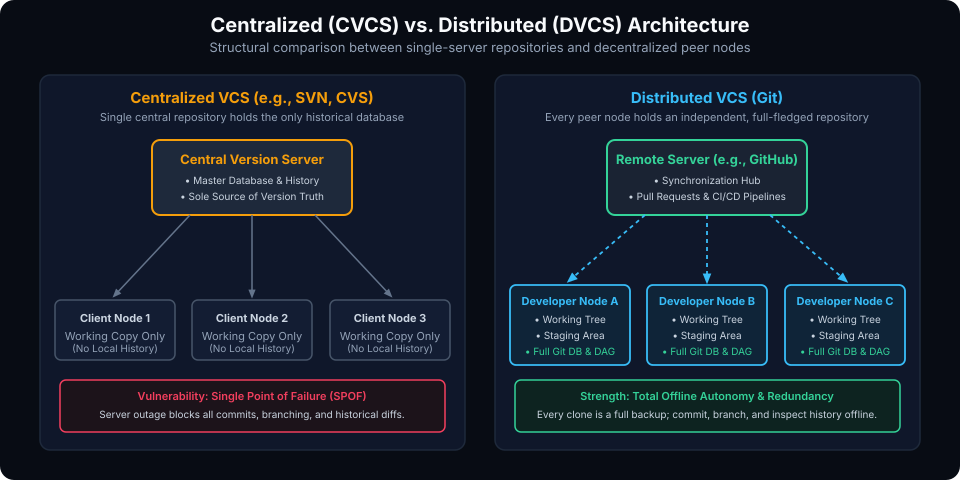
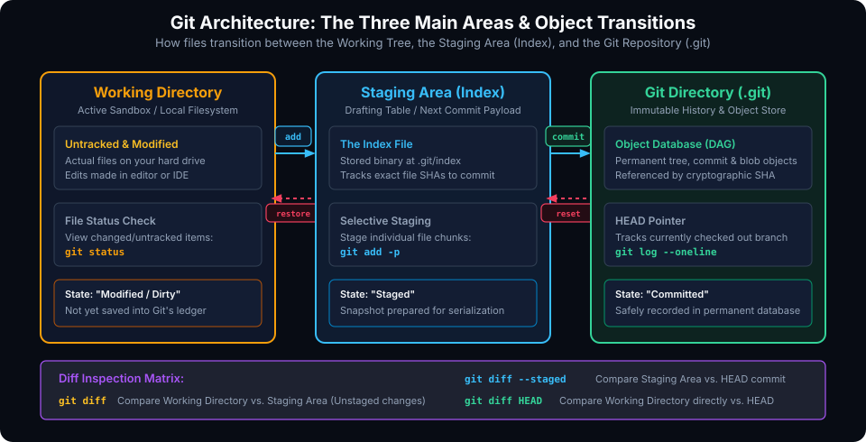

# Introduction to Git: Distributed Version Control Fundamentals

## Learning Goals

After completing this chapter, you should be able to:

- Articulate the architectural differences between Centralized Version Control Systems (CVCS) and Distributed Version Control Systems (DVCS).
- Explain the design philosophy and performance principles underpinning Git.
- Identify and describe the three primary areas of a local Git environment: the Working Directory, the Staging Area (Index), and the Git Repository (`.git`).
- Differentiate between file lifecycle states: Untracked, Modified, Staged, and Committed.
- Install Git across Linux, macOS, and Windows platforms with proper command-line integration.
- Configure global identities, default branch naming, credential helpers, text editors, and cross-platform line-ending normalization (`core.autocrlf`).
- Inspect differences across all three Git storage areas using targeted `git diff` flags.

---

## Demystifying Version Control: The Paradigm Shift

A **Version Control System (VCS)** records changes to a file or set of files over time, allowing developers to recall specific versions later, compare changes, identify who introduced a defect, and collaborate without stepping on each other's work.

Before Git, older systems like **Subversion (SVN)**, **CVS**, and **Perforce** relied on a centralized architecture. Git, engineered by Linus Torvalds in 2005 to manage the Linux kernel development tree, introduced a radical departure: the **Distributed Version Control System (DVCS)**.



### Centralized VCS (CVCS) vs. Distributed VCS (DVCS)

| Architectural Vector | Centralized VCS (SVN, CVS, Perforce) | Distributed VCS (Git, Mercurial) |
| :--- | :--- | :--- |
| **History Storage** | Only on the central server; clients check out single revisions. | Every client clone is a complete mirror of the full historical repository. |
| **Network Dependency** | Commits, diffs, logs, and branch switching require active server connection. | Fully functional offline; all historical queries and local commits run locally in milliseconds. |
| **Failure Vulnerability**| Central server failure halts all development; corrupt server backup risks losing history. | Highly resilient; any developer workstation clone serves as an authoritative full disaster-recovery backup. |
| **Branching Performance**| Heavyweight server-side directory copies; slow creation and costly merges. | Lightweight 41-byte text pointers to commit objects; creation and switching are instantaneous. |
| **Integrity Assurance** | Relies on server database consistency; vulnerability to silent disk corruption. | Cryptographic hash trees (SHA-1 / SHA-256); every file, commit, and tree is mathematically tamper-evident. |

### Core Design Principles of Git

1. **Snapshots, Not Deltas**: Unlike older systems that store changes as file-based delta differences over time, Git models its data as a stream of whole snapshots of a miniature filesystem. Whenever you commit, Git takes a picture of what all your files look like at that moment and stores a reference to that snapshot. If a file has not changed, Git simply links to the previously stored file.
2. **Local Operations**: Almost every Git operation needs only local files and resources to display history, generate diffs, or commit code. You can work uninhibited while offline on an airplane or disconnected in a secure lab.
3. **Data Integrity**: Everything in Git is checksummed before it is stored and is referenced by that checksum. It is impossible to change the contents of any file or directory without Git knowing it.

---

## Git Architecture: The Three Main Areas

Understanding Git begins with mastering the three logical partitions that make up a local Git workspace.



### 1. The Working Directory (Working Tree)
The **Working Directory** is a single checkout of one version of the project. These files are unpacked from the compressed database in the Git directory onto your local filesystem for you to view, edit, compile, and run.

### 2. The Staging Area (Index)
The **Staging Area** (technically called the **Index**) is a binary file located at `.git/index`. It acts as a staging dock or drafting table that contains the exact list of files and cryptographic object hashes that will compose your next commit snapshot. The staging area gives developers granular control over what changes enter history.

### 3. The Git Directory (Repository / Object Database)
The **Git Directory** (the hidden `.git` folder) is the core of Git. It stores the object database (compressed blobs, trees, commits, and tags), reference pointers to branches (`refs/heads/*`), remote tracking references (`refs/remotes/*`), configuration files, hooks, and the `HEAD` pointer. When you clone a repository, this directory is what gets downloaded.

### The Lifecycle States of a File

Within these three areas, files cycle through four primary states:

```
[Untracked] ──(git add)──> [Staged] ──(git commit)──> [Committed]
                                ^                          │
                                │                          ▼
                                └──────(git add)────── [Modified]
```

- **Untracked**: The file exists in your working directory, but Git has no record of it in the Index or previous commits.
- **Modified**: You have altered an existing tracked file in your working directory, but have not yet staged it.
- **Staged**: You have marked a modified or newly created file in its current version to go into your next commit snapshot.
- **Committed**: The data is safely sealed and stored in your local repository database.

### Inspecting Differences Across Areas

Git provides precise flags to inspect changes between these states before sealing commits:

```bash
# Compare Working Directory modifications against the Staging Area
# (Shows what you have edited but NOT yet staged)
git diff

# Compare Staged changes against the latest commit (HEAD)
# (Shows exactly what will be included in your next commit)
git diff --staged

# Compare Working Directory directly against the latest commit (HEAD)
# (Shows all edits regardless of whether they have been staged)
git diff HEAD
```

> [!TIP]
> Always run `git status` and `git diff --staged` before executing `git commit`. Verifying the staged payload prevents accidental inclusion of debug print statements, temporary credentials, or untracked build artifacts.

---

## Installing Git on Your System

### 1. Linux Distributions

#### Debian / Ubuntu / Mint
```bash
sudo apt update
sudo apt install -y git
```

#### Fedora / RHEL / CentOS
```bash
# Modern Fedora
sudo dnf install -y git

# RHEL / CentOS
sudo yum install -y git
```

#### Arch Linux / Manjaro
```bash
sudo pacman -S --noconfirm git
```

### 2. macOS

#### Option A: Using Homebrew (Recommended)
```bash
# Install Homebrew if not present
/bin/bash -c "$(curl -fsSL https://raw.githubusercontent.com/Homebrew/install/HEAD/install.sh)"

# Install latest Git build
brew install git
```

#### Option B: Using Xcode Command Line Tools
```bash
xcode-select --install
```

### 3. Windows

Download and run the official installer from [Git for Windows](https://git-scm.com/download/win).

**Recommended installer options:**
- **Default Editor**: Select Visual Studio Code or Vim.
- **Adjusting PATH environment**: Choose *"Git from the command line and also from 3rd-party software"* to ensure `git` is accessible from Command Prompt, PowerShell, and Windows Terminal.
- **Line ending conversions**: Choose *"Checkout Windows-style, commit Unix-style line endings"* (`core.autocrlf = true`).
- **Terminal emulator**: Choose *"Use MinTTY"* or Windows Terminal.

Verify successful installation across any platform:
```bash
git --version
```

---

## First-Time Configuration & Identity Setup

Git stores its configuration variables across three distinct levels of precedence:

1. **System (`--system`)**: Located at `/etc/gitconfig` (or `C:\ProgramData\Git\config`). Applies to every user on the system and all their repositories.
2. **Global (`--global`)**: Located at `~/.gitconfig` (or `%USERPROFILE%\.gitconfig`). Applies specifically to your operating system user account.
3. **Local (`--local`)**: Located at `.git/config` within a specific repository. Overrides global and system settings for that project.

### Essential Global Setup Commands

```bash
# 1. Set Author Identity (Mandatory for commit attribution)
git config --global user.name "Your Name"
git config --global user.email "your.email@example.com"

# 2. Establish Standard Default Branch Name
git config --global init.defaultBranch main

# 3. Configure Default Text Editor
git config --global core.editor "vim"
# Or for VS Code:
# git config --global core.editor "code --wait"

# 4. Cross-Platform Line Ending Normalization
# On Windows:
git config --global core.autocrlf true
# On macOS / Linux:
git config --global core.autocrlf input

# 5. Fast-Forward Pull Discipline
git config --global pull.ff only
```

### Checking Your Configuration

To verify active settings and trace which configuration file set each value:

```bash
git config --list --show-origin
```

> [!IMPORTANT]
> The `user.name` and `user.email` you configure in Git are baked permanently into every commit object you create. If you work on both personal open-source projects and proprietary enterprise code on the same computer, configure your corporate email locally inside work repositories using `git config --local user.email "work@company.com"`.

---

## Common Pitfalls and Best Practices

- **Never Commit Secrets or Credentials**: Once an API token, private key, or password is committed to a Git repository, it remains in the historical object database even if you delete the file in a subsequent commit.
- **Use `.gitignore` Proactively**: Configure `.gitignore` before creating your first commit so build artifacts, object files (`*.o`, `*.vcd`), logs, and virtual environments (`.venv/`, `node_modules/`) are never tracked.
- **Verify Line-Ending Settings**: Mixed CRLF and LF line endings cause massive, noisy diffs where every line appears modified. Enforce `.gitattributes` across your team to standardize line endings regardless of developer OS.

---

## Practical Exercises

1. Check your installed Git version and inspect all currently configured global settings along with their source files.
2. In a temporary directory, create a file named `notes.txt`. Run `git status` before and after running `git add notes.txt` to observe how Git reports the file transitioning from Untracked to Staged.
3. Modify `notes.txt` after staging it. Run `git status` again. Notice how Git reports the file in two different areas simultaneously (Staged and Modified).
4. Run `git diff` and compare the output with `git diff --staged` to inspect the difference between your working edits and staged changes.

##### Copyright (c) 2026 squared-studio
