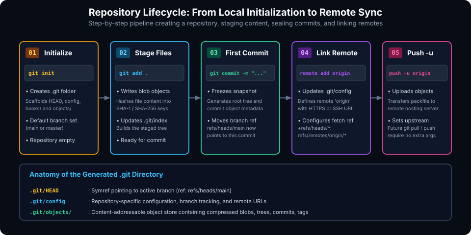
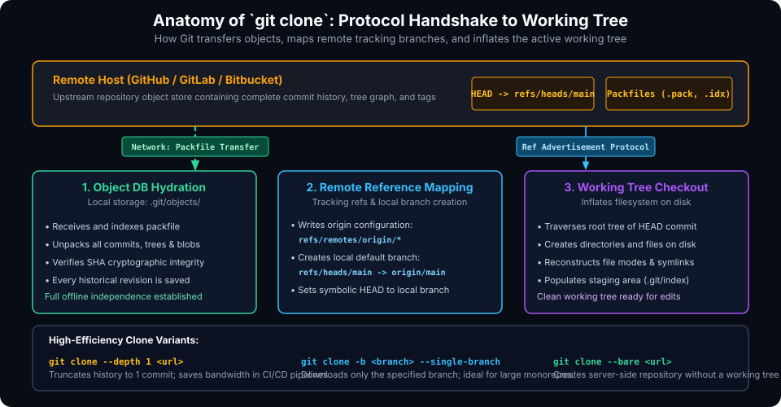

# Getting Started with Git: Repositories, Staging, and Remote Connections

## Learning Goals

After completing this chapter, you should be able to:

- Initialize a local Git repository from scratch and explain the internal structural scaffolding created in `.git`.
- Stage project files into the Index and execute well-documented initial commits.
- Configure and manage remote repository associations using `git remote`.
- Set up secure authentication for remote repositories using SSH public keys and HTTPS Personal Access Tokens (PATs).
- Push local branches to remote hosting services while establishing upstream tracking (`-u`).
- Clone remote repositories and select appropriate clone strategies (full clone, shallow clone, single-branch clone, bare clone).
- Use the GitHub CLI (`gh`) to provision cloud repositories directly from the terminal.

---

## Initializing a Local Repository

Every Git project begins with a repository. A repository is simply a project directory containing a hidden `.git` folder that manages all version history, staging states, branch pointers, and object databases.



### Step-by-Step Initialization

To turn any local directory into a version-controlled Git repository:

```bash
# 1. Create and navigate into your project directory
mkdir my-project
cd my-project

# 2. Initialize the Git repository
git init
```

Upon execution, Git produces the confirmation message:
```plaintext
Initialized empty Git repository in /path/to/my-project/.git/
```

### What Happens Inside `.git`?

The `git init` command creates a hidden directory named `.git`. Inspecting this directory reveals Git's foundational components:

```bash
ls -la .git
```

- **`HEAD`**: A reference pointer file containing `ref: refs/heads/main`. It indicates which branch is currently checked out.
- **`config`**: Project-specific configuration file containing repository settings and remote definitions.
- **`objects/`**: The object database where all compressed files (blobs), directory trees, and commit nodes will be stored.
- **`refs/`**: Contains subdirectories `heads/` (local branch pointers), `tags/` (tag markers), and `remotes/` (remote tracking pointers).
- **`hooks/`**: Sample client-side and server-side automation scripts triggered by Git actions.

### Staging and Sealing the Initial Snapshot

Once a repository is initialized, your project files are initially **Untracked**. You must explicitly tell Git which files to track and include in your initial commit snapshot:

```bash
# Create initial project documentation
echo "# My Embedded Project" > README.md

# Inspect status
git status
```

Output:
```plaintext
On branch main

No commits yet

Untracked files:
  (use "git add <file>..." to include in what will be committed)
	README.md

nothing added to commit but untracked files present (use "git add" to track)
```

Now, stage and commit the file:

```bash
# Stage the file into the Index
git add README.md

# Seal the snapshot into the local repository
git commit -m "feat: initial commit with README"
```

Output:
```plaintext
[main (root-commit) 3f8a10b] feat: initial commit with README
 1 file changed, 1 insertion(+)
 create mode 100644 README.md
```

> [!NOTE]
> Until you create your very first commit, the branch `main` does not yet exist as a physical file in `.git/refs/heads/`. The initial commit establishes the root commit of your repository's Directed Acyclic Graph (DAG) and creates the pointer `refs/heads/main`.

---

## Linking Local Repositories to Remote Hosts

To collaborate with peers, backup code off-site, or trigger CI/CD deployment pipelines, you connect your local repository to a remote Git hosting service (such as GitHub, GitLab, or an internal enterprise server).

### Remote Naming & The `origin` Convention

In Git, a remote is a bookmark or alias for a remote repository URL. By universal industry convention, the primary upstream server is named **`origin`**.

```bash
# Link your local repo to a remote GitHub repository
git remote add origin https://github.com/username/my-project.git
```

To verify the remote configuration and inspect the fetch and push endpoints:

```bash
git remote -v
```

Output:
```plaintext
origin  https://github.com/username/my-project.git (fetch)
origin  https://github.com/username/my-project.git (push)
```

### Authentication: SSH Keys vs. HTTPS Tokens

Modern Git servers forbid plain account passwords for command-line authentication:

1. **HTTPS with Personal Access Tokens (PAT)**: Requires generating an access token with repository read/write scopes and configuring a Git credential helper:
   ```bash
   git config --global credential.helper cache
   ```
2. **SSH Authentication (Recommended)**: Cryptographic key pairs eliminate repeated password prompts and provide seamless, cryptographically secure push/pull authentication:
   ```bash
   # Generate a modern Ed25519 SSH key
   ssh-keygen -t ed25519 -C "your.email@example.com"
   
   # Display your public key to copy into GitHub -> Settings -> SSH Keys
   cat ~/.ssh/id_ed25519.pub
   
   # Add remote using SSH URL format:
   git remote set-url origin git@github.com:username/my-project.git
   ```

### Pushing with Upstream Tracking (`-u`)

When pushing your local branch to the remote repository for the first time, include the `-u` (or `--set-upstream`) flag:

```bash
git push -u origin main
```

Output:
```plaintext
Enumerating objects: 3, done.
Counting objects: 100% (3/3), done.
Writing objects: 100% (3/3), 242 bytes | 242.00 KiB/s, done.
Total 3 (delta 0), reused 0 (delta 0), pack-reused 0
To github.com:username/my-project.git
 * [new branch]      main -> main
branch 'main' set up to track 'origin/main'.
```

The `-u` flag instructs Git to write a tracking entry inside `.git/config`:
```ini
[branch "main"]
    remote = origin
    merge = refs/heads/main
```
Once upstream tracking is configured, all subsequent pushes and pulls require only typing:
```bash
git push
git pull
```

---

## Cloning Existing Repositories

**Cloning** creates an exact local copy of an existing remote repository on your workstation. It does not just copy the current version of the files; it downloads the full historical object database, tags, and all branches.



### Standard Clone Command

```bash
# Clone via SSH (Recommended)
git clone git@github.com:organization/core-system.git

# Or via HTTPS
git clone https://github.com/organization/core-system.git
```

When you execute `git clone`, Git automatically executes the following sequence:

1. Initializes a new local directory named after the repository.
2. Connects to the remote server and advertises references.
3. Downloads all packfiles containing historical commits, trees, and blobs into `.git/objects/`.
4. Creates remote-tracking branches (`refs/remotes/origin/*`) for every branch on the server.
5. Identifies the remote `HEAD` branch (usually `main`), creates a corresponding local branch (`refs/heads/main`), and attaches local `HEAD` to it.
6. Checks out the contents of the latest commit into your local working directory.

### High-Efficiency Clone Variants

For massive repositories or automated Continuous Integration (CI) build pipelines, standard full clones can be slow and consume excessive network bandwidth. Git provides targeted clone variants:

| Clone Command | Operational Behavior | Primary Use Case |
| :--- | :--- | :--- |
| `git clone --depth 1 <url>` | **Shallow Clone**: Downloads only the latest commit; discards all previous historical commits. | CI/CD build runners, rapid Docker image generation, and quick audits. |
| `git clone -b <branch> --single-branch <url>` | **Targeted Clone**: Clones history solely for the specified branch, ignoring all other branches on the server. | Large multi-team repositories where you only work on one release track. |
| `git clone --bare <url>` | **Bare Clone**: Downloads only the `.git` metadata and object database without creating a working tree. | Central server hosting, backup mirrors, and automated repository analysis. |
| `git clone --recurse-submodules <url>` | **Recursive Clone**: Clones parent repository and automatically clones all nested Git submodules. | Projects depending on external submodules or vendor IP libraries. |

> [!TIP]
> If you performed a shallow clone using `--depth 1` and later need to convert it into a complete repository with full history, you can unshallow it without re-cloning from scratch:
> ```bash
> git fetch --unshallow
> ```

---

## Provisioning via GitHub Web & CLI

### Creating via GitHub Web Interface
When starting a project on GitHub's website ([github.com/new](https://github.com/new)):
1. Choose an explicit repository name using lowercase letters and hyphens (e.g., `axi-stream-controller`).
2. Select **Public** (open-source) or **Private** (proprietary).
3. Option to initialize with:
   - **`README.md`**: Project orientation and architectural overview.
   - **`.gitignore`**: Language-specific template ignoring compiler artifacts.
   - **License**: Pre-configured license terms (MIT, Apache 2.0, GPLv3).

### Provisioning Directly via GitHub CLI (`gh`)
Modern engineering teams use the official GitHub CLI to eliminate context switching between the terminal and browser:

```bash
# Authenticate GitHub CLI
gh auth login

# Create a remote repository from your current directory and push in one step:
gh repo create my-awesome-tool --public --source=. --remote=origin --push
```

---

## Best Practices for Repository Initialization

- **Always Include a `.gitignore` Immediately**: Never run `git add .` on a dirty directory before creating a `.gitignore`. If build outputs or credentials are staged and committed, deleting them in a second commit leaves them permanently in Git's object database.
- **Write Informative Maiden Commits**: Avoid generic messages like `"first commit"` or `"initial code"`. A message such as `"feat: scaffold project architecture with CMake build system and unit tests"` provides clear historical provenance.
- **Enforce Branch Protection on Remotes**: In team environments, protect the `main` branch immediately in GitHub repository settings to require pull request reviews and status checks before merges.

---

## Practical Exercises

1. Initialize a new local Git repository in a folder named `git-lab-01`. Inspect the `.git` directory structure before and after creating an initial commit.
2. Create a `.gitignore` file that ignores all `*.log` files and a directory named `temp/`. Create `debug.log` and verify that `git status` ignores it.
3. Generate an Ed25519 SSH key pair on your machine and verify connectivity to GitHub using `ssh -T git@github.com`.
4. Perform a shallow clone of an open-source repository using `--depth 1`. Compare the size on disk of the shallow `.git` folder against a full clone.

##### Copyright (c) 2026 squared-studio
