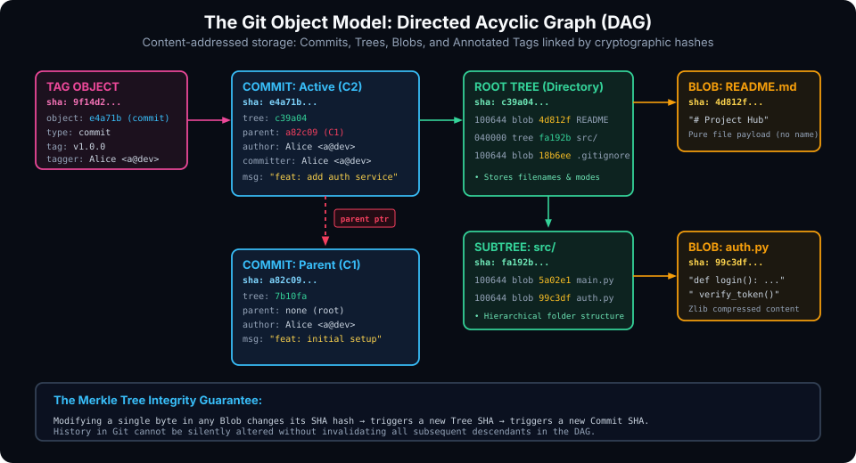
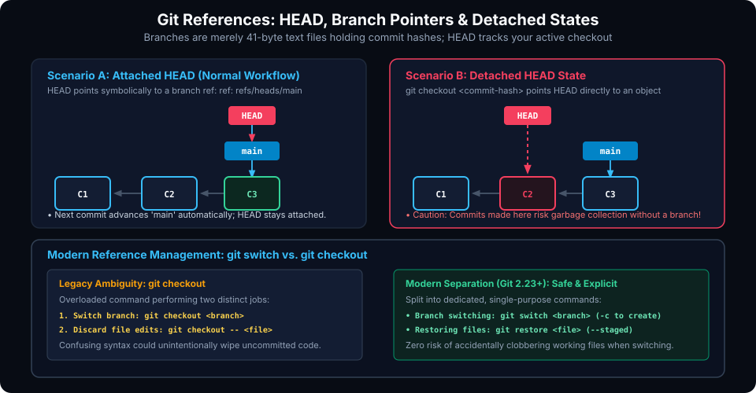

# Core Git Concepts and Internals Explained

## Learning Goals

After completing this chapter, you should be able to:

- Deconstruct Git's content-addressable storage model and explain how cryptographic SHA hashes guarantee repository immutability.
- Dissect the four fundamental Git object primitives: Blobs, Trees, Commits, and Annotated Tags.
- Use low-level plumbing commands (`git hash-object`, `git cat-file`, `git ls-tree`) to inspect internal Git objects on disk.
- Define what a branch is under the hood and trace how branch pointer files update during commits.
- Demystify the `HEAD` reference, distinguish between attached and detached `HEAD` states, and safely recover from detached states.
- Compare modern reference switching (`git switch` / `git restore`) against legacy overloaded commands (`git checkout`).
- Connect collaborative project management concepts (Issues, Milestones, Pull Requests) with Git commits and branch workflows.

---

## The Git Object Model & Content-Addressable Storage

At its heart, Git is not simply a version control tool; it is a **content-addressable filesystem** with a Version Control System user interface layered on top. 

In a content-addressable storage system, data is retrieved not by an arbitrary filename or location path, but by computing the cryptographic hash of the content itself. Traditionally, Git computes a 40-character hexadecimal SHA-1 hash (160 bits) of an object's header and payload (modern Git also supports SHA-256).

Git stores all historical data in `.git/objects/` using four fundamental object types:



### The Four Object Primitives

#### 1. The Blob Object (`type blob`)
A **blob** (binary large object) stores pure file data. A blob holds the contents of a file compressed via zlib, but contains **no metadata**: no filename, no directory path, and no permissions (`chmod`). If two files in different directories contain identical content, Git stores only one blob in `.git/objects/`, saving substantial disk space.

#### 2. The Tree Object (`type tree`)
A **tree** represents a filesystem directory. A tree solves the problem of storing filenames and directory hierarchies. Each tree entry contains:
- File mode (`100644` for normal file, `100755` for executable, `040000` for subdirectory)
- Object type (`blob` or `tree`)
- SHA-1 / SHA-256 hash of the target object
- Filename or folder name

Trees can point to blobs (files) and to nested trees (subdirectories), recursively mirroring the entire directory tree of your project.

#### 3. The Commit Object (`type commit`)
A **commit** represents a permanent snapshot of the project at a specific instant in time. A commit object contains:
- A pointer to the top-level **root tree** (`tree <sha>`)
- Pointers to **parent commits** (`parent <sha>`) (initial commits have zero parents; standard commits have one; merge commits have two or more)
- **Author**: The developer who originally wrote the code and timestamp
- **Committer**: The developer or system that applied the commit and timestamp
- Commit message describing the architectural intent of the change

#### 4. The Tag Object (`type tag`)
An **annotated tag** provides a permanent, human-readable marker (e.g., `v1.0.0`) pointing to a specific commit object. Unlike lightweight tags (which are plain references), an annotated tag is an independent object in `.git/objects/` containing the tagger's name, email, date, an optional GPG cryptographic signature, and a release note.

### Exploring Git Internals with Plumbing Commands

Git commands are divided into **Porcelain** (user-friendly high-level commands like `git status`, `git commit`) and **Plumbing** (low-level commands designed for scripts and internal mechanics).

We can inspect Git's internal object store directly using the plumbing command `git cat-file`:

```bash
# Check the type of any object hash
git cat-file -t e4a71b

# Output:
# commit

# Inspect the raw contents of an object
git cat-file -p e4a71b
```

Sample output of a commit object:
```plaintext
tree c39a04a80695bbf8984920f26938dc830f81d11a
parent a82c091f0490f23554032d849cf2418b7681335b
author Alice <alice@dev.org> 1700000000 +0000
committer Alice <alice@dev.org> 1700000000 +0000

feat(auth): add JWT bearer token authentication service
```

Inspecting the referenced root tree:
```bash
git cat-file -p c39a04
```

Sample output of a tree object:
```plaintext
100644 blob 4d812f80876402479e0a0d480dcfbdf9426f0923    README.md
040000 tree fa192b0059c381c828d1973ff5ba4b02d8471b05    src
100644 blob 18b6ee388a10787e2264c9d784d14210e75e9f82    .gitignore
```

### The Merkle Tree Guarantee: Cryptographic Immutability

Because every commit references its root tree and its parent commit's hash, and every tree references the hashes of its blobs, Git forms a cryptographic **Merkle Tree**. 

If an attacker or disk corruption alters a single byte in any file:
1. The file's blob SHA changes.
2. The tree pointing to that blob must change its entry hash, altering the tree's SHA.
3. The commit pointing to that tree must change its tree hash, altering the commit's SHA.
4. All child commits in history are invalidated.

This mathematical property makes Git history tamper-evident.

---

## Pointers, Branches, and References

Many developers imagine branches as heavy copies of their code. In Git, a branch is astonishingly lightweight: it is simply a 41-byte text file on disk!

If you open `.git/refs/heads/main`, it contains nothing more than the 40-character hexadecimal hash of the latest commit on that branch, followed by a newline:
```plaintext
e4a71b89643d99e52c7104b901b2297bb3201402
```

Creating a branch takes less than a millisecond: Git creates a new 41-byte file containing the current commit hash.



### The `HEAD` Pointer

`HEAD` is a symbolic reference that points to the currently active branch in your workspace. Inspecting `.git/HEAD` reveals:
```plaintext
ref: refs/heads/main
```

When you commit, Git:
1. Creates the new commit object pointing to the current commit as its parent.
2. Updates `refs/heads/main` to point to the new commit's hash.
3. `HEAD` remains pointed to `main`, automatically staying at the leading edge.

### The Detached HEAD State

When you check out a specific commit hash, a remote tracking branch, or a tag rather than a local branch, `HEAD` points directly to a commit object rather than a branch reference:

```bash
git checkout a82c09
```

Output:
```plaintext
Note: switching to 'a82c09'.

You are in 'detached HEAD' state. You can look around, make experimental
changes and commit them, and you can discard any commits you make in this
state without impacting any branches by switching back to a branch.
```

> [!CAUTION]
> If you make commits while in a detached HEAD state and then switch back to `main` without creating a branch, your new commits become **orphaned**. They have no branch pointer referencing them and will eventually be permanently deleted by Git's automatic garbage collection (`git gc`).
> 
> **How to safely save work from detached HEAD:**
> ```bash
> git switch -c my-rescued-feature
> ```

### Modern Reference Switching: `git switch` & `git restore`

In older Git versions, `git checkout` was heavily overloaded: it was used both to switch branches and to discard uncommitted file edits. In Git 2.23+, these responsibilities were cleanly separated into two single-purpose commands:

```bash
# --- Branch Navigation (git switch) ---
# Switch to an existing branch:
git switch feature/login

# Create and switch to a new branch:
git switch -c feature/payments

# Return to previous branch:
git switch -

# --- File Restoration (git restore) ---
# Discard unstaged working tree changes in a file:
git restore src/main.c

# Unstage a file from the Index back to working directory:
git restore --staged config/settings.json
```

---

## Issues, Milestones, and Pull Request (PR) Lifecycle

While Git tracks code history on your machine, modern collaborative software engineering relies on web hosting platforms (GitHub, GitLab, Bitbucket) to coordinate human intent.

### 1. Issues & Task Tracking
An **Issue** is an actionable unit of work tracking bugs, features, or architectural proposals. Issues contain discussion threads, reproduction steps, assignees, and labels (`bug`, `enhancement`, `priority:high`).

### 2. Linking Commits to Issues
Git hosting platforms parse commit messages for automated issue closure keywords. Including these in your commit message or PR description automatically links the commit and closes the issue upon merging:

```bash
git commit -m "fix(parser): prevent buffer overflow on malformed packet

Closes #142
Resolves #189"
```

Supported keywords: `close`, `closes`, `closed`, `fix`, `fixes`, `fixed`, `resolve`, `resolves`, `resolved`.

### 3. Milestones
A **Milestone** groups related issues and pull requests towards a concrete release deadline (e.g., `v2.4.0 Release`). Milestones provide real-time progress bars showing completed vs. open issues.

### 4. Pull Requests (PR) / Merge Requests (MR)
A **Pull Request** is a formal proposal to merge a feature branch into a target branch (e.g., merging `feat/auth` into `main`). PRs serve as the centerpiece of modern code quality:
- **Code Review**: Peers inspect line-by-line diffs, leave inline comments, and suggest modifications.
- **Automated CI/CD**: Continuous Integration runners build the branch, run test suites, check code coverage, and enforce linters before code can merge.
- **Branch Protection**: Requires a minimum number of approving reviews and passing CI checks before the green merge button becomes unlocked.

---

## Best Practices for Branches and Commits

- **Keep Commits Atomic**: A commit should represent one logical change. Never bundle unrelated bug fixes and feature enhancements into the same commit. Atomic commits make code reviews effortless and allow clean rollbacks if a bug emerges.
- **Follow Branch Naming Standards**: Use descriptive prefixes to immediately communicate branch purpose:
  - `feat/user-auth`
  - `fix/memory-leak-in-parser`
  - `refactor/simplify-database-queries`
  - `docs/update-api-reference`
- **Avoid Long-Lived Branches**: The longer a feature branch diverges from `main`, the harder the eventual merge will be. Keep branches short-lived (1–3 days) and merge frequently.

---

## Practical Exercises

1. Create a new repository and commit two files. Use `git log --oneline` to find your commit hash, then run `git cat-file -p <hash>` to inspect the root tree pointer and parent pointer.
2. Run `git cat-file -p` on the root tree hash to view how Git associates file modes and blob hashes with filenames.
3. Inspect `.git/HEAD` and `.git/refs/heads/main` using `cat` in your terminal to verify that branches are plain text files storing commit hashes.
4. Intentionally enter a detached HEAD state by running `git checkout HEAD~1`. Verify the state with `git status`. Practice creating a new branch from that detached commit using `git switch -c recovery-branch`.

##### Copyright (c) 2026 squared-studio
