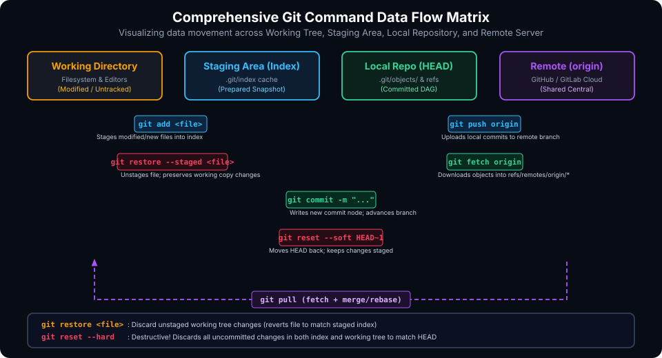
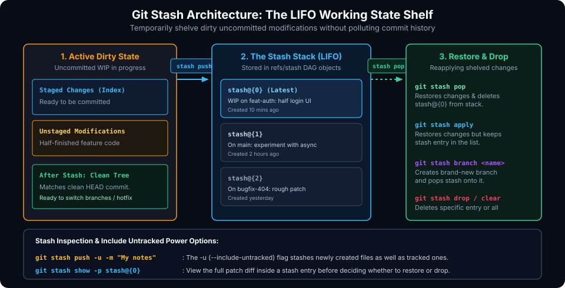

# Essential Git Commands: The Everyday Porcelain Toolkit

## Learning Goals

After completing this chapter, you should be able to:

- Master the primary everyday Git porcelain commands and trace how each command transfers data across local and remote storage boundaries.
- Inspect workspace status using standard and concise formats (`git status -s`).
- Customize `git log` to generate readable ASCII branch graph visualizations.
- Perform granular interactive staging using `git add -p` to craft clean, atomic commits.
- Compare and contrast the three modes of `git reset` (`--soft`, `--mixed`, `--hard`) and identify when to use `git revert` instead.
- Shelve and restore uncommitted changes using the Git stash stack (`git stash push`, `pop`, `apply`, `branch`).
- Safely synchronize with remote repositories using `git fetch`, `git pull`, and `git push --force-with-lease`.

---

## The Porcelain Command Navigation Matrix

Git provides dozens of commands, but roughly 15 commands compose 95% of a professional engineer's daily workflow. Understanding the direction in which each command moves data prevents confusion.



### Data Movement Summary

| Command | Source Area | Destination Area | Primary Function |
| :--- | :--- | :--- | :--- |
| `git add <file>` | Working Directory | Staging Area (Index) | Stages modified or untracked file contents. |
| `git restore --staged <file>` | Staging Area | Working Directory | Unstages file changes while preserving local edits. |
| `git restore <file>` | Staging Area / HEAD | Working Directory | Discards unstaged modifications in the working tree. |
| `git commit -m "..."` | Staging Area | Local Repository | Creates a permanent snapshot and advances the branch pointer. |
| `git reset --soft HEAD~1` | Local Repository | Staging Area | Undoes the commit; preserves changes staged in the Index. |
| `git reset --mixed HEAD~1` | Local Repository | Working Directory | Undoes commit and unstages changes; preserves working files. |
| `git reset --hard HEAD~1` | Local Repository | Discarded | Destructive! Resets working tree and Index to match commit. |
| `git fetch origin` | Remote Repository | Local Tracking Refs | Downloads remote objects and updates `refs/remotes/origin/*`. |
| `git pull origin <branch>` | Remote Repository | Working Tree & HEAD | Fetches remote objects and integrates them via merge or rebase. |
| `git push origin <branch>` | Local Repository | Remote Repository | Transmits local commits to update the remote branch. |

---

## Status, History, and Inspection Commands

### 1. Checking Workspace Status (`git status`)

```bash
# Detailed status
git status

# Concise short status (ideal for scripting and terminal prompts)
git status -s
```

In short format (`-s`), the first column indicates the Staging Area state; the second column indicates the Working Directory state:
```plaintext
 M README.md     # Modified and STAGED in Index
M  src/main.c    # Modified in Working Tree, NOT staged
MM styles.css    # Modified, staged, then modified AGAIN in Working Tree
A  config.json   # Newly Added and staged
?? notes.txt     # Untracked file
```

### 2. Inspecting Project History (`git log`)

A default `git log` can be verbose and hard to follow across multiple branches. Production teams configure clean graph aliases:

```bash
# Pretty one-line history with branch pointers and ASCII merge graph
git log --oneline --graph --decorate --all -n 15
```

Useful filtering flags:
```bash
# View commits that touched a specific file
git log -p src/packet_parser.c

# View commits authored by a specific developer
git log --author="Alice" --oneline

# View commits made within the last week
git log --since="1 week ago" --oneline

# Search commit messages for specific keywords
git log --grep="memory leak" --oneline
```

### 3. Comparing Changes with `git diff`

```bash
# Unstaged working directory changes vs. Staging Area
git diff

# Staged changes vs. HEAD commit (What will be committed next)
git diff --staged

# Differences between two distinct branches
git diff main..feature/auth

# Summarize files changed without displaying full patches
git diff --stat HEAD~3 HEAD
```

---

## Staging and Committing Workflows

### Interactive Staging (`git add -p`)

Often, you make multiple edits in a single file that belong to different logical features or bug fixes. Staging the whole file with `git add <file>` creates bloated, non-atomic commits.

Use patch mode (`-p`) to review and stage changes hunk by hunk:

```bash
git add -p src/controller.c
```

Git presents each modified hunk with interactive prompt options:
- `y`: Stage this hunk.
- `n`: Do not stage this hunk.
- `q`: Quit; do not stage this hunk or any remaining hunks.
- `s`: Split the current hunk into smaller sub-hunks.
- `e`: Manually edit the hunk in your text editor.

### Crafting Commits

```bash
# Commit staged changes with an inline message
git commit -m "feat(uart): support baud rate configuration up to 921600"

# Open editor to write a multi-line commit message while viewing the staged diff
git commit -v

# Amend the most recent commit (add newly staged files or fix the message)
git commit --amend --no-edit
```

> [!WARNING]
> Only use `git commit --amend` on commits that exist strictly on your local machine. Amending rewrites the commit hash. If the commit has already been pushed to a shared remote repository, amending it requires a force push and will disrupt your teammates' local branches.

---

## Undoing Changes and Rollback Strategies

Choosing the correct undo command depends entirely on whether changes are unstaged, staged, or already committed:

### 1. Discarding Unstaged Local Modifications
```bash
# Revert a specific file back to the staged or HEAD state
git restore path/to/file.c

# Discard all unstaged changes across the entire working tree
git restore .
```

### 2. Unstaging Files from the Index
```bash
# Remove a file from the staging area without losing your edits
git restore --staged path/to/file.c
```

### 3. Undoing Local Commits with `git reset`

```bash
# Soft Reset: Moves branch pointer back 1 commit; keeps changes staged
# (Perfect for splitting a commit or rewriting the commit message)
git reset --soft HEAD~1

# Mixed Reset (Default): Moves branch back 1 commit; unstages changes
# (Changes remain safe in your working directory)
git reset --mixed HEAD~1

# Hard Reset: Completely erases the last commit, index, and working tree!
# (Dangerous: uncommitted work cannot be recovered)
git reset --hard HEAD~1
```

### 4. Safe Public History Rollbacks with `git revert`

When a faulty commit has already been pushed to a shared production branch (`main`), **never use `git reset`**. Instead, use `git revert`:

```bash
git revert a82c09
```

`git revert` does not delete history. It analyzes the target commit and automatically synthesizes a brand-new commit that applies the exact inverse changes (deleting added lines and restoring deleted lines). This safely fixes the problem while preserving a complete, transparent audit trail.

---

## The Stashing Mechanism

During software development, urgent tasks frequently interrupt active work. For example, while halfway through an uncommitted feature, you must suddenly switch branches to fix a critical production bug.

`git stash` allows you to shelve dirty working modifications onto a local Last-In, First-Out (LIFO) stack and restore your workspace to a pristine `HEAD` state.



### Essential Stash Commands

```bash
# 1. Stash changes with a clear descriptive label
git stash push -m "WIP: halfway through SPI DMA descriptor logic"

# Include untracked new files in the stash
git stash push -u -m "WIP: including new testbench headers"

# 2. View all stashed entries
git stash list
# Output:
# stash@{0}: On main: WIP: halfway through SPI DMA descriptor logic
# stash@{1}: On feature/uart: experimental baud clock fix

# 3. Inspect the contents of a stash before applying
git stash show -p stash@{0}

# 4. Reapply the latest stash and REMOVE it from the stash stack
git stash pop

# Or reapply the stash while KEEPING it safely in the stash list
git stash apply stash@{0}

# 5. Extract a stash directly into a brand-new branch (avoids conflicts)
git stash branch feature/resumed-spi-work stash@{0}

# 6. Delete a specific stash or clear all stashes
git stash drop stash@{0}
git stash clear
```

---

## Remote Collaboration Commands

### `git fetch` vs. `git pull`

A frequent point of confusion is the difference between fetching and pulling:

- **`git fetch origin`**: Connects to the remote repository, downloads all new objects, and updates your remote tracking branches (`origin/main`, `origin/feature`). It **does not alter your working directory or local branches**. It is completely non-destructive and safe to run at any time.
- **`git pull origin main`**: A composite command that runs `git fetch` followed immediately by `git merge origin/main` (or `git rebase` if configured). It directly alters your active working directory.

### Safe Pushing with `--force-with-lease`

When working on a personal feature branch where you rebased or amended a commit, you must push rewritten history to your remote fork:

```bash
# DANGEROUS: Blindly overwrites remote branch regardless of teammates' work
git push --force origin feature/my-branch

# SAFE: Only forces push if no one else has pushed new commits since your last fetch
git push --force-with-lease origin feature/my-branch
```

> [!IMPORTANT]
> `--force-with-lease` acts as a safety check. If a teammate pushed a commit to the remote branch that you have not yet fetched, `--force-with-lease` will reject your push, preventing accidental destruction of their work.

---

## Command Reference Cheat Sheet

| Task | Command |
| :--- | :--- |
| **Inspect Staged / Unstaged Status** | `git status -s` |
| **Visual ASCII Commit Graph** | `git log --oneline --graph --decorate --all` |
| **Stage Changes Interactively** | `git add -p` |
| **Amend Last Local Commit** | `git commit --amend --no-edit` |
| **Discard Unstaged File Edits** | `git restore <file>` |
| **Unstage a Staged File** | `git restore --staged <file>` |
| **Undo Commit (Keep Staged)** | `git reset --soft HEAD~1` |
| **Invert Public Commit** | `git revert <commit-hash>` |
| **Shelve Dirty Work with Label** | `git stash push -u -m "note"` |
| **Restore Shelved Work** | `git stash pop` |
| **Download Remote Updates Only** | `git fetch origin` |
| **Safely Force Push Personal Branch** | `git push --force-with-lease origin <branch>` |

---

## Practical Exercises

1. Create a repository and configure a custom alias for graphical logging:
   ```bash
   git config --global alias.graph "log --oneline --graph --decorate --all"
   ```
   Test `git graph` across multiple commits.
2. Edit two different sections of a file. Use `git add -p` to stage only the first section into the Index. Run `git diff` and `git diff --staged` to verify that only that section was staged.
3. Make a commit, then run `git reset --soft HEAD~1`. Run `git status` to verify that your changes remain staged. Re-commit using `git commit -m "..."`.
4. Introduce uncommitted edits in your working directory. Run `git stash push -m "test stash"`, confirm with `git status` that your tree is clean, and then restore your edits using `git stash pop`.

##### Copyright (c) 2026 squared-studio
