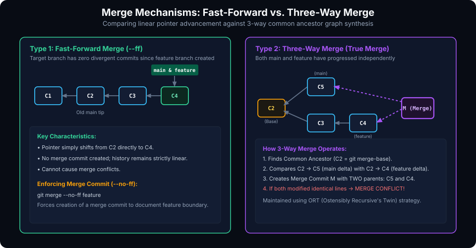
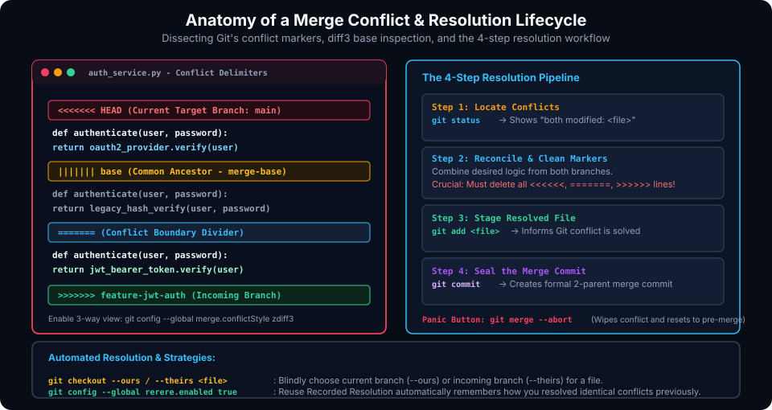

# Mastering Git Merge Conflicts: Resolution Mechanics and Strategies

## Learning Goals

After completing this chapter, you should be able to:

- Explain the mathematical and structural causes of merge conflicts during parallel branch divergence.
- Compare Fast-Forward merges against Three-Way merges and describe how Git computes the common ancestor (`merge-base`).
- Configure and interpret advanced 3-way conflict markers using `zdiff3` (`merge.conflictStyle zdiff3`).
- Execute a rigorous 4-step conflict resolution pipeline to reconcile conflicting logic without leaving syntax artifacts.
- Safely abort a failed or corrupted merge using `git merge --abort`.
- Leverage pro-level conflict tools, including `git mergetool`, `--ours` / `--theirs` checkout selectors, and the automated `rerere` (Reuse Recorded Resolution) engine.
- Resolve real-world code conflicts involving concurrent file edits and deletion-versus-modification collisions.

---

## Why Merge Conflicts Occur

A **merge conflict** is not an error or a software failure; it is an intentional safety pause. A conflict occurs when two branches make contradictory modifications to the same file that Git cannot mathematically or logically reconcile on its own.

### Common Conflict Triggers

1. **Concurrent Modifications to Identical Lines**: Two developers branch off a common base commit, and both alter line 42 of the same file. Git cannot guess which version reflects the true architectural intent.
2. **Deletion vs. Modification**: Developer A updates a function inside `utils.py`, while Developer B refactors the codebase and deletes `utils.py`. Git does not know whether to preserve the new function or delete the file.
3. **Rename Collisions**: One branch renames `network.c` to `net_driver.c`, while another branch renames the same file to `socket_interface.c`.
4. **Binary File Divergence**: Binary files (compiled firmware images, waveforms, images) cannot be diffed line-by-line; concurrent edits always trigger binary conflicts.

---

## Merge Algorithms: Fast-Forward vs. Three-Way Merge

When you run `git merge <incoming-branch>`, Git selects a merge strategy based on the topological relationship between the branch pointers in the Directed Acyclic Graph (DAG).



### 1. Fast-Forward Merge (`--ff`)
A **Fast-Forward merge** occurs when there is a direct linear path from the target branch to the incoming branch. If no new commits were added to `main` after `feature` was branched off:
- Git simply slides the `main` branch pointer forward to match the tip of `feature`.
- **No new commit object is created**.
- Fast-forward merges can **never** trigger merge conflicts.

To enforce creating a merge commit to preserve historical feature boundaries, use:
```bash
git merge --no-ff feature
```

### 2. Three-Way Merge
A **Three-Way merge** is required when branches have diverged (both `main` and `feature` have accumulated independent commits).

To merge divergent branches, Git's ORT (*Ostensibly Recursive's Twin*) merge engine identifies three critical states:
1. **Common Ancestor (Base)**: The most recent shared commit where the two branches diverged (found via `git merge-base main feature`).
2. **Target Version (Ours / HEAD)**: The tip of the branch you are merging into.
3. **Incoming Version (Theirs)**: The tip of the branch you are merging in.

Git calculates two diffs: $\Delta_1 = \text{Base} \rightarrow \text{Ours}$, and $\Delta_2 = \text{Base} \rightarrow \text{Theirs}$.
- If a file changed only in $\Delta_1$, Git keeps Ours.
- If a file changed only in $\Delta_2$, Git adopts Theirs.
- If identical changes were made in both, Git applies them cleanly.
- If contradictory changes were made to the same region, Git halts and raises a **Merge Conflict**.

---

## Anatomy of Conflict Markers and Diff3

When Git encounters conflicting lines, it pauses the merge, modifies the file on disk, and embeds visual **conflict markers**.



### Standard 2-Way Conflict Markers (Default)

```python
<<<<<<< HEAD
def get_auth_token():
    return session.get("oauth_token")
=======
def get_auth_token():
    return jwt.decode(request.headers["Authorization"])
>>>>>>> feature/jwt-auth
```

- `<<<<<<< HEAD`: Marks the start of changes from your currently checked out branch.
- `=======`: The boundary separating your local changes from the incoming changes.
- `>>>>>>> feature/jwt-auth`: Marks the end of changes from the incoming branch.

### The Power of `zdiff3` (3-Way Conflict Inspection)

Standard 2-way conflict markers show *what* changed, but fail to show *what the code looked like before either branch modified it*. 

Enabling `zdiff3` instructs Git to include the Common Ancestor base directly between the markers:

```bash
git config --global merge.conflictStyle zdiff3
```

With `zdiff3` enabled, the conflict block displays three views:
```python
<<<<<<< HEAD
    return session.get("oauth_token")
||||||| base
    return legacy_auth_cookie()
=======
    return jwt.decode(request.headers["Authorization"])
>>>>>>> feature/jwt-auth
```
Now you can immediately see that both branches attempted to replace `legacy_auth_cookie()`, allowing you to make an informed architectural decision.

---

## Step-by-Step Conflict Resolution Workflow

When a conflict occurs during `git merge`, follow this disciplined 4-step sequence:

```
[git merge] ──(Conflict!)──> [1. git status] ──> [2. Edit & Remove Markers]
                                                               │
[Clean History] <──(4. git commit) <── [3. git add] <─────────┘
```

### Step 1: Identify Conflicted Files
Run `git status` to get a list of unmerged paths:
```bash
git status
```
Output:
```plaintext
You have unmerged paths.
  (fix conflicts and run "git commit")
  (use "git merge --abort" to abort the merge)

Unmerged paths:
  (use "git add <file>..." to mark resolution)
	both modified:   src/auth_service.py
```

### Step 2: Reconcile the Code in Your Editor
Open each conflicted file, analyze the competing changes, and write the unified production logic.

**Critical Rule:** You must delete all Git conflict marker lines (`<<<<<<<`, `|||||||`, `=======`, `>>>>>>>`). Leaving marker syntax behind causes syntax errors and compiler breaks.

### Step 3: Stage the Resolved Files
Staging a conflicted file informs Git that the conflict on that path has been resolved:
```bash
git add src/auth_service.py
```
Check `git status` to verify that all unmerged paths are now in the `Changes to be committed` section.

### Step 4: Seal the Merge Commit
Finalize the merge by executing `git commit` (without `-m` to preserve Git's auto-generated merge summary):
```bash
git commit
```

### The Panic Button: Aborting a Merge
If a merge conflict is too messy or you need to consult a teammate before proceeding, you can instantly back out without leaving corrupt artifacts:
```bash
git merge --abort
```
`git merge --abort` immediately rolls back your working tree and staging area to the pristine state prior to running `git merge`.

---

## The Pro Conflict Resolution Toolkit

### 1. Visual Resolution with `git mergetool`
Configure a graphical three-way diff tool (such as VS Code, Meld, or KDiff3) to visually resolve conflicts side by side:

```bash
# Configure VS Code as your default merge tool
git config --global merge.tool code
git config --global mergetool.code.cmd 'code --wait --merge "$LOCAL" "$REMOTE" "$BASE" "$MERGED"'

# Launch the visual tool when a conflict occurs
git mergetool
```

### 2. Fast Resolution with `--ours` and `--theirs`
For non-code assets (such as locked dependency files or documentation) where you know upfront you want to discard one side completely:

```bash
# Keep our local branch version completely:
git checkout --ours package-lock.json

# Or accept incoming branch version completely:
git checkout --theirs package-lock.json

# Stage and seal:
git add package-lock.json
```

### 3. Automated Repeat Resolutions (`git rerere`)

In long-running feature branches that frequently rebase onto `main`, resolving the same merge conflict repeatedly is tedious. Git includes **`rerere`** (*Reuse Recorded Resolution*):

```bash
# Enable rerere globally
git config --global rerere.enabled true
```

When enabled, Git records a fingerprint of your conflict pre-images and post-images. When the exact same conflict reappears during future rebases or merges, Git automatically resolves it for you!

---

## Practical Exercises

1. Enable `zdiff3` globally:
   ```bash
   git config --global merge.conflictStyle zdiff3
   ```
2. Initialize a repository. Create `server.conf` on `main` with the line `PORT=8080` and commit it.
3. Create a branch `feat/port-9000`, change the line to `PORT=9000`, and commit.
4. Switch back to `main`, change `PORT=8080` to `PORT=3000`, and commit.
5. Merge `feat/port-9000` into `main`. Observe the conflict markers displaying the base (`8080`), ours (`3000`), and theirs (`9000`).
6. Reconcile the file to `PORT=3000`, remove all conflict markers, run `git add server.conf`, and seal the merge with `git commit`.
7. Verify clean commit history using `git log --oneline --graph`.

##### Copyright (c) 2026 squared-studio
