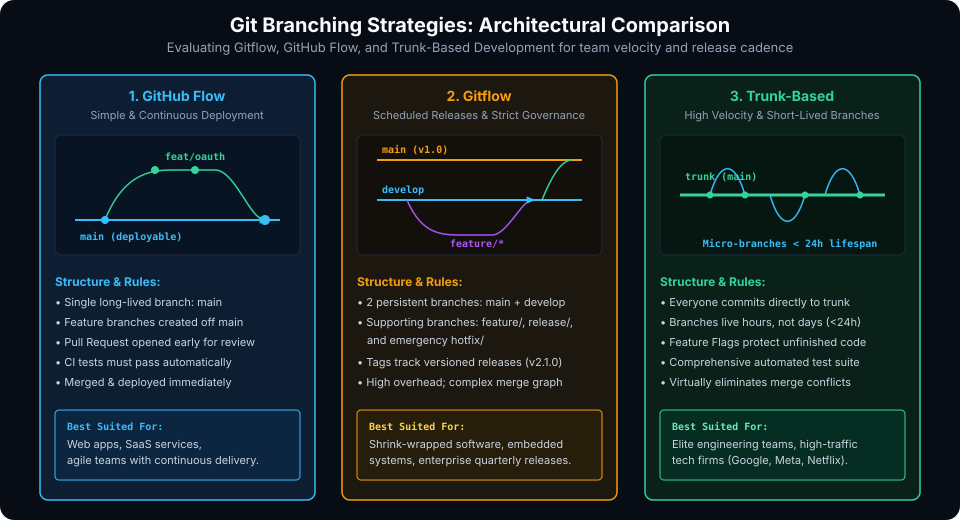
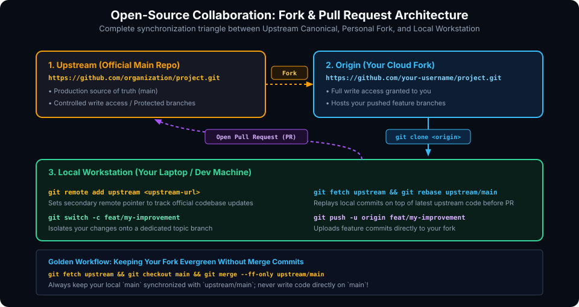

# Git Workflows and Collaboration Models

## Learning Goals

After completing this chapter, you should be able to:

- Compare and evaluate the three primary branching models in industry: GitHub Flow, Gitflow, and Trunk-Based Development.
- Select the appropriate branching strategy based on team size, release cadence, and deployment infrastructure.
- Architect and manage the open-source Fork and Pull Request collaboration triangle between Upstream, Origin, and Local clones.
- Keep local and remote forks evergreen without introducing unintended merge bubbles.
- Evaluate the tradeoffs between Merge Commits, Squash Merging, and Rebase Merging during Pull Request integration.
- Implement branch protection rules and CI/CD status gates to maintain mainline stability.

---

## Architectural Comparison of Branching Models

A **Git workflow** is a set of team-wide conventions governing how branches are named, when they are created, and how code is integrated back into the production codebase.



### 1. GitHub Flow (Lightweight & Continuous)

**GitHub Flow** is a streamlined, branch-based workflow created for teams that practice Continuous Delivery (CD) and deploy to production frequently (daily or hourly).

#### Core Rules:
1. Anything on the `main` branch is deployable and guaranteed production-ready.
2. To work on something new, create a descriptive branch off `main` (e.g., `feat/rate-limiter`).
3. Commit locally and push regularly to the remote branch on GitHub.
4. Open a Pull Request early to discuss implementation, review code, and verify CI tests.
5. Once approved and tested, merge into `main` and deploy immediately.

### 2. Gitflow (Scheduled Releases & Formal Governance)

Originally published by Vincent Driessen in 2010, **Gitflow** is a strict, multi-branch framework designed for software with traditional versioned release cycles (e.g., desktop software, mobile apps, or embedded hardware firmware).

#### Branch Roles:
- **`main`**: Stores the official release history. Every commit on `main` is tagged with a version number (e.g., `v2.1.0`).
- **`develop`**: Serves as the integration branch for completed features.
- **`feature/*`**: Branched off `develop`; merged back into `develop` when finished.
- **`release/*`**: Branched off `develop` when a release candidate is frozen. Only bug fixes, documentation, and release metadata edits are permitted. Once stable, merged into both `main` and `develop`.
- **`hotfix/*`**: Branched directly off `main` to address critical production issues; merged into both `main` and `develop`.

> [!NOTE]
> Gitflow introduces significant process overhead and frequent merge conflicts due to long-lived divergent branches. Most modern cloud, web, and SaaS engineering teams avoid Gitflow in favor of GitHub Flow or Trunk-Based Development.

### 3. Trunk-Based Development (High Velocity)

**Trunk-Based Development** is the standard practiced by high-performing tech organizations (including Google, Meta, and Netflix). All developers merge small, frequent updates into a single shared branch (the "trunk", typically `main`).

#### Core Rules:
1. Feature branches live for hours, not days (maximum 24 hours).
2. Changes are submitted as small, atomic micro-PRs (< 200 lines of code).
3. Incomplete features are concealed behind **Feature Flags / Feature Toggles** in code, allowing unreleased logic to exist safely in production without exposing it to end users.
4. Eliminates the dreaded "merge hell" by continuously integrating code before branches diverge.

### Branching Strategy Decision Matrix

| Dimension | GitHub Flow | Gitflow | Trunk-Based Development |
| :--- | :--- | :--- | :--- |
| **Branch Lifespan** | Short (1–3 days) | Long (Weeks to months) | Ultra-short (< 24 hours) |
| **Persistent Branches**| 1 (`main`) | 2 (`main`, `develop`) | 1 (`main` / `trunk`) |
| **Deployment Cadence** | Continuous (Multiple/day) | Scheduled (Quarterly/Monthly) | Continuous / On-demand |
| **Complexity & Overhead**| Low | High | Medium (Requires Feature Flags & CI) |
| **Best Used In** | Web apps, APIs, SaaS | Embedded firmware, packaged apps | High-scale microservices, elite CI/CD |

---

## The Open-Source Fork and Pull Request Model

In open-source software and security-conscious enterprise environments, external contributors are not granted direct write access to the central repository. Collaboration occurs via the **Fork and Pull Request Model**.



### The Collaboration Triangle

1. **`upstream`**: The official, authoritative repository hosted by the project maintainers.
2. **`origin`**: Your personal cloud fork of the repository hosted on your GitHub account (where you have full push access).
3. **`local`**: The cloned Git repository residing on your developer laptop.

### Step-by-Step Open Source Contribution Pipeline

```bash
# 1. Clone your personal fork to your workstation
git clone git@github.com:your-username/open-project.git
cd open-project

# 2. Add the authoritative upstream repository as a second remote
git remote add upstream git@github.com:organization/open-project.git

# 3. Verify remote endpoints
git remote -v
# Output:
# origin    git@github.com:your-username/open-project.git (fetch & push)
# upstream  git@github.com:organization/open-project.git (fetch & push)

# 4. Synchronize your local main with upstream BEFORE creating a feature branch
git fetch upstream
git switch main
git merge --ff-only upstream/main

# 5. Create a dedicated topic branch for your contribution
git switch -c feat/fast-packet-checksum

# 6. Make atomic commits
# ... code edits ...
git commit -m "feat(checksum): optimize Adler-32 SIMD calculation"

# 7. Rebase onto latest upstream main prior to pushing
git fetch upstream
git rebase upstream/main

# 8. Push your topic branch to YOUR personal fork (origin)
git push -u origin feat/fast-packet-checksum

# 9. Open a Pull Request on GitHub proposing to merge into upstream:main
```

> [!TIP]
> **Keeping `main` Evergreen:** Never write code directly on your local `main` branch. Treat `main` strictly as a read-only mirror of `upstream/main`. All development should occur inside dedicated `feat/*` or `fix/*` topic branches.

---

## Code Review, CI/CD, and Merge Strategies

### Merge Methods on GitHub / GitLab

When an approved Pull Request is merged into `main`, GitHub provides three distinct integration methods:

| GitHub Merge Option | Underlying Git Mechanics | Resulting History Appearance |
| :--- | :--- | :--- |
| **Create a Merge Commit** (`--no-ff`) | Synthesizes a two-parent merge commit retaining all individual commit objects from the branch. | Preserves individual commit history and shows branch divergence curves. |
| **Squash and Merge** | Combines all commits from the PR into **one single commit** applied directly atop `main`. | Pristine, ultra-clean linear history; eliminates intermediate "wip" or "fix typo" commits. |
| **Rebase and Merge** | Replays individual commits linearly onto `main` with rewritten hashes without a merge commit. | Linear history with individual commits preserved. |

### Protected Branches & Automated CI Status Gates

In production repositories, the `main` branch should always be **protected**:
- **Require Pull Request Reviews**: Prevents anyone (including administrators) from pushing directly to `main` without review.
- **Require Status Checks to Pass**: Ensures all automated unit tests, linters, and security vulnerability scanners pass before the merge button is enabled.
- **Require Branches to be Up-to-Date**: Forces the author to rebase or merge the latest `main` code before integrating to prevent silent regressions.

---

## Workflow Pitfalls and Anti-Patterns

- **Megabranch Anti-Pattern**: Branches that remain unmerged for weeks accumulate hundreds of divergent commits, creating immense merge friction, broken tests, and prolonged code reviews.
- **Noisy Commit History**: Pushing commits like `"fix typo"`, `"trying again"`, `"temp fix"` directly to `main`. Use interactive rebasing to tidy commits locally before requesting review.
- **Blind Merging**: Never merge a Pull Request without reading the complete file diff, even if all automated CI tests pass. Automated tests verify test assertions, not overall system architecture.

---

## Practical Exercises

1. Fork an open-source repository on GitHub to your account.
2. Clone your fork locally and configure `upstream` pointing to the parent repository using `git remote add upstream <url>`.
3. Practice synchronizing your local `main` with `upstream/main` using `git fetch upstream && git merge --ff-only upstream/main`.
4. Create a topic branch `feat/test-sync`, make a commit, push it to `origin`, and inspect the GitHub UI prompt offering to open a Pull Request against upstream.

##### Copyright (c) 2026 squared-studio
