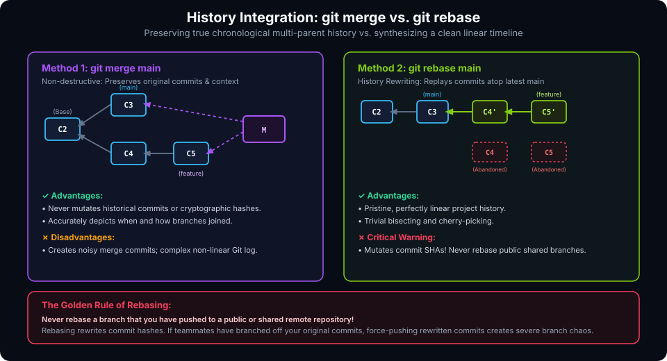
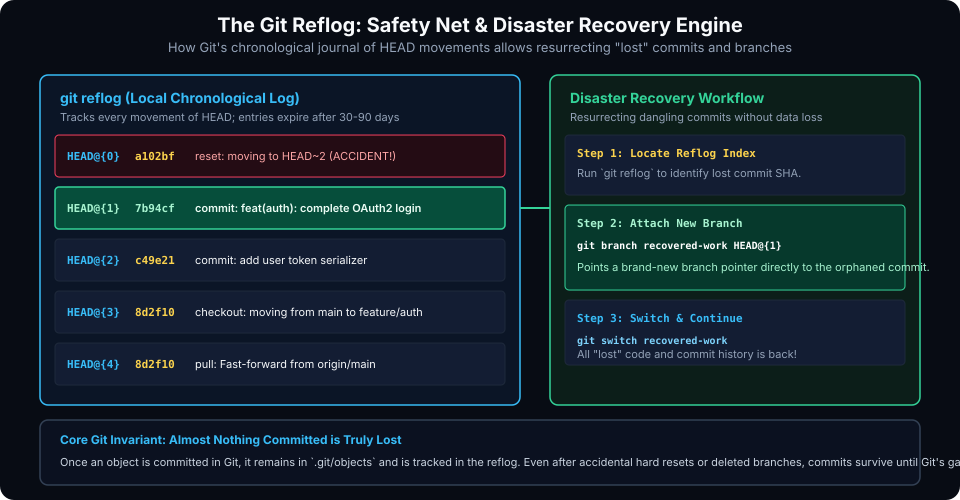

# Level Up Your Git Skills: Advanced Engineering, Best Practices, and Recovery

## Learning Goals

After completing this chapter, you should be able to:

- Rewrite and curate local branch history using interactive rebase (`git rebase -i`) with actions including `squash`, `fixup`, `reword`, and `drop`.
- Articulate and enforce the Golden Rule of Rebasing to prevent destructive remote history disruptions.
- Cherry-pick specific commits across release branches while recording audit provenance (`git cherry-pick -x`).
- Automate regression debugging across large commit histories using `git bisect run`.
- Inspect the local reference journal (`git reflog`) and resurrect accidentally deleted commits, lost branches, and hard-reset states.
- Manage large binaries efficiently using Git Large File Storage (Git LFS) and automate pre-commit validation using Git hooks.
- Apply the Conventional Commits specification to standardize commit logs for automated semantic versioning and changelog generation.

---

## Rewriting History: Interactive Rebasing

During local development, commits are naturally messy: you make typos, test ideas, save incremental progress, and debug unexpected test failures. Before submitting your branch for peer code review, Git allows you to curate your commits into a clean, professional narrative using **Interactive Rebasing**.



### Starting an Interactive Rebase

To edit the last 4 commits on your current branch:
```bash
git rebase -i HEAD~4
```

Git opens your configured text editor displaying an instruction sheet listing your commits from oldest to newest:

```plaintext
pick a82c091 feat(parser): scaffold packet decoder structure
pick 4d19bf2 fix typo in packet length check
pick 5c01da4 add CRC-32 checksum calculation
pick 9b88fe1 fix typo again and remove debug printf

# Rebase commands:
# p, pick <commit> = use commit
# r, reword <commit> = use commit, but edit the commit message
# e, edit <commit> = use commit, but stop for amending
# s, squash <commit> = use commit, but meld into previous commit
# f, fixup <commit> = like "squash", but discard this commit's log message
# d, drop <commit> = remove commit
```

### Curating the Commits

Edit the command verbs in the file:
```plaintext
pick a82c091 feat(parser): scaffold packet decoder structure
fixup 4d19bf2 fix typo in packet length check
pick 5c01da4 add CRC-32 checksum calculation
fixup 9b88fe1 fix typo again and remove debug printf
```

Save and exit the editor. Git automatically:
1. Replays `a82c091` and absorbs the typo fix `4d19bf2` directly into it without altering the original message.
2. Replays `5c01da4` and absorbs `9b88fe1` into it.
3. Produces a tidy, two-commit history that looks like you wrote the code flawlessly on your first attempt!

### The Golden Rule of Rebasing

> [!CAUTION]
> **The Golden Rule:** Never rebase a branch that has been pushed to a public or shared remote repository!
> 
> Rebasing creates **brand-new commit objects with new cryptographic SHA hashes**, abandoning the original commits. If teammates have pulled your branch or built work on top of your original commits, force-pushing rewritten commits creates severe branch confusion and can cause their local branches to duplicate historical commits.
> 
> Only rebase commits that exist solely on your private local branch!

---

## Selective Commit Transplantation: `git cherry-pick`

**Cherry-picking** allows you to select a specific commit from one branch and apply its exact patch onto your currently checked out branch without merging the entire branch.

```bash
# Switch to production maintenance branch
git switch maintenance/v1.2

# Cherry-pick a specific security patch from main
git cherry-pick -x 7a49bf2
```

- **`-x` flag**: Appends a line to the commit message reading `(cherry picked from commit 7a49bf2...)`. This is an essential practice in enterprise engineering to provide an audit trail linking back to the original patch.
- **`-n` (`--no-commit`) flag**: Applies the changes to your working tree and staging area without automatically committing, allowing you to bundle changes or inspect code.

---

## Automated Binary Search Debugging: `git bisect`

When a bug is discovered in a codebase with hundreds of recent commits, manually testing each revision is slow and exhausting. **`git bisect`** executes a binary search through your commit history to find the exact commit that introduced the regression in $O(\log n)$ steps.

### Interactive Bisecting

```bash
# 1. Start the bisect wizard
git bisect start

# 2. Inform Git that the current version has the bug
git bisect bad

# 3. Inform Git of a known working commit in the past
git bisect good v1.0.0
```

Git automatically checks out the middle commit:
```plaintext
Bisecting: 64 revisions left to test after this (roughly 6 steps)
[3f8a10b] refactor: optimize network socket buffer allocation
```

Compile and test your project:
- If the bug is present: run `git bisect bad`
- If the bug is absent: run `git bisect good`

Git halves the search space at each step until it pinpoints the culprit commit:
```plaintext
7b94cf281a is the first bad commit
commit 7b94cf281a
Author: Developer <dev@org.com>
Date:   Mon Nov 02 14:22:10 2026

    refactor(parser): change buffer indexing logic
```

Once finished, return to your original branch:
```bash
git bisect reset
```

### Fully Automated Bisecting (`git bisect run`)

If you have an automated test script that returns exit code `0` for success and non-zero for failure:

```bash
git bisect start HEAD v1.0.0
git bisect run ./run_unit_tests.sh
```

Git runs the script on each binary partition automatically, finding the faulty commit without any human intervention!

---

## Disaster Recovery and The Git Reflog Safety Net

One of the greatest features of Git is that **almost nothing committed is ever truly lost**. 

When you run `git reset --hard HEAD~3` or accidentally delete a feature branch with `git branch -D my-feature`, the commits are disconnected from branch pointers, but their objects remain untouched in `.git/objects/`.

Git maintains the **`reflog`** (*Reference Log*): an append-only, chronological journal of every movement of `HEAD` and local branch pointers on your machine.



### Recovering "Lost" Commits

```bash
# Display the chronological history of HEAD movements
git reflog
```

Sample output:
```plaintext
a102bf3 (HEAD -> main) HEAD@{0}: reset: moving to HEAD~2
7b94cf2 HEAD@{1}: commit: feat(auth): complete OAuth2 login
c49e210 HEAD@{2}: commit: add user token serializer
8d2f105 HEAD@{3}: checkout: moving from feature/auth to main
```

Notice that `7b94cf2` is the commit that was discarded by the accidental reset!

To restore this commit and all its history:
```bash
# Option A: Create a new branch pointing directly to the orphaned commit
git branch recovered-auth-work 7b94cf2

# Option B: Re-reset HEAD back to its position before the accident
git reset --hard HEAD@{1}
```

> [!NOTE]
> Reflog entries are local to your workstation (they are never pushed to GitHub) and expire by default after 30 days for unreachable commits and 90 days for reachable ones, at which point `git gc` prunes them.

---

## Repository Hygiene, Git LFS, and Automation Hooks

### 1. Large File Storage (Git LFS)
Git is designed for text files. Storing large binary assets (trained neural network weights, high-resolution textures, FPGA bitstreams, video files) directly in Git causes repository bloat because every revision stores a full duplicate.

**Git LFS** replaces large files in your repository with small text pointer files, storing the actual multi-gigabyte binaries on a dedicated object server:

```bash
# Install Git LFS extension
git lfs install

# Track large files (e.g., all *.bin firmware bitstreams)
git lfs track "*.bin"

# Commit the generated tracking configuration
git add .gitattributes
git commit -m "chore: track firmware binaries via Git LFS"
```

### 2. Standardized Commit Messages: Conventional Commits
High-performing software teams adopt the **Conventional Commits** specification to format commit logs:

$$\text{<type>}(\text{<optional scope>}): \text{<description>}$$

Common Types:
- **`feat`**: Introduces a new feature to the codebase.
- **`fix`**: Patches a bug in production or test code.
- **`docs`**: Documentation-only alterations.
- **`refactor`**: Code changes that neither fix a bug nor add a feature.
- **`perf`**: Performance optimization improvements.
- **`test`**: Adding missing unit/integration tests or correcting existing tests.
- **`chore`**: Build system, dependencies, or auxiliary tool configuration.

### 3. Client-Side Git Hooks
Git hooks are executable scripts placed inside `.git/hooks/` that run automatically at key lifecycle events:
- **`pre-commit`**: Runs linters, formatters (`clang-format`, `black`), and unit tests before allowing a commit.
- **`commit-msg`**: Validates that the commit message adheres to Conventional Commits standards.
- **`pre-push`**: Verifies that regression suites pass before code is transmitted to remote servers.

---

## Pro Engineering Best Practices Checklist

- **Never Force Push to Main**: Enforce branch protection on remote hosting servers to disable `--force` pushes to `main`.
- **Use `git status -s` Frequently**: Keep your working tree clean and be constantly aware of untracked and modified files.
- **Write Imperative Commit Messages**: Write `"fix: correct race condition"` rather than `"fixed:"` or `"fixing:"`.
- **Clean Untracked Files Safely**:
  ```bash
  # Preview untracked files and directories to be deleted:
  git clean -nd
  # Perform deletion once verified:
  git clean -fd
  ```

---

## Practical Exercises

1. In a sandbox repository, make three small commits. Run `git rebase -i HEAD~3` and use `squash` or `fixup` to combine the last two commits into one.
2. Invert a previous commit using `git revert <hash>` and inspect `git log` to see the newly generated inverse commit.
3. Intentionally execute `git reset --hard HEAD~1` to wipe your latest commit. Use `git reflog` to identify the orphaned commit hash and restore it by attaching a new branch: `git branch restored-work <hash>`.
4. Install and configure a basic `pre-commit` hook that checks for trailing whitespace before allowing commits.

##### Copyright (c) 2026 squared-studio
