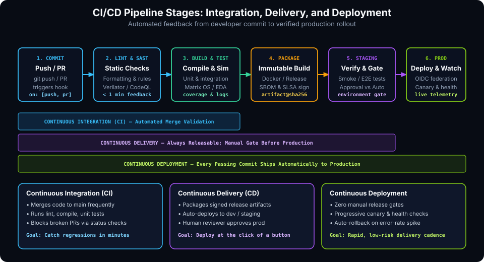
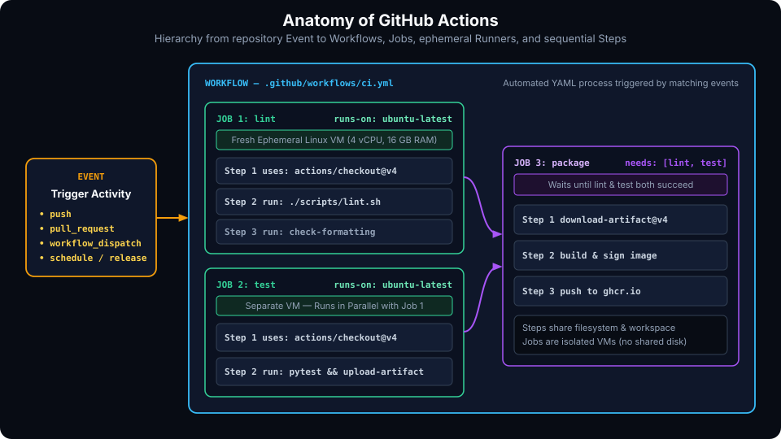

# CI/CD Foundations and GitHub Actions Architecture

## Learning Goals

After completing this chapter, you should be able to:

- Distinguish clearly between Continuous Integration (CI), Continuous Delivery, and Continuous Deployment, and articulate how they improve DORA delivery metrics.
- Explain the complete GitHub Actions object hierarchy: Events, Workflows, Jobs, Runners, Steps, and Actions.
- Author a production-ready `.github/workflows/ci.yml` file featuring shallow checkouts, parallel jobs, `needs:` dependencies, timeouts, and `$GITHUB_STEP_SUMMARY` reporting.
- Compare GitHub-hosted runner operating systems, VM specifications, ephemeral lifecycle guarantees, and billing multipliers.
- Apply foundational CI hygiene practices—such as splitting fast static checks from slow test suites and setting fail-fast shell options—to maximize developer feedback speed.

---

## Continuous Integration, Delivery, and Deployment Explained

Modern software and hardware teams integrate work from dozens of contributors every day. Without automated validation, merging divergent branches leads to broken builds, silent behavioral regressions, and painful manual release nights. **CI/CD** solves this by automating every verification, packaging, and delivery step between a developer's `git push` and production.



### 1. Continuous Integration (CI)
**Continuous Integration** is the engineering practice of merging developer changes into a shared mainline branch (`main`) frequently—often multiple times per day—where every commit triggers an automated build, static lint, and test suite.

- **Core Principle**: Catch defects within minutes while the code context is still fresh in the author's mind.
- **Software Example**: Running `ruff`/`eslint`, type checks (`mypy`/`tsc`), and `pytest` on every Pull Request.
- **Hardware / RTL Example**: Running `verible-verilog-lint`, `verilator --lint-only`, and SystemVerilog/`cocotb` unit simulations on every RTL commit before peer review.

### 2. Continuous Delivery (CD)
**Continuous Delivery** extends CI by ensuring that every commit passing the integration suite is automatically packaged into an immutable, release-ready artifact and deployed to a staging or pre-production environment. Releasing to production remains an intentional business decision—often gated behind a human approval click.

### 3. Continuous Deployment (CD)
**Continuous Deployment** removes the manual approval gate for production. Every commit that clears all automated unit, integration, security, and staging smoke tests is automatically rolled out to end users—typically using progressive delivery (canary rollouts and automated health rollbacks).

### CI/CD Comparison Matrix

| Dimension | Continuous Integration (CI) | Continuous Delivery | Continuous Deployment |
| :--- | :--- | :--- | :--- |
| **Primary Trigger** | Every PR commit and push to `main` | Merge to `main` or release tag | Merge to `main` |
| **Automation Scope** | Lint, compile, unit/integration tests | CI + packaging + staging deploy | Full pipeline straight to production |
| **Human Approval Gate** | Code review before PR merge | Required before production rollout | None (automated health checks) |
| **Key Output** | Pass/fail PR status checks & logs | Signed, tested release artifact | Live production deployment |
| **DORA Metrics Impact** | Cuts change failure rate early | Shrinks lead time for changes | Maximizes deployment frequency |

> [!NOTE]
> **DORA Metrics & Tight Feedback Loops:** Research by the DevOps Research and Assessment (DORA) group identifies four indicators of elite engineering teams: **Deployment Frequency**, **Lead Time for Changes**, **Change Failure Rate**, and **Time to Restore Service**. GitHub Actions directly improves all four by turning manual checklists into deterministic, repeatable pipelines.

---

## Anatomy of GitHub Actions

**GitHub Actions** is GitHub's native automation and CI/CD platform embedded directly alongside your Git repository, Pull Requests, Issues, and Environments. Workflows are stored as declarative YAML files under `.github/workflows/` inside your repository—meaning your CI pipeline itself is version-controlled, code-reviewed, and branched alongside your source code.



### The Six Core Building Blocks

1. **Event**: An activity inside or outside GitHub that triggers a workflow run—such as `push`, `pull_request`, `release`, `schedule`, or a manual `workflow_dispatch`.
2. **Workflow**: A configurable automated process defined in `.github/workflows/<name>.yml`. A repository can have multiple workflows (e.g., `ci.yml`, `security.yml`, `release.yml`).
3. **Job**: A collection of steps inside a workflow that executes on a single runner instance. By default, **all jobs in a workflow run in parallel** unless connected with `needs:`. Because each job runs on a separate machine, jobs do **not** share a local filesystem.
4. **Runner**: A physical or virtual server hosting the GitHub Actions Runner agent that listens for jobs, executes one job at a time, and streams logs and exit codes back to GitHub.
5. **Step**: An individual task inside a job—either executing a shell command (`run:`) or invoking a reusable Action (`uses:`). Steps inside the same job execute **sequentially** on the same runner and **share the workspace filesystem**.
6. **Action**: A packaged, versioned unit of automation (from GitHub, the Marketplace, or your own repository) invoked with `uses: owner/repo@ref`—such as `actions/checkout@v4` to clone your code.

> [!TIP]
> Think of a **Workflow** as a DAG (Directed Acyclic Graph) of isolated **Jobs** (separate machines), and each **Job** as a sequential shell script of **Steps** sharing one directory (`$GITHUB_WORKSPACE`).

---

## Writing Your First Production-Ready Workflow

A minimal "hello world" workflow rarely holds up in production. A well-structured CI workflow sets an explicit workflow name, configures safe shell defaults, specifies `timeout-minutes` to prevent hung processes from burning billing quotas, splits fast checks from heavier tests, and publishes a clean summary.

Create `.github/workflows/ci.yml` inside your repository:

```yaml
name: CI Pipeline

# Trigger on pushes to main and all Pull Requests targeting main
on:
  push:
    branches: [main]
  pull_request:
    branches: [main]

# Strict least-privilege token permissions (covered deeply in Chapter 12)
permissions:
  contents: read

# Apply strict Bash error-handling across all run steps
defaults:
  run:
    shell: bash

jobs:
  lint:
    name: Static Analysis & Formatting
    runs-on: ubuntu-latest
    timeout-minutes: 10
    steps:
      - name: Check out repository
        uses: actions/checkout@v4
        with:
          fetch-depth: 1

      - name: Verify shell & YAML hygiene
        run: |
          set -euo pipefail
          echo "Inspecting commit $GITHUB_SHA on ref $GITHUB_REF_NAME"
          ./scripts/check_format.sh

  test:
    name: Build & Unit Tests
    runs-on: ubuntu-latest
    timeout-minutes: 20
    steps:
      - name: Check out repository
        uses: actions/checkout@v4

      - name: Run unit test suite
        run: |
          set -euo pipefail
          make test

      - name: Write job summary
        if: always()
        run: |
          {
            echo "### Build & Test Summary"
            echo "- **Commit:** \`$GITHUB_SHA\`"
            echo "- **Runner OS:** \`$RUNNER_OS\`"
            echo "- **Status:** \`${{ job.status }}\`"
          } >> "$GITHUB_STEP_SUMMARY"

  verify-gate:
    name: CI Gatekeeper
    needs: [lint, test]
    runs-on: ubuntu-latest
    timeout-minutes: 5
    steps:
      - name: Confirm all checks succeeded
        run: echo "Lint and unit tests passed cleanly."
```

### Key Elements in This Workflow

- **`actions/checkout@v4`**: Clones your repository into `$GITHUB_WORKSPACE` using a shallow clone (`fetch-depth: 1`) by default so the checkout step finishes in seconds instead of downloading decades of history.
- **`timeout-minutes`**: GitHub defaults job timeouts to **360 minutes (6 hours)**. A hung simulation or infinite loop without an explicit timeout can consume hundreds of runner minutes before aborting. Always cap every job tightly (e.g., `10`–`30` minutes).
- **`needs: [lint, test]`**: Creates a fan-in gatekeeper job that runs only after both `lint` and `test` pass. Meanwhile, `lint` and `test` run concurrently on two separate VMs.
- **`$GITHUB_STEP_SUMMARY`**: Appending Markdown to the file path in `$GITHUB_STEP_SUMMARY` renders rich headings, status bullets, and tables directly on the workflow run summary page in the GitHub UI.

---

## Runners, Execution Environment, and Billing Mechanics

Every job executes on either a **GitHub-hosted runner** (managed cloud VMs provisioned on demand) or a **self-hosted runner** (infrastructure you manage, covered in Chapter 13).

### Standard GitHub-Hosted Runners (Public & Standard Repos)

| Runner Label | Operating System | CPU / RAM Highlights | Preinstalled Tooling | Billing Minute Multiplier |
| :--- | :--- | :--- | :--- | :---: |
| `ubuntu-latest` / `ubuntu-24.04` | Ubuntu Linux (x64) | 4 vCPU, 16 GB RAM | Docker, Python, Node, GCC, Git, `gh`, Make | **1x** (Baseline) |
| `ubuntu-24.04-arm` | Ubuntu Linux (ARM64) | 4 vCPU, 16 GB RAM | Native ARM64 container & build stack | **1x** (Partner/Standard) |
| `windows-latest` / `windows-2022` | Windows Server | 4 vCPU, 16 GB RAM | MSVC, PowerShell, .NET, Chocolatey, Git | **2x** |
| `macos-latest` / `macos-15` | macOS (Apple Silicon) | 3–4 CPU, 7–14 GB RAM | Xcode, Homebrew, Swift, Python, Clang | **10x** |

> [!IMPORTANT]
> **Ephemeral Virtual Machines:** Each GitHub-hosted job receives a **brand-new, freshly imaged VM** that is permanently destroyed the moment the job completes. Nothing written to `/tmp`, `$HOME`, or `$GITHUB_WORKSPACE` survives into the next job unless explicitly saved as a cache or artifact.

### Cost & Quota Mechanics

- **Public Repositories**: Standard GitHub-hosted runners are **free** (subject to GitHub's abuse and concurrency policies).
- **Private Repositories**: Every GitHub plan includes a monthly pool of free Linux-equivalent minutes (e.g., 2,000 minutes on GitHub Free, 3,000 on Pro/Team, 50,000 on Enterprise). Minutes consumed on `windows-latest` count **2x** against your quota, and `macos-latest` counts **10x** (10 minutes on macOS consumes 100 quota minutes).
- **Billing Rounding**: Execution time per job is rounded **up to the nearest whole minute**. Splitting a single workflow into ten 15-second jobs consumes 10 billed minutes instead of 3! Keep setup lightweight and group tiny checks logically.

---

## Best Practices and Common Pitfalls

- **Always Set `timeout-minutes` on Every Job**: Never leave the default 6-hour timeout active on CI jobs.
- **Fail Fast Inside Multi-Line `run:` Blocks**: On Linux/macOS, GitHub runs `bash -e -o pipefail {0}` by default when `shell: bash` is selected—but explicitly adding `set -euo pipefail` guarantees undefined variables and piped errors fail immediately.
- **Avoid `fetch-depth: 0` Unless Needed**: Full-history clones slow down large repositories; only set `fetch-depth: 0` for tasks requiring `git log`, `git describe --tags`, or changelog generation.
- **Split Fast Checks from Slow Builds**: Run 30-second linters and syntax checks in parallel with 10-minute test suites so authors learn about formatting or typo errors immediately rather than waiting for compilation to finish.
- **Add a Repository Status Badge in `README.md`**:
  ```markdown
  
  ```

---

## Practical Exercises

1. Inspect an existing `.github/workflows/*.yml` file in a public open-source project on GitHub and identify every Event, Job, Runner, `needs:` dependency edge, and `uses:` Action version.
2. In a sandbox GitHub repository, create `.github/workflows/ci.yml` with two parallel jobs (`lint` and `unit-test`) plus a `summary` job using `needs: [lint, unit-test]`, `timeout-minutes: 10`, and `$GITHUB_STEP_SUMMARY`.
3. Push a branch and open a Pull Request to observe both parallel jobs executing simultaneously and inspect the generated Markdown report in the GitHub Actions summary UI.
4. Intentionally make the `lint` job exit with code `1` and verify that the downstream `summary` job is automatically skipped unless guarded with `if: always()`.

##### Copyright (c) 2026 squared-studio
