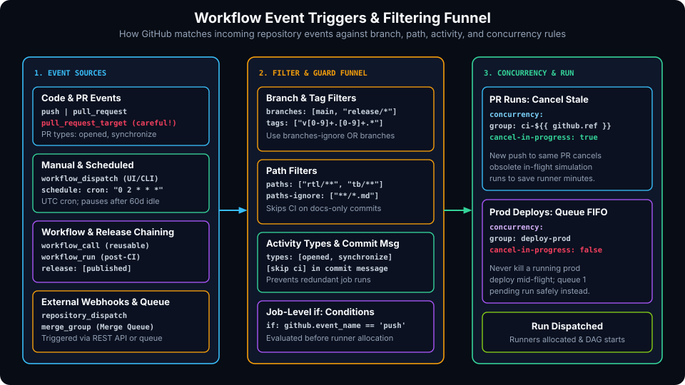
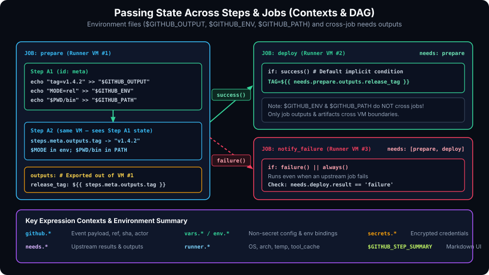

# Workflow Triggers, Contexts, Expressions, and Flow Control

## Learning Goals

After completing this chapter, you should be able to:

- Configure event triggers (`push`, `pull_request`, `schedule`, `workflow_dispatch`, `repository_dispatch`, `workflow_run`) with branch, tag, and path filters.
- Access runtime metadata safely using GitHub Actions contexts (`github`, `env`, `vars`, `secrets`, `needs`, `inputs`, `runner`, `steps`).
- Write conditional logic and dynamic expressions using `${{ ... }}` operators and built-in functions (`contains`, `startsWith`, `hashFiles`, `fromJSON`, `format`).
- Pass scalar and multi-line state across steps (`$GITHUB_OUTPUT`, `$GITHUB_ENV`, `$GITHUB_PATH`) and across jobs (`outputs:` + `needs.<job>.outputs`).
- Control parallel and deployment execution safely using `concurrency:` groups and `cancel-in-progress`.

---

## Event Triggers and Path Filtering

The `on:` block determines **when** GitHub starts a workflow run. Precision filtering keeps CI fast and avoids wasting runner minutes on documentation or unrelated directory edits.



### Core Repository Triggers

```yaml
on:
  push:
    branches:
      - main
      - "release/**"
    paths:
      - "src/**"
      - "rtl/**"
      - ".github/workflows/ci.yml"

  pull_request:
    types: [opened, synchronize, reopened, ready_for_review]
    branches: [main]
    paths-ignore:
      - "docs/**"
      - "**/*.md"

  schedule:
    # Runs nightly at 02:30 UTC (never rely on exact minute timing; expect 5-15m jitter)
    - cron: "30 2 * * *"

  workflow_dispatch:
    inputs:
      environment:
        description: "Target deployment environment"
        type: choice
        required: true
        default: "staging"
        options: [dev, staging, production]
      debug_sim:
        description: "Enable verbose waveform trace"
        type: boolean
        default: false
      sim_seed:
        description: "Deterministic simulation seed"
        type: string
        default: "42"
```

### Trigger Reference Matrix

| Trigger Event | Typical Use Case | Key Gotchas / Rules |
| :--- | :--- | :--- |
| `push` | Build `main`, tag releases, deploy docs | Cannot combine `branches` and `branches-ignore` under the same event. |
| `pull_request` | Untrusted PR CI validation (runs on merge commit preview) | Fork PRs receive read-only `GITHUB_TOKEN` and **zero secrets**. |
| `pull_request_target` | Commenting/labeling on fork PRs | **High security risk** if paired with fork code checkout (see Chapter 12). |
| `schedule` | Nightly regressions, security scans, cleanup | Always **UTC**; paused automatically after **60 days** of repository inactivity. |
| `workflow_dispatch` | On-demand runs from GitHub UI, API, or `gh workflow run` | Must exist on the **default branch** (`main`) to appear in the UI Run button. |
| `workflow_call` | Invoked as a reusable workflow by another workflow | Supports strongly typed `inputs`, `outputs`, and explicit `secrets`. |
| `workflow_run` | Post-CI privileged follow-up after another workflow completes | Always runs in base branch context; requires validating downloaded artifacts. |
| `repository_dispatch` | External webhook trigger via GitHub REST API (`type:`) | Ideal for ChatOps, external artifact builds, or upstream repo notifications. |

> [!TIP]
> **Preventing Duplicate Runs on Same-Repo PRs:** If you configure `on: [push, pull_request]` without filters, pushing a branch and opening a PR triggers **two** parallel CI runs for the exact same commit. Restrict `push` to `branches: [main]` (or tags) while running `pull_request` on feature branches.

---

## Contexts, Variables, and Expression Syntax

GitHub Actions injects structured JSON-like objects called **contexts** into every workflow evaluation, accessed inside `${{ ... }}` expression blocks.

### Primary Contexts

| Context | Scope | Common Properties |
| :--- | :--- | :--- |
| `github` | Workflow & event metadata | `github.sha`, `github.ref_name`, `github.event_name`, `github.actor`, `github.repository` |
| `env` | Workflow / job / step env vars | `env.NODE_ENV`, `env.CC` |
| `vars` | Non-secret repo/org/env variables | `vars.DEPLOY_REGION`, `vars.PYTHON_VERSION` |
| `secrets` | Encrypted credentials | `secrets.GITHUB_TOKEN`, `secrets.DEPLOY_ROLE_ARN` |
| `inputs` | `workflow_dispatch` / `workflow_call` inputs | `inputs.environment`, `inputs.debug_sim` |
| `needs` | Upstream job results & exported outputs | `needs.build.result`, `needs.build.outputs.version` |
| `steps` | Outputs & outcomes of prior steps in same job | `steps.meta.outputs.tag`, `steps.test.outcome` |
| `runner` | Current runner hardware/OS metadata | `runner.os` (`Linux`, `Windows`, `macOS`), `runner.arch`, `runner.temp` |
| `matrix` | Active matrix cell values | `matrix.os`, `matrix.python-version` |

### Essential Expression Functions

Inside `${{ ... }}`, string literals use **single quotes** (`'main'`), comparisons use `==`, `!=`, `&&`, `||`, `!`, and GitHub provides helper functions:

- **`contains(search, item)`**: Case-insensitive substring or array membership test:
  `if: contains(github.event.pull_request.labels.*.name, 'run-full-sim')`
- **`startsWith(str, prefix)` / `endsWith(str, suffix)`**: Prefix/suffix match, e.g., `startsWith(github.ref, 'refs/tags/v')`.
- **`format(str, ...)`**: Positional string formatting (`format('v{0}-{1}', inputs.major, github.run_number)`).
- **`hashFiles('**/package-lock.json')`**: Computes deterministic SHA-256 hash of matched files for cache keys.
- **`fromJSON(str)` / `toJSON(obj)`**: Parses JSON strings into matrix/object structures or serializes contexts for inspection.

---

## Passing State Between Steps and Jobs

Because each step spawns a fresh shell process—and each job spawns an isolated runner VM—ordinary shell exports (`export FOO=bar`) **disappear** as soon as the step ends. GitHub provides special environment files to persist state safely.



### Environment Files (`$GITHUB_OUTPUT`, `$GITHUB_ENV`, `$GITHUB_PATH`)

```yaml
jobs:
  prepare:
    runs-on: ubuntu-latest
    # Export step outputs to downstream jobs via job-level outputs
    outputs:
      version: ${{ steps.meta.outputs.version }}
      changelog: ${{ steps.meta.outputs.changelog }}
    steps:
      - uses: actions/checkout@v4

      - name: Compute metadata and update runner state
        id: meta
        run: |
          set -euo pipefail
          VERSION="v1.4.${GITHUB_RUN_NUMBER}"

          # 1. Step output (available to later steps and job outputs)
          echo "version=$VERSION" >> "$GITHUB_OUTPUT"

          # 2. Multi-line output using a unique EOF delimiter
          {
            echo "changelog<<EOF_CHANGELOG"
            git log -n 5 --oneline
            echo "EOF_CHANGELOG"
          } >> "$GITHUB_OUTPUT"

          # 3. Job-wide environment variable for ALL subsequent steps in this job
          echo "BUILD_VERSION=$VERSION" >> "$GITHUB_ENV"

          # 4. Prepend custom binary directory to PATH for subsequent steps
          echo "$GITHUB_WORKSPACE/scripts/bin" >> "$GITHUB_PATH"

      - name: Consume state in a later step of the same job
        run: |
          echo "Using env var: $BUILD_VERSION"
          echo "Using step output: ${{ steps.meta.outputs.version }}"

  deploy:
    needs: prepare
    runs-on: ubuntu-latest
    steps:
      - name: Read upstream job output
        env:
          TARGET_VER: ${{ needs.prepare.outputs.version }}
        run: |
          echo "Deploying version $TARGET_VER"
```

### Workflow Commands for Log Readability & Annotations

Writing specially formatted lines to stdout enables structured UI feedback:

```bash
# Fold noisy installation logs into collapsible groups
echo "::group::Installing verification toolchain"
pip install -r requirements.txt
echo "::endgroup::"

# Annotate exact source file and line numbers in the PR "Files changed" tab
echo "::warning file=rtl/uart_tx.sv,line=42::Register bitwidth truncated implicitly"
echo "::error file=tb/test_axi.py,line=108::AXI BRESP returned SLVERR"

# Mask dynamically generated tokens so they are scrubbed as *** in logs
echo "::add-mask::$DYNAMIC_SESSION_TOKEN"
```

> [!WARNING]
> **Multiline Outputs & Security:** Always use an unpredictable delimiter or `EOF` token when writing untrusted strings into `$GITHUB_OUTPUT` or `$GITHUB_ENV`. If input data could contain your delimiter line, an attacker could inject arbitrary environment variables (such as `LD_PRELOAD` or `PATH`). Never write untrusted PR payloads directly into `$GITHUB_ENV`.

---

## Conditional Execution, Concurrency, and DAG Control

### Job & Step Status Functions

By default, GitHub injects an implicit `if: success()` on every job and step—meaning it runs only if all upstream dependencies succeeded. You can override this with:

| Function | When It Evaluates `true` | Common Usage |
| :--- | :--- | :--- |
| `success()` | All previous steps / `needs:` jobs succeeded | Default implicit guard |
| `failure()` | At least one prior step or `needs:` job failed | Upload waveforms, crash dumps, Slack failure alerts |
| `always()` | Always runs, even on failure or cancellation | Upload test reports, cleanup temp state, `$GITHUB_STEP_SUMMARY` |
| `cancelled()` | The workflow run was explicitly cancelled | Release remote locks or ephemeral cloud sandboxes |
| `needs.a.result == 'skipped'` | Explicit inspection when an upstream job was skipped | Gatekeeper job validating `contains(..., needs.a.result)` |

Note that inside an `if:` field at the workflow or job level, **you can omit `${{ ... }}`**, though keeping `${{ ... }}` is also valid. Be aware that if an upstream job is **skipped**, `success()` evaluates to `true` only if no ancestor failed—so gatekeeper jobs that run after optional path-filtered jobs must check:

```yaml
  ci-gate:
    needs: [lint, unit-tests]
    if: ${{ !cancelled() }}
    runs-on: ubuntu-latest
    steps:
      - name: Verify no dependency failed
        run: |
          if [[ "${{ needs.lint.result }}" == "failure" || "${{ needs.unit-tests.result }}" == "failure" ]]; then
            echo "Upstream check failed!"
            exit 1
          fi
```

### Concurrency Groups (`cancel-in-progress`)

When a developer pushes three quick commits to a Pull Request in two minutes, running three overlapping test suites wastes quota and causes race conditions. Concurrency groups enforce mutual exclusion per group key:

```yaml
# Cancel stale PR runs immediately, but NEVER cancel main/deploy runs mid-flight
concurrency:
  group: ${{ github.workflow }}-${{ github.event.pull_request.number || github.ref }}
  cancel-in-progress: ${{ github.event_name == 'pull_request' }}
```

- At most **one running** and **one pending** job/workflow exist per `group` at any instant.
- If a third run arrives while one is pending and `cancel-in-progress: false`, the older pending run is dropped so the newest commit runs next—while the live deployment finishes safely.

---

## Best Practices and Common Pitfalls

- **Never Use `export VAR=...` Across Steps**: Always write to `"$GITHUB_ENV"` or `"$GITHUB_OUTPUT"`.
- **Keep `schedule` Cron Minutes Off `:00`**: GitHub runners experience heavy load spikes at the top of every hour (`0 * * * *`). Offset schedules to odd minutes like `23 3 * * *` for significantly faster runner startup.
- **Avoid `pull_request_target` Unless Strictly Required**: For PRs from forks, stick to `pull_request` so untrusted code runs unprivileged without access to repository secrets.
- **Remember the `$GITHUB_ENV` / `needs` Boundary**: Variables written to `$GITHUB_ENV` vanish when the job ends; cross-job data must be explicitly declared in the upstream job's `outputs:` map.
- **Treat Non-Secret Config as `vars.*`, Not `secrets.*`**: Putting region names or tool versions in `vars` keeps them visible in logs for easy debugging, reserving `secrets` strictly for sensitive credentials.

---

## Practical Exercises

1. Write a workflow using `workflow_dispatch` with a `choice` input (`sim_tool: verilator | iverilog`) and a `boolean` input (`enable_waves`), echoing those selections into `$GITHUB_STEP_SUMMARY`.
2. Build a two-job DAG (`build` → `verify`) where `build` computes a dynamic build tag and timestamp, writes them to `$GITHUB_OUTPUT`, exports them via job `outputs:`, and `verify` reads `${{ needs.build.outputs.tag }}`.
3. Add a third job `cleanup` with `needs: [build, verify]` and `if: always()` that reports the final `needs.build.result` and `needs.verify.result` values.
4. Configure a `concurrency:` group at the workflow level that sets `cancel-in-progress: true` exclusively on `pull_request` events while setting `cancel-in-progress: false` on pushes to `main`.

##### Copyright (c) 2026 squared-studio
