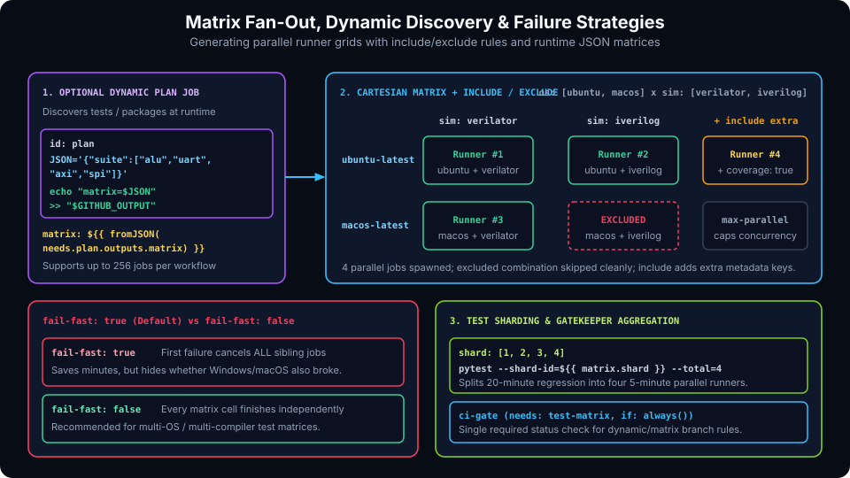
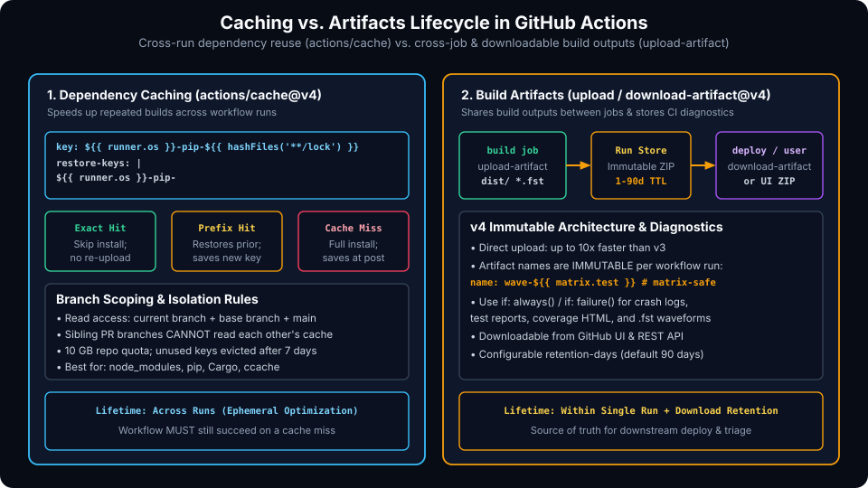

# Matrix Builds, Dependency Caching, and Artifact Management

## Learning Goals

After completing this chapter, you should be able to:

- Design multi-dimensional test grids using `strategy.matrix`, `include`, `exclude`, `max-parallel`, and `fail-fast: false`.
- Generate dynamic runtime test matrices using JSON outputs and `fromJSON()`.
- Configure deterministic, fast dependency caching with `actions/cache@v4`, `hashFiles()`, and `restore-keys` while understanding branch scoping and the 10 GB LRU quota.
- Share immutable build outputs, crash logs, waveforms, and coverage reports between jobs using `actions/upload-artifact@v4` and `actions/download-artifact@v4`.
- Choose accurately between caching and artifacts, and optimize runner latency via test sharding, sparse checkouts, and path filters.

---

## Build Matrices and Dynamic Fan-Out

Real-world projects must verify compatibility across multiple operating systems, language runtimes, compiler toolchains, or simulation configurations. Instead of duplicating YAML jobs, **`strategy.matrix`** expands a single job template into a Cartesian grid of parallel runner jobs.



### Multi-Dimensional Matrix with `include` and `exclude`

```yaml
jobs:
  cross-verify:
    name: Test (${{ matrix.os }}, ${{ matrix.sim }})
    runs-on: ${{ matrix.os }}
    timeout-minutes: 15
    strategy:
      fail-fast: false       # Keep testing Windows/macOS even if Linux fails
      max-parallel: 4        # Cap concurrent runners (useful for licensed tools)
      matrix:
        os: [ubuntu-latest, macos-latest, windows-latest]
        sim: [verilator, iverilog]
        exclude:
          # Exclude redundant or unsupported combinations
          - os: windows-latest
            sim: verilator
        include:
          # Inject extra parameters onto an existing cell
          - os: ubuntu-latest
            sim: verilator
            coverage: "true"
            extra_flags: "--coverage --assert"
          # Add a completely new standalone matrix cell
          - os: ubuntu-24.04-arm
            sim: verilator
            coverage: "false"
            extra_flags: ""

    steps:
      - uses: actions/checkout@v4
      - name: Run simulator
        env:
          SIM_TOOL: ${{ matrix.sim }}
          COV_ENABLED: ${{ matrix.coverage || 'false' }}
          SIM_FLAGS: ${{ matrix.extra_flags }}
        run: ./scripts/run_sim.sh --tool "$SIM_TOOL" $SIM_FLAGS
```

- **`fail-fast`**: Defaults to `true`, which cancels all in-progress sibling jobs the moment one cell fails. Set `fail-fast: false` for cross-platform matrices so you see every platform's failures in a single run instead of playing whack-a-mole.
- **Matrix Limits**: A single workflow run supports up to **256 matrix jobs** per job definition.

### Dynamic Runtime Matrices (`fromJSON`) & Test Sharding

In monorepos or large testbases, hardcoding module lists in YAML goes stale quickly. A lightweight `plan` job can inspect changed files or discover test suites dynamically, emit JSON to `$GITHUB_OUTPUT`, and fan out downstream:

```yaml
jobs:
  discover:
    runs-on: ubuntu-latest
    outputs:
      matrix: ${{ steps.scan.outputs.matrix }}
    steps:
      - uses: actions/checkout@v4
      - id: scan
        run: |
          # Dynamically discover testbenches or shard IDs
          MATRIX_JSON=$(python3 -c '
          import glob, json, os
          suites = sorted(os.path.basename(p) for p in glob.glob("tb/suite_*"))
          print(json.dumps({"suite": suites}))
          ')
          echo "matrix=$MATRIX_JSON" >> "$GITHUB_OUTPUT"

  regression:
    needs: discover
    if: ${{ needs.discover.outputs.matrix != '{"suite":[]}' }}
    runs-on: ubuntu-latest
    strategy:
      fail-fast: false
      matrix: ${{ fromJSON(needs.discover.outputs.matrix) }}
    steps:
      - uses: actions/checkout@v4
      - name: Execute ${{ matrix.suite }}
        run: pytest "tb/${{ matrix.suite }}"
```

Similarly, for a 20-minute monolithic test suite, you can split execution evenly across 4 runners using numeric sharding (`shard: [1, 2, 3, 4]`) and `pytest --shard-id` or custom index modulo logic—cutting wall-clock CI latency by nearly 4x.

---

## Dependency Caching Internals and Strategies

Downloading gigabytes of `pip` wheels, `npm` packages, Rust crates, or C++ object files on a fresh ephemeral VM during every run slows builds down and strains upstream registries. **`actions/cache@v4`** persists directories across workflow runs keyed by a cryptographic content hash.

### Deterministic Cache Keys & `restore-keys`

```yaml
steps:
  - uses: actions/checkout@v4

  - name: Cache Python virtualenv & build ccache
    uses: actions/cache@v4
    with:
      path: |
        ~/.cache/pip
        ~/.ccache
        .venv
      key: ${{ runner.os }}-venv-${{ hashFiles('**/requirements.txt', '**/pyproject.toml') }}
      restore-keys: |
        ${{ runner.os }}-venv-
```

#### How Lookup & Saving Work
1. **Exact Match (`key`)**: If an archive with the exact SHA-256 lockfile hash exists, `actions/cache` restores it at this step and **skips re-uploading** at the end of the job (`cache-hit == 'true'`).
2. **Prefix Fallback (`restore-keys`)**: When you update a dependency and the lockfile hash changes, no exact key exists. GitHub searches in order for the **most recently created cache** starting with the prefix `${{ runner.os }}-venv-`, restores that warm partial cache so `pip`/`ccache` only fetches the delta, and saves a fresh entry under the new exact key during the post-job step.
3. **Complete Miss**: No key matches; everything installs cleanly from scratch and uploads at job completion (only if the job succeeds).

### Built-In Setup Caching & Docker GHA Cache

Before manually configuring `actions/cache@v4`, check if your language setup action already integrates caching natively:

```yaml
- uses: actions/setup-python@v5
  with:
    python-version: "3.12"
    cache: "pip"   # Automatically hashes requirements*.txt / pyproject.toml

- uses: actions/setup-node@v4
  with:
    node-version: "20"
    cache: "npm"

# For Docker Buildx layers, store layer cache directly in the GitHub Actions cache API
- uses: docker/build-push-action@v6
  with:
    context: .
    cache-from: type=gha
    cache-to: type=gha,mode=max
```

### Cache Scoping & Quota Constraints

- **Security Isolation**: A workflow running on a Pull Request can read caches created on **the same PR branch**, **its base branch**, or the **default branch (`main`)**. Sibling PR branches **cannot** read or poison each other's caches—preventing an untrusted PR from injecting trojanized dependencies into another PR or `main`.
- **10 GB Repository Cap**: Each repository has a **10 GB** cache limit. When exceeded, GitHub silently evicts the oldest caches using an LRU (Least Recently Used) policy. Any cache unused for **7 days** is also automatically evicted.

---

## Artifacts: Sharing Build Outputs and Diagnostics

While caches accelerate repeated installs across runs, **Artifacts** preserve outputs produced **during** a workflow run—either to pass compiled binaries from a `build` job to downstream `test`/`deploy` jobs, or to retain logs, coverage reports, and hardware waveforms for human debugging.



### Uploading & Downloading Artifacts (`v4`)

```yaml
jobs:
  build-sim:
    runs-on: ubuntu-latest
    steps:
      - uses: actions/checkout@v4
      - name: Compile Verilator simulation binary
        run: make build_sim

      - name: Upload compiled simulator
        uses: actions/upload-artifact@v4
        with:
          name: sim-binary-${{ github.sha }}
          path: build/Vtop
          retention-days: 7
          if-no-files-found: error

  run-regressions:
    needs: build-sim
    runs-on: ubuntu-latest
    strategy:
      fail-fast: false
      matrix:
        suite: [smoke, burst, error_inj]
    steps:
      - uses: actions/checkout@v4
      - name: Download compiled simulator
        uses: actions/download-artifact@v4
        with:
          name: sim-binary-${{ github.sha }}
          path: build/

      - name: Restore executable bit & run tests
        run: |
          chmod +x build/Vtop
          ./scripts/run_suite.sh "${{ matrix.suite }}"

      # Upload waveforms and logs EVEN IF tests fail
      - name: Upload failure waveforms & logs
        if: failure()
        uses: actions/upload-artifact@v4
        with:
          name: debug-waves-${{ matrix.suite }}
          path: |
            logs/*.log
            waves/*.fst
            waves/*.vcd
          retention-days: 14
```

> [!CAUTION]
> **Artifacts v4 Immutability Rule:** Starting with `actions/upload-artifact@v4`, artifact names are **immutable within a workflow run**. Two matrix jobs uploading to the same `name: test-results` will fail with a 409 conflict! Always include `${{ matrix.* }}` in the artifact name (e.g., `test-results-${{ matrix.suite }}`), and use `actions/download-artifact@v4` with `pattern: test-results-*` and `merge-multiple: true` in a downstream summary job.

Note also that ZIP archiving strips POSIX executable bits (`+x`), so remember `chmod +x` after downloading compiled binaries before executing them.

---

## Caching vs. Artifacts Decision Matrix

| Feature | Caching (`actions/cache@v4`) | Artifacts (`upload-artifact@v4`) |
| :--- | :--- | :--- |
| **Primary Purpose** | Speed up dependencies across runs | Pass job outputs & save CI diagnostics |
| **Lifetime** | Across workflow runs (7d idle TTL) | Single run + retention (`1`–`90` days) |
| **Guarantee** | Best-effort (may miss/evict anytime) | Deterministic for the workflow run |
| **UI Downloadability** | Not directly downloadable as ZIPs | Downloadable in GitHub UI & API |
| **Quota** | 10 GB per repository (LRU eviction) | Billed/included storage quota per org |
| **Ideal Payloads** | `node_modules`, `.venv`, `ccache`, Cargo | Binaries, `.fst` waveforms, coverage HTML, SBOMs |

---

## Optimizing CI Speed and Runner Costs

1. **Skip Docs-Only Builds**: Use `paths-ignore: ['**/*.md', 'docs/**']` on heavy compilation workflows.
2. **Sparse Checkout for Monorepos**: Use `actions/checkout@v4` with `sparse-checkout:` when a job only needs `rtl/` and `scripts/` out of a multi-gigabyte repository.
3. **Cache Compiler Objects (`ccache` / `sccache`)**: For C++ or Verilator builds, caching `.ccache` cuts rebuild time from minutes to seconds when only a single `.sv` or `.cpp` file changes.
4. **Always Set `retention-days` on Ephemeral Artifacts**: Short-lived PR debug logs rarely need the 90-day default; setting `retention-days: 7` or `14` cuts storage costs by up to 6x.

---

## Best Practices and Common Pitfalls

- **Never Require a Cache Hit to Succeed**: Pipelines must pass cleanly on a cold cache miss (`actions/cache` is strictly an accelerator, never an authoritative dependency store).
- **Avoid Cache Thrashing**: Do not include `${{ github.run_id }}` or `${{ github.sha }}` in a dependency cache `key:` unless paired with proper `restore-keys`, or every single commit creates a multi-hundred-MB orphan archive that rapidly exhausts your 10 GB cap.
- **Avoid Uploading `node_modules` or `.git` as Artifacts**: Large uncompacted trees slow down artifact compression and consume storage quota rapidly.
- **Don't Forget `chmod +x` on Downloaded Binaries**: `upload-artifact` ZIPs do not preserve Unix file execution permissions across runner VMs.
- **Always Use `if: failure()` or `if: always()` for Debug Logs**: If you omit `if: always()`, an artifact upload step after a failing test is skipped—robbing you of the exact crash dump or waveform needed to diagnose the failure!

---

## Practical Exercises

1. Author a matrix job testing across `os: [ubuntu-latest, windows-latest]` and `python-version: ["3.11", "3.12"]` with `fail-fast: false`, excluding `windows-latest` + `3.11`, and including an extra `coverage: true` flag on `ubuntu-latest` + `3.12`.
2. Add dependency caching via `actions/cache@v4` keyed on `hashFiles('**/requirements.txt')` with a `restore-keys:` fallback prefix, and verify a cache miss followed by a cache hit in two consecutive runs.
3. Create a two-stage pipeline where `compile` builds an executable (or output bundle), uploads it with `actions/upload-artifact@v4`, and a 3-shard `test` matrix downloads it, runs tests, and uploads per-shard reports using unique `name: report-${{ matrix.shard }}`.
4. Add a `summarize` job (`needs: test`, `if: always()`) that collects all shard artifacts using `actions/download-artifact@v4` with `pattern: report-*` and `merge-multiple: true`, then appends a combined summary to `$GITHUB_STEP_SUMMARY`.

##### Copyright (c) 2026 squared-studio
