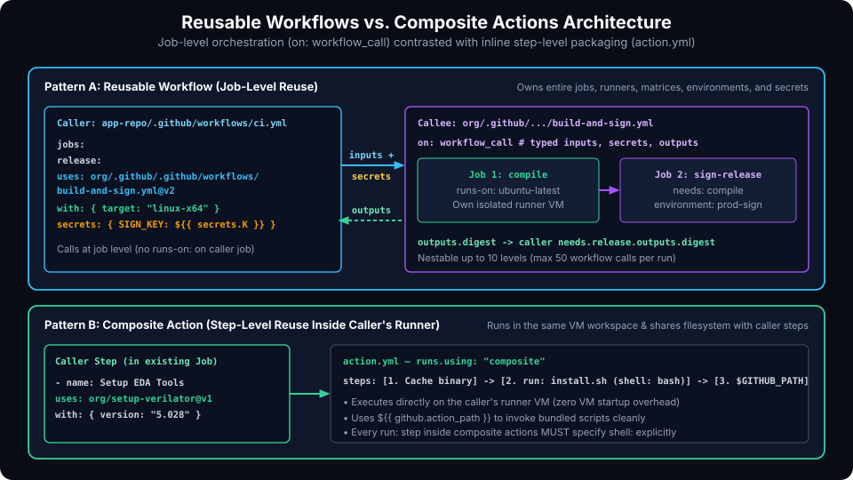
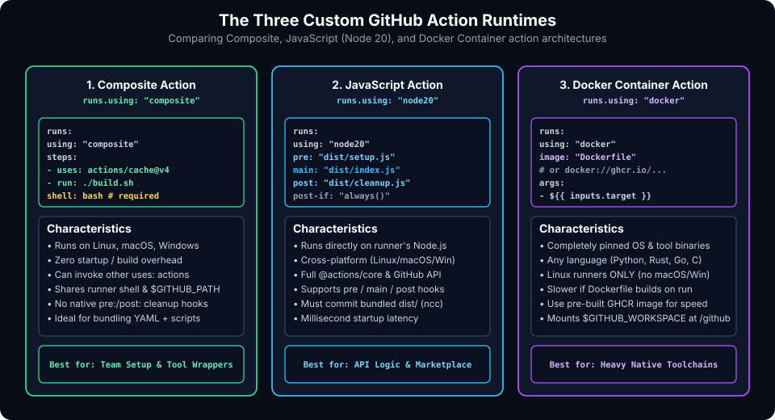

# Reusable Workflows, Composite Actions, and Custom Action Development

## Learning Goals

After completing this chapter, you should be able to:

- Select the right abstraction for scaling CI/CD across repositories: Reusable Workflows, Composite Actions, JavaScript (`node20`) Actions, or Docker Container Actions.
- Author and call parameterized Reusable Workflows (`on: workflow_call`) with typed `inputs`, explicit `secrets`, `outputs`, and `strategy.matrix`.
- Build self-contained Composite Actions (`runs.using: "composite"`) with bundled scripts via `${{ github.action_path }}` and explicit `shell:` declarations.
- Understand JavaScript/TypeScript action lifecycles (`pre`/`main`/`post` + `@actions/core`) and Docker container actions (`Dockerfile`).
- Version, tag (`v1.2.3` + floating `v1`), and locally test custom actions cleanly before publishing.

---

## Scaling Automation Across Repositories

Copying and pasting a 150-line `.github/workflows/ci.yml` across 20 repositories creates an unmaintainable maintenance burden: every linter upgrade, runner bump, or security fix requires 20 separate Pull Requests. GitHub provides two complementary mechanisms to keep CI/CD **DRY (Don't Repeat Yourself)**:

- **Reusable Workflows**: Call an entire multi-job pipeline from another workflow at the **job level** (`uses:` on a job).
- **Custom Actions**: Package reusable build, setup, or API steps into a single **step-level** module (`uses:` inside `steps:`), implemented as a Composite, JavaScript, or Docker action.



### Choosing the Right Reuse Mechanism

| Abstraction Level | Invoked Inside | Can Define Multiple Jobs / Runners? | Cross-Platform? | Best For |
| :--- | :--- | :---: | :---: | :--- |
| **Reusable Workflow** (`workflow_call`) | `jobs.<id>.uses` | **Yes** (full DAG & environments) | **Yes** | Standardizing entire CI/CD pipelines across org repos |
| **Composite Action** (`composite`) | `steps[].uses` | No (runs in caller's step) | **Yes** (per step `shell:`) | Bundling setup steps, caching, and shell scripts |
| **JavaScript Action** (`node20`) | `steps[].uses` | No (fast Node runtime) | **Yes** (Linux/macOS/Win) | Complex API integrations, JSON parsing, `pre`/`post` cleanup |
| **Docker Action** (`docker`) | `steps[].uses` | No (isolated container) | **Linux only** | Pinning heavy native binaries (Python/Rust/EDA tools) |

> [!TIP]
> **Organization-Wide `.github` Hub:** Many organizations store shared reusable workflows inside a dedicated `.github` repository (e.g., `org/.github/.github/workflows/ci-rtl.yml@v1`) so every team repository can consume vetted, centrally maintained pipelines in five lines of YAML.

---

## Reusable Workflows

A **reusable workflow** is a regular workflow file that includes `on: workflow_call`. It can declare strictly typed `inputs`, require named `secrets`, export job `outputs`, attach to deployment `environment:` protections, and even run on its own `strategy.matrix`.

### Defining a Reusable Workflow (`org/.github/.github/workflows/build-test.yml`)

```yaml
name: Reusable Build & Test

on:
  workflow_call:
    inputs:
      python-version:
        description: "Python runtime version"
        required: false
        type: string
        default: "3.12"
      run-coverage:
        description: "Enable coverage upload"
        required: false
        type: boolean
        default: false
    secrets:
      CODECOV_TOKEN:
        required: false
    outputs:
      artifact-name:
        description: "Name of uploaded build artifact"
        value: ${{ jobs.test.outputs.artifact }}

jobs:
  test:
    runs-on: ubuntu-latest
    timeout-minutes: 20
    outputs:
      artifact: ${{ steps.pkg.outputs.name }}
    steps:
      - uses: actions/checkout@v4

      - uses: actions/setup-python@v5
        with:
          python-version: ${{ inputs.python-version }}
          cache: "pip"

      - name: Install and run tests
        run: |
          pip install -r requirements.txt
          pytest

      - name: Package build output
        id: pkg
        run: |
          NAME="dist-${GITHUB_SHA::7}"
          echo "name=$NAME" >> "$GITHUB_OUTPUT"

      - uses: actions/upload-artifact@v4
        with:
          name: ${{ steps.pkg.outputs.name }}
          path: dist/

      - name: Upload coverage
        if: ${{ inputs.run-coverage && secrets.CODECOV_TOKEN != '' }}
        env:
          CODECOV_TOKEN: ${{ secrets.CODECOV_TOKEN }}
        run: ./scripts/upload_cov.sh
```

### Calling the Reusable Workflow from an Application Repository

```yaml
name: App CI
on: [pull_request]

permissions:
  contents: read

jobs:
  verify:
    strategy:
      matrix:
        py: ["3.11", "3.12"]
    uses: squared-studio/.github/.github/workflows/build-test.yml@v1
    with:
      python-version: ${{ matrix.py }}
      run-coverage: ${{ matrix.py == '3.12' }}
    secrets:
      CODECOV_TOKEN: ${{ secrets.CODECOV_TOKEN }}

  summary:
    needs: verify
    runs-on: ubuntu-latest
    steps:
      - run: echo "Artifact produced -> ${{ needs.verify.outputs.artifact-name }}"
```

### Key Constraints of Reusable Workflows
- **No `runs-on:` or `steps:` on the caller job**: A job that specifies `uses:` delegates runner assignment entirely to the called workflow.
- **Explicit Secrets vs. `secrets: inherit`**: Prefer passing secrets explicitly (`secrets: { TOKEN: ... }`). Use `secrets: inherit` **only** when calling trusted workflows within the same organization—never across external third-party workflows.
- **Nesting Limits**: Reusable workflows can call other reusable workflows up to **10 levels deep**, with a maximum of **50 workflow calls** per single workflow run.

---

## Building Composite Actions

A **Composite Action** combines multiple workflow steps—both `run:` shell commands and `uses:` calls to existing actions—into a reusable step packaged via `action.yml`.

### Directory Layout (Local or Dedicated Action Repo)

```text
.github/actions/setup-verilator/
├── action.yml
└── install_verilator.sh
```

### Implementing `action.yml`

```yaml
name: "Setup Verilator Toolchain"
description: "Installs and caches a pinned Verilator release and adds it to PATH"

inputs:
  version:
    description: "Verilator version tag"
    required: true
    default: "5.028"

outputs:
  bin-path:
    description: "Path to installed verilator executable"
    value: ${{ steps.install.outputs.bin_path }}

runs:
  using: "composite"
  steps:
    - name: Restore Verilator cache
      id: cache-verilator
      uses: actions/cache@v4
      with:
        path: ${{ runner.tool_cache }}/verilator-${{ inputs.version }}
        key: verilator-${{ runner.os }}-${{ runner.arch }}-${{ inputs.version }}

    - name: Install Verilator if cache missed
      id: install
      shell: bash   # REQUIRED on every run step inside composite actions!
      env:
        VERILATOR_VER: ${{ inputs.version }}
        CACHE_HIT: ${{ steps.cache-verilator.outputs.cache-hit }}
      run: |
        set -euo pipefail
        INSTALL_DIR="${RUNNER_TOOL_CACHE}/verilator-${VERILATOR_VER}"
        if [[ "$CACHE_HIT" != "true" ]]; then
          bash "${GITHUB_ACTION_PATH}/install_verilator.sh" "$VERILATOR_VER" "$INSTALL_DIR"
        fi
        echo "${INSTALL_DIR}/bin" >> "$GITHUB_PATH"
        echo "bin_path=${INSTALL_DIR}/bin/verilator" >> "$GITHUB_OUTPUT"
```

### Calling a Local Composite Action

```yaml
steps:
  - uses: actions/checkout@v4   # Required BEFORE calling a local ./.github/actions/* action!
  - id: eda
    uses: ./.github/actions/setup-verilator
    with:
      version: "5.028"
  - run: verilator --version
```

> [!WARNING]
> **Two Classic Composite Action Gotchas:**
> 1. **Missing `shell:`**: Unlike regular workflows, composite actions **fail validation** if any `run:` step omits `shell: bash` (or `pwsh`).
> 2. **Using `${{ github.action_path }}` vs `./`**: Always reference bundled helper scripts using `"${GITHUB_ACTION_PATH}/script.sh"` so the action locates its own files even when invoked remotely from another repository.

---

## Authoring JavaScript and Docker Container Actions

When step automation requires complex HTTP API requests, structured JSON processing, cross-platform filesystem logic without shell quirks, or automatic post-job cleanup, build a **JavaScript Action** (`node20`) or **Docker Action** (`docker`).



### JavaScript / TypeScript Action (`runs.using: "node20"`)

JavaScript actions run directly inside the runner's Node.js 20 binary with millisecond startup and full access to the official `@actions/core` and `@actions/github` toolkit:

```yaml
# action.yml
name: "Check PR Label Policy"
description: "Validates PR labels and cleans up temporary annotations"
inputs:
  required-prefix:
    description: "Required label prefix"
    required: true
outputs:
  matched-label:
    description: "Matched label name"
runs:
  using: "node20"
  pre: "dist/pre.js"       # Runs at start of job (before main steps)
  main: "dist/index.js"    # Runs when this step executes
  post: "dist/cleanup.js"  # Automatically runs at end of job (even on failure!)
  post-if: "always()"
```

Minimal `src/index.js` using `@actions/core`:

```javascript
const core = require("@actions/core");
const github = require("@actions/github");

async function run() {
  try {
    const prefix = core.getInput("required-prefix", { required: true });
    const labels = github.context.payload.pull_request?.labels || [];
    const match = labels.find((l) => l.name.startsWith(prefix));

    if (!match) {
      core.setFailed(`Pull Request must include a label starting with "${prefix}".`);
      return;
    }
    core.setOutput("matched-label", match.name);
    core.info(`Verified label: ${match.name}`);
  } catch (error) {
    core.setFailed(error.message);
  }
}

run();
```

> [!IMPORTANT]
> GitHub runners do **not** run `npm install` when executing a JavaScript action. You must bundle all dependencies into a single standalone file (`dist/index.js`) using `@vercel/ncc` or `esbuild` and commit `dist/` to the repository.

### Docker Container Action (`runs.using: "docker"`)

A Docker action packages an exact OS, system libraries, and binaries (`Dockerfile` or pre-built `docker://ghcr.io/...`):

```yaml
# action.yml
name: "Yosys Synthesis Check"
description: "Runs Yosys synthesis inside a pinned container"
inputs:
  top-module:
    required: true
runs:
  using: "docker"
  image: "docker://ghcr.io/my-org/yosys-ci:0.44"
  args:
    - ${{ inputs.top-module }}
```

- **Pre-build your image**: Building from a local `image: "Dockerfile"` rebuilds the image on **every single CI run** (slowing jobs by minutes). Publish the image to `ghcr.io` and reference `docker://ghcr.io/...` instead.
- **Linux Runners Only**: Docker actions cannot run on `macos-latest` or `windows-latest`.

---

## Versioning, Testing, and Publishing Actions

Follow the GitHub Marketplace Semantic Versioning convention when distributing internal or public actions:

1. **Tag Releases with Exact SemVer**: Create immutable release tags like `v1.2.0` and `v1.2.1` (and signed commit SHAs for security-critical callers).
2. **Maintain a Floating Major Tag (`v1`)**: When releasing `v1.2.1`, move the `v1` pointer forward so consumers opting into `@v1` automatically receive backward-compatible fixes:
   ```bash
   git tag -a v1.2.1 -m "Release v1.2.1: fix cache key handling"
   git tag -fa v1 -m "Update v1 major tag to v1.2.1"
   git push origin v1.2.1
   git push -f origin v1
   ```
3. **Self-Test in CI Before Tagging**: Always run an integration workflow inside the action repository itself using `uses: ./` against real test inputs before pushing release tags.

---

## Best Practices and Common Pitfalls

- **Always Specify `shell: bash` Inside Composite Steps**: Prevents YAML parsing errors on registration.
- **Avoid `secrets: inherit` Across Unvetted Repositories**: Pass only the specific secrets a callee workflow actually needs.
- **Remember to Bundle `dist/` for JS Actions**: Stale or missing `dist/index.js` files cause runtime `Cannot find module` failures even when source edits look right.
- **Check Out First for Local Actions (`uses: ./.github/...`)**: Local `./` actions fail unless `actions/checkout@v4` ran earlier in the same job (reusable workflows with `uses: ./.github/workflows/...` are resolved by GitHub directly and do *not* require checkout beforehand).
- **Avoid Circular Reusable Workflow Calls**: Workflow A calling B calling A is rejected at parse time.

---

## Practical Exercises

1. Refactor a repeated setup sequence (checkout, tool install, caching) in your repository into a local Composite Action under `.github/actions/setup-env/action.yml`, complete with typed `inputs:` and an output written to `$GITHUB_OUTPUT`.
2. Create a Reusable Workflow (`.github/workflows/reusable-lint.yml`) triggered by `on: workflow_call` accepting a `working-directory` string input, and invoke it from a caller workflow across two different subdirectories using `strategy.matrix`.
3. Scaffold a small Node.js 20 action using `@actions/core`, bundle it into `dist/index.js` with `esbuild` or `@vercel/ncc`, and test it in a workflow via `uses: ./`.
4. Practice publishing an action version tag (`v1.0.0`) alongside a floating major tag (`v1`), verifying both tags resolve properly in GitHub.

##### Copyright (c) 2026 squared-studio
