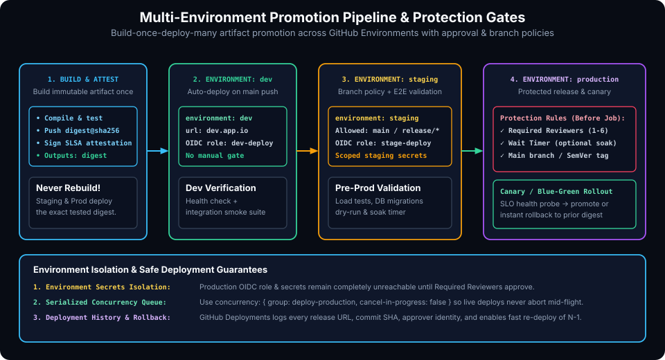
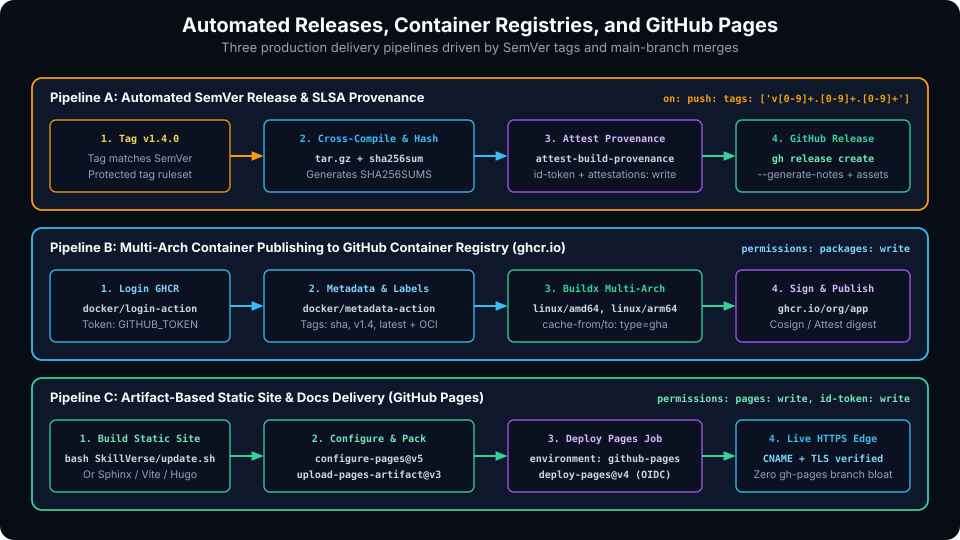

# Production Continuous Deployment, Releases, Governance, and Observability

## Learning Goals

After completing this chapter, you should be able to:

- Architect a build-once-deploy-many promotion pipeline across GitHub Environments (`dev` → `staging` → `production`) enforced by Required Reviewers, Wait Timers, and Branch Policies.
- Automate Semantic Versioning releases (`gh release create`), SHA-256 checksums, SLSA attestations, and multi-architecture container publishing to GitHub Container Registry (`ghcr.io`).
- Deploy modern static websites and documentation directly to GitHub Pages using artifact-based OIDC workflows (`configure-pages`, `upload-pages-artifact`, `deploy-pages`).
- Enforce mainline reliability using Repository Rulesets, Merge Queues (`merge_group`), and the aggregator gatekeeper job pattern for matrix/path-filtered checks.
- Design actionable CI/CD observability dashboards via `$GITHUB_STEP_SUMMARY`, JUnit test reporting, and fast immutable rollback runbooks.

---

## Deployment Environments, Protection Rules, and Promotion Gates

Continuous Delivery requires promoting the **exact same compiled, tested, and signed artifact** from development to staging and finally to production—never recompiling from source mid-pipeline, which risks introducing subtle dependency drift between environments.



### Configuring Protected GitHub Environments

In **Repository Settings → Environments**, create `dev`, `staging`, and `production`, attaching environment-specific secrets (`vars.*`, `secrets.*`, and OIDC role ARNs) plus protection rules:

- **Required Reviewers**: Pauses the workflow immediately before the `production` job starts until 1–6 designated maintainers approve it in the GitHub UI (preventing self-approval when configured).
- **Wait Timer**: Delays deployment execution by 1–43,200 minutes (e.g., a 15-minute bake window after staging before production starts).
- **Deployment Branches & Tags**: Restricts which Git refs can deploy to an environment (for example, `production` accepts **only** `main` or `v*.*.*` SemVer tags).

### Build-Once, Deploy-Many Promotion Workflow

```yaml
name: Build & Progressive Deploy

on:
  push:
    branches: [main]

permissions: {}

concurrency:
  # Never abort an active production deployment mid-flight!
  group: deploy-pipeline-${{ github.ref }}
  cancel-in-progress: false

jobs:
  build-artifact:
    runs-on: ubuntu-latest
    timeout-minutes: 15
    permissions:
      contents: read
      packages: write
      id-token: write
      attestations: write
    outputs:
      image_digest: ${{ steps.meta.outputs.digest }}
    steps:
      - uses: actions/checkout@v4
      - name: Build, test, and push immutable container digest
        id: meta
        run: |
          # Suppose buildx outputs the immutable sha256 digest:
          echo "digest=ghcr.io/${GITHUB_REPOSITORY}@sha256:e3b0c44298fc..." >> "$GITHUB_OUTPUT"

  deploy-dev:
    needs: build-artifact
    environment:
      name: dev
      url: https://dev.example.org
    runs-on: ubuntu-latest
    permissions:
      id-token: write
      contents: read
    steps:
      - name: Deploy exact digest to dev
        env:
          IMAGE: ${{ needs.build-artifact.outputs.image_digest }}
        run: ./scripts/deploy.sh --env dev --image "$IMAGE"

  deploy-staging:
    needs: deploy-dev
    environment:
      name: staging
      url: https://staging.example.org
    runs-on: ubuntu-latest
    permissions:
      id-token: write
      contents: read
    steps:
      - name: Deploy to staging & run smoke tests
        env:
          IMAGE: ${{ needs.build-artifact.outputs.image_digest }}
        run: |
          ./scripts/deploy.sh --env staging --image "$IMAGE"
          ./scripts/smoke_test.sh https://staging.example.org

  deploy-production:
    needs: deploy-staging
    environment:
      name: production   # Configured in GitHub Settings with Required Reviewers
      url: https://example.org
    runs-on: ubuntu-latest
    permissions:
      id-token: write
      contents: read
    steps:
      - name: Deploy verified digest to production
        env:
          IMAGE: ${{ needs.build-artifact.outputs.image_digest }}
        run: ./scripts/deploy.sh --env production --image "$IMAGE"
```

---

## Automated Releases, Versioning, and Package Publishing

Manual release cutting—compiling binaries locally, computing checksums by hand, and uploading ZIPs in a browser—is error-prone and unverifiable. Tagging a Semantic Version (`git tag -a v1.4.0 -m "Release v1.4.0" && git push origin v1.4.0`) should trigger a completely deterministic release pipeline.



### Automated GitHub Release + SHA-256 + Provenance

```yaml
name: Release

on:
  push:
    tags:
      - "v[0-9]+.[0-9]+.[0-9]+"

permissions: {}

jobs:
  release:
    runs-on: ubuntu-latest
    timeout-minutes: 20
    permissions:
      contents: write      # Create GitHub Release & upload release assets
      id-token: write      # Required for OIDC provenance attestation
      attestations: write  # Publish SLSA provenance attestation
    steps:
      - uses: actions/checkout@v4

      - name: Build release binaries & generate checksums
        run: |
          set -euo pipefail
          mkdir -p dist
          make release
          cd dist
          sha256sum *.tar.gz > SHA256SUMS.txt

      - name: Attest build provenance (SLSA)
        uses: actions/attest-build-provenance@v2
        with:
          subject-path: "dist/*.tar.gz"

      - name: Publish GitHub Release with auto-generated notes
        env:
          GH_TOKEN: ${{ secrets.GITHUB_TOKEN }}
          TAG: ${{ github.ref_name }}
        run: |
          gh release create "$TAG" dist/*.tar.gz dist/SHA256SUMS.txt \
            --title "$TAG" \
            --generate-notes \
            --verify-tag
```

### Multi-Architecture Container Publishing to GHCR (`ghcr.io`)

```yaml
  docker-release:
    runs-on: ubuntu-latest
    timeout-minutes: 25
    permissions:
      contents: read
      packages: write
    steps:
      - uses: actions/checkout@v4

      - uses: docker/setup-qemu-action@v3
      - uses: docker/setup-buildx-action@v3

      - uses: docker/login-action@v3
        with:
          registry: ghcr.io
          username: ${{ github.actor }}
          password: ${{ secrets.GITHUB_TOKEN }}

      - id: meta
        uses: docker/metadata-action@v5
        with:
          images: ghcr.io/${{ github.repository }}
          tags: |
            type=semver,pattern={{version}}
            type=semver,pattern={{major}}.{{minor}}
            type=sha

      - uses: docker/build-push-action@v6
        with:
          context: .
          platforms: linux/amd64,linux/arm64
          push: true
          tags: ${{ steps.meta.outputs.tags }}
          labels: ${{ steps.meta.outputs.labels }}
          cache-from: type=gha
          cache-to: type=gha,mode=max
```

---

## Deploying Static Sites and Documentation with GitHub Pages

Legacy GitHub Pages deployments pushed built HTML into an orphan `gh-pages` branch, bloating Git history with thousands of generated files. Today, **artifact-based GitHub Pages deployment** builds in CI and publishes via OIDC without ever touching a Git branch.

```yaml
name: Deploy GitHub Pages

on:
  push:
    branches: [main]
  workflow_dispatch:

permissions:
  contents: read
  pages: write
  id-token: write

concurrency:
  group: pages
  cancel-in-progress: false  # Never cancel an active Pages deployment

jobs:
  build:
    runs-on: ubuntu-latest
    timeout-minutes: 10
    steps:
      - uses: actions/checkout@v4
      - name: Build static site
        run: make docs   # Or bash SkillVerse/update.sh / vite build

      - name: Configure Pages
        uses: actions/configure-pages@v5

      - name: Upload Pages artifact
        uses: actions/upload-pages-artifact@v3
        with:
          path: "_site"  # Or "." for pure static root repositories

  deploy:
    needs: build
    runs-on: ubuntu-latest
    timeout-minutes: 10
    environment:
      name: github-pages
      url: ${{ steps.deployment.outputs.page_url }}
    steps:
      - name: Deploy to GitHub Pages
        id: deployment
        uses: actions/deploy-pages@v4
```

> [!NOTE]
> **Custom Domains (`CNAME`):** If your repository uses a custom domain via a root `CNAME` file, ensure the uploaded artifact directory contains that `CNAME` file and verify DNS + HTTPS enforcement in **Settings → Pages**.

---

## Branch Rulesets, Merge Queues, and Required Status Checks

### Repository Rulesets & The "Semantic Conflict" Problem
Even when two Pull Requests (`PR #10` and `PR #11`) individually pass CI against `main`, merging both sequentially can break `main` if `PR #10` renamed a function or RTL port that `PR #11` still calls.

GitHub **Merge Queues** solve this cleanly: when maintainers click **Merge when ready**, GitHub creates temporary merge-group branches testing `main + PR #10`, then `main + PR #10 + PR #11` together before fast-forwarding `main`. To participate, add `merge_group:` alongside `pull_request:`:

```yaml
on:
  pull_request:
    branches: [main]
  merge_group:
    branches: [main]
```

### The Aggregator "Gatekeeper" Job Pattern
GitHub Branch Protection / Rulesets require an exact check name to pass before allowing merge. If you mark individual matrix jobs (`test (ubuntu, verilator)`) or path-filtered jobs as required checks:
- Updating a Python version or adding a matrix cell forces you to manually reconfigure Repository Rulesets.
- Path-skipped jobs stay `Pending` forever and **block PRs touching only `README.md`**!

Solve both problems permanently by requiring **one single aggregator job** (`ci-gate`) that runs with `if: always()` (or `if: ${{ !cancelled() }}`):

```yaml
  ci-gate:
    name: CI Required Gate
    needs: [lint, test-matrix]
    if: ${{ !cancelled() }}
    runs-on: ubuntu-latest
    timeout-minutes: 5
    steps:
      - name: Verify all upstream checks succeeded or cleanly skipped
        run: |
          for res in "${{ needs.lint.result }}" "${{ needs.test-matrix.result }}"; do
            if [[ "$res" != "success" && "$res" != "skipped" ]]; then
              echo "Upstream job failed with status: $res"
              exit 1
            fi
          done
          echo "All required CI checks satisfied."
```

Configure Branch Rulesets to require **only** `CI Required Gate`!

---

## Pipeline Observability, Rollbacks, and Operational Readiness

### 1. Rich Dashboards via `$GITHUB_STEP_SUMMARY` & Annotations
Make failures diagnosable in 5 seconds without digging through 10,000 lines of raw logs:
- Emit Markdown tables summarizing unit test counts, synthesis area/LUT deltas, and deployment URLs to `$GITHUB_STEP_SUMMARY`.
- Publish JUnit XML test reports (`dorny/test-reporter` or `EnricoMi/publish-unit-test-result-action`) so failed assertions appear directly as inline PR annotations.

### 2. Progressive Rollouts & Fast Rollbacks
- **Blue/Green & Canary Rollouts**: Route 5%–10% of traffic (or run automated synthetic health probes against a standby "green" slot) before shifting 100% production traffic.
- **Immutable Rollbacks**: Because builds produce immutable versioned digests (`@sha256:...` or SemVer tags), rolling back a broken release is a 60-second `workflow_dispatch` job specifying `target_digest: <previous-known-good-digest>`—far faster and safer than trying to rush a forward fix or `git revert` through a full 20-minute build!

---

## Production CI/CD Readiness Checklist

| Category | Production Requirement | Verification |
| :--- | :--- | :--- |
| **Security** | `permissions: {}` root, SHA-pinned actions, OIDC | Zero static cloud secrets; Dependabot enabled |
| **Determinism** | Lockfiles committed; containers pinned by digest | Builds succeed identically on cold cache |
| **Protection** | Rulesets require `CI Required Gate` + PR review | Direct force-pushes to `main` blocked |
| **Environments** | `staging` → `production` with Required Reviewers | Prod secrets isolated from non-main runs |
| **Concurrency** | `cancel-in-progress: true` on PRs; `false` on deploy | Zero overlapping production deployments |
| **Observability** | `timeout-minutes`, `$GITHUB_STEP_SUMMARY`, failure artifacts | Failed logs/waveforms retained 14 days |
| **Rollback** | `workflow_dispatch` deploy accepts prior release tag/digest | Tested rollback path under 2 minutes |

---

## Practical Exercises

1. Configure a `ci-gate` aggregator job (`needs: [lint, sim-matrix]`, `if: ${{ !cancelled() }}`) that passes when dependencies are `success` or `skipped` and fails if any dependency is `failure`, then set it as the sole required status check in a repository Ruleset.
2. Add `merge_group:` alongside `pull_request:` to a CI workflow and verify how GitHub Merge Queue validates stacked PRs before advancing `main`.
3. Create a tag-triggered `.github/workflows/release.yml` workflow (`v*.*.*`) that builds an archive, generates `SHA256SUMS.txt`, attaches SLSA provenance via `actions/attest-build-provenance`, and publishes a GitHub Release with `gh release create`.
4. Author a manual rollback workflow (`workflow_dispatch` taking a `release_tag` input and targeting `environment: production`) so operators can re-deploy any prior tested artifact without rebuilding from source.

##### Copyright (c) 2026 squared-studio
